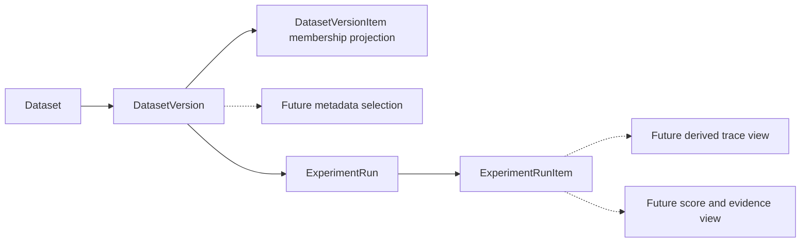
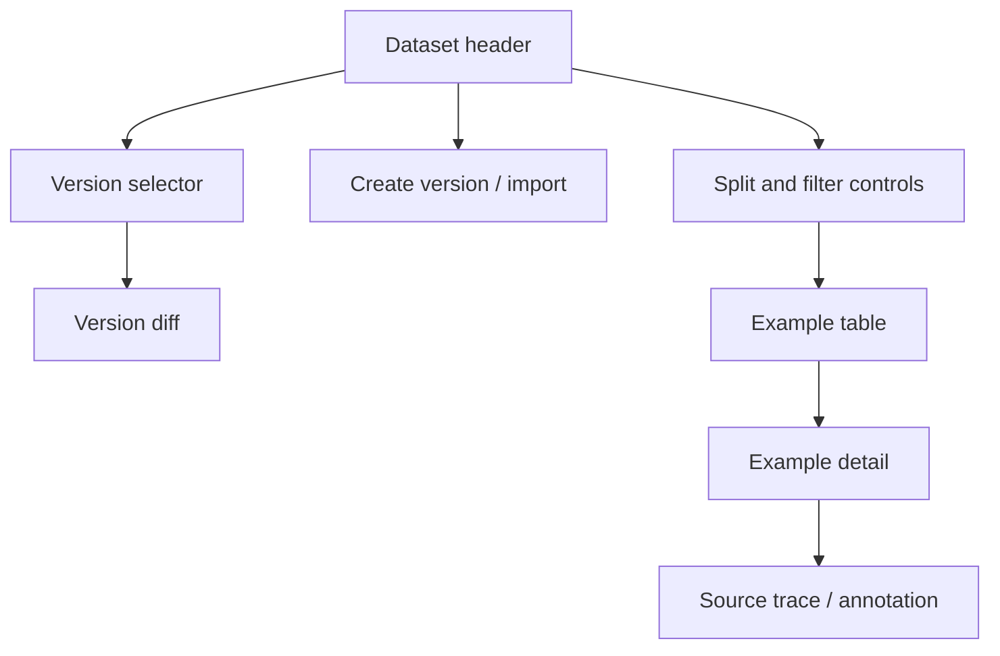
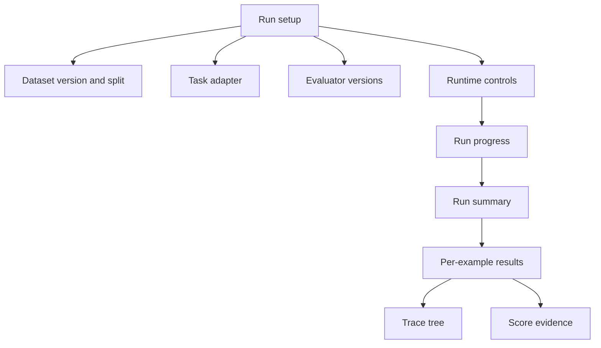
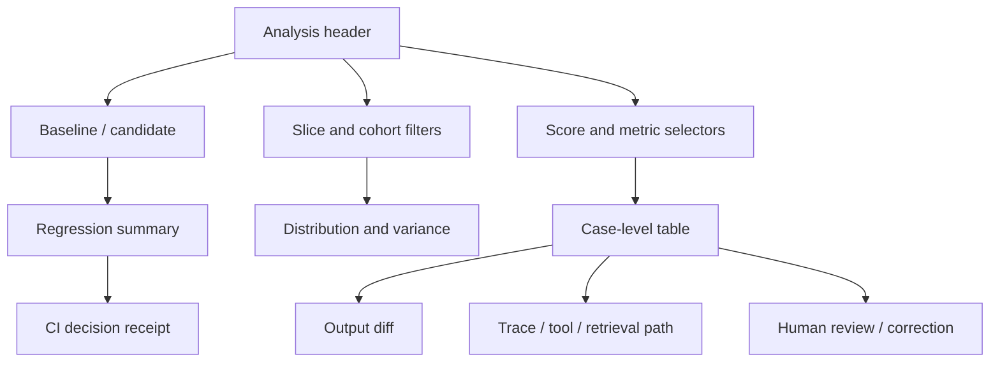

# Dataset and experiment platform design contract

This is the target UI handoff for the M0 Figma work, not an implemented screen
or an approved Figma artifact. The core has three domain primitives:
`DatasetVersion`, `ExperimentRun`, and `ExperimentRunItem`. Version membership
uses the persisted `DatasetVersionItem` projection. Selection, trace analysis,
and evidence below are future derived views, not additional durable primitives.
Attach actual Figma designs to the Linear issues before UI implementation;
backend review drafts can proceed while designs are prepared.

## Primary objects

## Dataset screen

Required states:

- Empty dataset
- Importing
- Import partially succeeded
- Schema validation errors
- Version has no changes
- Version is read-only
- Example has no expected output
- Example has a source trace
- Example has attachments
- Access denied

## Experiment screen

Task adapters are presented uniformly even when execution differs:

- Prompt/model
- Future AGI GraphVersion
- External task endpoint
- Uploaded result file

Required states:

- Draft setup
- Invalid mapping
- Queued
- Running with progress
- Partially complete
- Cancelled
- Failed with retry action
- Complete
- Incomplete evaluator results
- No comparable baseline

## Analysis screen

Required analysis outcomes:

- Improvement
- Regression
- Tradeoff
- Tie
- Missing case
- Duplicate case
- Invalid score
- Not assessed
- Unknown

## Figma handoff checklist

The Figma file must contain:

1. Dataset version timeline and example detail.
2. Run setup and task-adapter selection.
3. Complex-agent trace tree with tool/retrieval spans.
4. Case-level baseline/candidate diff.
5. Trial variance and distribution view.
6. Human review and correction state.
7. CI receipt and incomplete-run failure state.
8. Loading, empty, partial, error, permission, and accessibility annotations.
