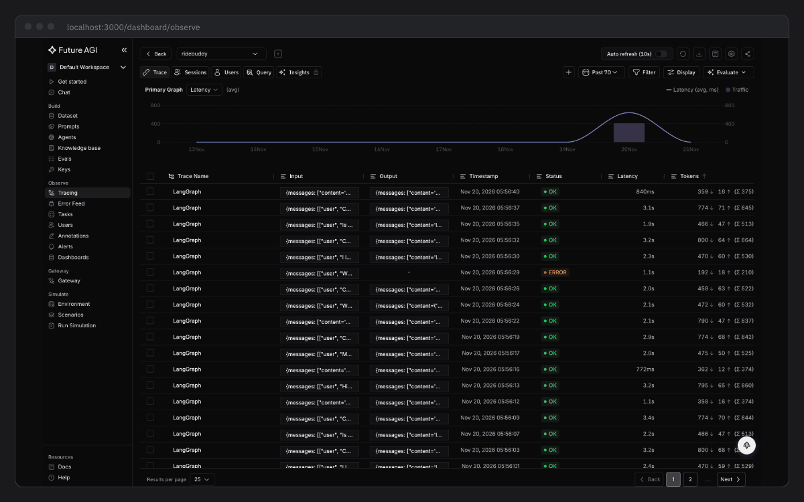

<div align="center">

<a href="https://futureagi.com?utm_source=github&utm_medium=readme&utm_campaign=oss_repo&utm_content=logo">
  <picture>
    <source media="(prefers-color-scheme: dark)" srcset="../../.github/assets/logo-dark.svg">
    
  </picture>
</a>

# La infraestructura para agentes de IA que mejoran por sí mismos

Future AGI convierte las trazas, evaluaciones y simulaciones de un agente en mejoras para ese mismo agente. Es de código abierto y puedes alojarlo en tu propia infraestructura.

<p>
  <a href="../../LICENSE"></a>
  <a href="https://github.com/future-agi/future-agi/releases/latest"></a>
  <a href="https://hub.docker.com/r/futureagi/standalone"></a>
  <a href="https://pypi.org/project/fi-instrumentation-otel/"></a>
  <a href="https://www.npmjs.com/package/@traceai/fi-core"></a>
  <br>
  <a href="https://discord.com/invite/cBnWkd7T9v"></a>
  <a href="https://x.com/FutureAGI_"></a>
  <a href="https://www.linkedin.com/company/futureagi/"></a>
  <a href="https://github.com/future-agi/future-agi/pulse"></a>
  <a href="https://github.com/future-agi/future-agi/issues?q=is%3Aissue+is%3Aclosed"></a>
</p>

<p>
  <a href="https://app.futureagi.com/auth/jwt/register?utm_source=github&utm_medium=readme&utm_campaign=oss_repo&utm_content=header_cta_cloud"><b>Empieza en Cloud (gratis)</b></a> ·
  <a href="#-quickstart"><b>Instálalo en tu infraestructura</b></a> ·
  <a href="https://docs.futureagi.com?utm_source=github&utm_medium=readme&utm_campaign=oss_repo&utm_content=header_docs"><b>Documentación</b></a> ·
  <a href="https://discord.com/invite/cBnWkd7T9v"><b>Discord</b></a>
</p>

<p>
  <b>SDK:</b>
  <a href="https://github.com/future-agi/traceAI#python">Python</a> ·
  <a href="https://github.com/future-agi/traceAI#typescript--javascript">TypeScript</a> ·
  <a href="https://github.com/future-agi/traceAI#java">Java</a> ·
  <a href="https://github.com/future-agi/traceAI#go">Go</a> ·
  <a href="https://github.com/future-agi/traceAI#c">C#</a> ·
  <a href="https://github.com/future-agi/futureagi-sdk">Platform SDK</a> ·
  <a href="https://github.com/future-agi/agent-command-center-sdk">Gateway SDK</a>
</p>

<p>
  <sub>
    <a href="../../README.md">English</a> ·
    <a href="README.zh-CN.md">简体中文</a> ·
    <a href="README.ja.md">日本語</a> ·
    <a href="README.ko.md">한국어</a> ·
    <b>Español</b> ·
    <a href="README.pt-BR.md">Português</a> ·
    <a href="README.fr.md">Français</a> ·
    <a href="README.de.md">Deutsch</a>
  </sub>
</p>

<a href="https://www.youtube.com/watch?v=6keOTAOUUWI"></a>

</div>

## Cómo funciona

Un modelo mejor ayuda a todos los agentes. Pero el modelo por sí solo no sabe qué respuestas de la semana pasada fueron incorrectas, no puede probar una corrección antes de que llegue a tus usuarios ni detectar si esa corrección hizo que otra cosa dejara de funcionar. Future AGI se encarga de hacerlo en un ciclo que se repite con tu agente.

<picture>
  <source media="(prefers-color-scheme: dark)" srcset="../../.github/assets/readme/system-dark.png">
  
</picture>

1. **[Traza](#trace-and-monitor)** cada ejecución de tu agente, paso a paso.<br><sub>Trazas · Sesiones y usuarios · Evaluaciones en producción · Instant eval · Paneles · Alertas · Registro de errores · Informes</sub>
2. **[Evalúa](#evaluate-and-label)** cada ejecución y comprueba por qué pasó o falló.<br><sub>Evaluaciones con agentes, LLM y código · Jev · Evaluaciones compuestas · Conjuntos de datos · Experimentos · Anotaciones · Evaluaciones en CI</sub>
3. **[Simula](#simulate-and-test)** usuarios realistas que interactúan con tu agente en un entorno de pruebas creado para él.<br><sub>Entornos · Escenarios y perfiles · Texto y voz · Escenarios a partir del tráfico real · Depuración de fallos</sub>
4. **[Mejora](#improve)** el agente: encuentra un cambio que corrija los fallos y comprueba que funciona antes de desplegarlo.<br><sub>Epoch · Optimización de prompts</sub>
5. **[Protege](#gateway-and-guardrails)** el tráfico de producción con una pasarela y controles de seguridad. Se registran las trazas de las nuevas ejecuciones y el ciclo vuelve a empezar.<br><sub>Una API para todos los modelos · Enrutamiento y alternativas en caso de fallo · Controles de seguridad · Caché · Claves y presupuestos · Registros y análisis · Experimentos en paralelo con tráfico real · MCP y A2A</sub>

Como complemento al ciclo, la sección **[Desarrollo](#build)** incluye prompts, Agent Playground, bases de conocimiento, Falcon AI, un servidor MCP y espacios de trabajo para equipos. Empieza por el componente que necesites. Todos usan las mismas trazas, conjuntos de datos y evaluaciones, así que puedes añadir otro cuando lo necesites.

<a id="-quickstart"></a>
<a id="-quickstart-60-seconds"></a>

<a id="get-started"></a>

## Primeros pasos

**1. Obtén tus claves.** [Crea una cuenta gratuita en Cloud](https://app.futureagi.com/auth/jwt/register?utm_source=github&utm_medium=readme&utm_campaign=oss_repo&utm_content=quickstart_cloud) o ejecuta Future AGI en tu equipo con Docker (Compose v2.24 o posterior, 2 vCPU y 4 GB para Docker):

```bash
git clone https://github.com/future-agi/future-agi.git
cd future-agi
./bin/install          # Windows (PowerShell): .\bin\install.ps1
```

El instalador guarda los secretos de esta instalación en `.env`, descarga las imágenes (unos 800 MB) y espera a que todos los servicios estén listos. El primer arranque tarda unos minutos. Después, abre <http://localhost:3000> y crea tu cuenta.

En ambos casos, abre **Keys** en la barra lateral, selecciona **Add API Key** y copia la clave de API y la clave secreta antes de cerrar el cuadro de diálogo.

**2. Instala el SDK y configura tus claves.**

```bash
pip install -U fi-instrumentation-otel traceai-openai openai
export FI_API_KEY="<your API key>" FI_SECRET_KEY="<your secret key>" FI_PROJECT_NAME="my-agent"
export OPENAI_API_KEY="<your OpenAI key>"
# Solo para instalaciones propias: envía las trazas al recolector de tu instalación
export FI_BASE_URL="http://localhost:4318"
```

**3. Ejecuta tu aplicación con trazado automático.** No necesitas importar módulos de trazado en tu código. Inicia la aplicación con `fi-instrument` y se registrarán las trazas de las bibliotecas que tengan instalado su paquete de traceAI:

```python
# app.py: código de OpenAI sin modificaciones
from openai import OpenAI

response = OpenAI().chat.completions.create(
    model="gpt-4o-mini",
    messages=[{"role": "user", "content": "Plan a three-step onboarding email."}],
)
print(response.choices[0].message.content)
```

```bash
fi-instrument python app.py      # también funciona con uvicorn, celery y otros comandos
```

Abre **Tracing** en la barra lateral y selecciona `my-agent` para ver la llamada, su entrada, su salida, los tokens y los tiempos. A continuación, puedes [puntuar la llamada con una evaluación](https://docs.futureagi.com/docs/evaluation?utm_source=github&utm_medium=readme&utm_campaign=oss_repo&utm_content=quickstart_next) o [crear un entorno de pruebas](https://docs.futureagi.com/docs/environments?utm_source=github&utm_medium=readme&utm_campaign=oss_repo&utm_content=quickstart_next) para tu agente.

<details>
<summary><b>¿Prefieres activarlo con una línea de código?</b></summary>

```python
import fi_instrumentation

fi_instrumentation.init(project_name="my-agent")
# ...código de tu aplicación; a partir de aquí se trazan las integraciones de traceAI instaladas
```

También puedes mantener tu comando de inicio sin cambios y definir `FI_AUTO_INSTRUMENT=true`. La mayoría de las integraciones se activan solas; algunas, como Strands y Temporal, requieren una llamada de configuración. Consulta la guía de [trazado sin modificar el código en Python](https://github.com/future-agi/traceAI/blob/main/docs/python/auto-instrumentation.md) para ver la lista completa, los ajustes de privacidad y el uso de `fi-instrument doctor`.

</details>

<details>
<summary><b>TypeScript</b></summary>

```bash
npm install "@traceai/fi-core@^1.4.0" @traceai/openai openai
```

Con Node.js 22.23.4 o posterior, guarda el siguiente código en `trace.mts` y ejecuta `node trace.mts`:

```typescript
import OpenAI from "openai";
import { register, ProjectType } from "@traceai/fi-core";
import { OpenAIInstrumentation } from "@traceai/openai";

const provider = register({ projectName: "my-agent", projectType: ProjectType.OBSERVE });
const instrumentation = new OpenAIInstrumentation();
instrumentation.setTracerProvider(provider);
instrumentation.manuallyInstrument(OpenAI);

const response = await new OpenAI().chat.completions.create({
  model: "gpt-4o-mini",
  messages: [{ role: "user", content: "Plan a three-step onboarding email." }],
});
console.log(response.choices[0].message.content);
await provider.shutdown(); // envía la traza antes de que termine el script
```

</details>

## Qué incluye

<a id="trace-and-monitor"></a>

### Trazado y monitorización

Comprueba qué hizo tu agente, cuánto costó y dónde falló.

- **[Tracing](https://docs.futureagi.com/docs/observe?utm_source=github&utm_medium=readme&utm_campaign=oss_repo&utm_content=module_tracing)**: consulta cada llamada al LLM, llamada a herramientas y paso del agente, con sus entradas, salidas, tokens, coste y latencia. Un grafo muestra el recorrido del agente. El trazado se basa en OpenTelemetry, incluye instrumentación lista para usar en más de 50 frameworks y admite llamadas de voz con sus grabaciones.
- **[Sesiones y usuarios](https://docs.futureagi.com/docs/observe/features/users?utm_source=github&utm_medium=readme&utm_campaign=oss_repo&utm_content=module_users)**: agrupa trazas por conversación y consulta todas las trazas y métricas de un usuario final.
- **[Evaluaciones del tráfico de producción](https://docs.futureagi.com/docs/observe/features/evals?utm_source=github&utm_medium=readme&utm_campaign=oss_repo&utm_content=module_live_evals)**: puntúa automáticamente las trazas de producción a medida que llegan, en cada span o en una muestra.
- **[Instant eval](https://docs.futureagi.com/docs/observe/features/instant-eval?utm_source=github&utm_medium=readme&utm_campaign=oss_repo&utm_content=module_instant_eval)**\*: en cualquier vista, hazle a Jev una pregunta de sí o no o pídele que asigne una categoría a las trazas, sesiones o usuarios. Por ejemplo: «¿Resolvió el asistente la solicitud?». No necesitas crear una evaluación.
- **[Dashboards](https://docs.futureagi.com/docs/observe/features/dashboard?utm_source=github&utm_medium=readme&utm_campaign=oss_repo&utm_content=module_dashboards)**: crea y comparte gráficos de tasa de errores, latencia, tokens, coste y puntuaciones de evaluación.
- **[Alerts](https://docs.futureagi.com/docs/observe/features/alerts?utm_source=github&utm_medium=readme&utm_campaign=oss_repo&utm_content=module_alerts)**: recibe un correo o un mensaje de Slack cuando una métrica o puntuación cruce un umbral.
- **[Error Feed](https://docs.futureagi.com/docs/error-feed?utm_source=github&utm_medium=readme&utm_campaign=oss_repo&utm_content=module_error_feed)**\*: agrupa las trazas con fallos por incidencia, explica la causa probable y sugiere una corrección.
- **[Insights](https://docs.futureagi.com/docs/observe/features/insights?utm_source=github&utm_medium=readme&utm_campaign=oss_repo&utm_content=module_insights)**\*: genera informes que clasifican trazas, sesiones o usuarios por categorías, miden la frecuencia de cada categoría y explican los resultados con enlaces a ejemplos.



<a id="evaluate-and-label"></a>

### Evaluación y etiquetado

Comprueba si cada respuesta fue correcta y por qué. Una evaluación puede ser tan económica como una expresión regular o tan exhaustiva como un agente que verifica cada afirmación.

| Tipo de evaluación | Cómo decide | Cuándo usarla |
|---|---|---|
| **Agente como juez** | Un agente evaluador revisa la ejecución en varios pasos, consulta fuentes y emite un veredicto razonado. | Cuando hace falta investigar: por ejemplo, si la ejecución es larga y tiene varios pasos o si hay que verificar afirmaciones con otras fuentes. |
| **LLM como juez** | Un modelo contrasta la salida con tus criterios en una sola pasada y devuelve un veredicto razonado. | Cuando puedes describir la calidad con palabras: fidelidad, tono, seguridad, cumplimiento de instrucciones o reglas propias. |
| **Código** | Tu código Python o JavaScript se ejecuta en un entorno aislado. Con la misma entrada obtienes el mismo resultado, sin llamar a un modelo. | Cuando la respuesta se puede calcular: validez del JSON, coincidencia con una expresión regular, BLEU o ROUGE, similitud o lógica de negocio. |

El **agente como juez** está diseñado para evaluar agentes y trabaja como lo haría un revisor meticuloso:

- **Sin asignar variables.** Redacta tu regla en lenguaje natural e incluye `{{trace}}`, `{{span}}`, `{{session}}`, `{{row}}` o `{{call}}`. El juez recibe el objeto completo. No tienes que vincular columnas.
- **Lee la ejecución completa.** En lugar de ver solo una entrada y una salida, el juez recorre el árbol de la traza span por span para encontrar el paso que falló.
- **Verifica los hechos durante la evaluación.** Activa [la búsqueda web, tus bases de conocimiento o tus propias herramientas mediante MCP](https://docs.futureagi.com/docs/evaluation/guides/advanced-usage?utm_source=github&utm_medium=readme&utm_campaign=oss_repo&utm_content=module_agent_tools) para contrastar las afirmaciones con tu documentación, tu base de datos o la web.
- **[Elige cuánto contexto recibe](https://docs.futureagi.com/docs/evaluation/guides/advanced-usage?utm_source=github&utm_medium=readme&utm_campaign=oss_repo&utm_content=module_data_injection)**: los campos asignados, la fila del conjunto de datos, el span, la traza completa, la sesión completa o la transcripción y la grabación de una llamada.
- **Admite ejecuciones largas.** Las trazas y conversaciones muy largas se compactan para que quepan en el contexto del juez. Las imágenes y el audio se conservan intactos.
- **Elige el nivel de detalle.** *Quick* responde en una pasada, *Agent* investiga en varios pasos y *Auto* busca un equilibrio entre ambos. Elige una explicación breve, extensa o personalizada.
- Funciona con tu clave de OpenAI, Anthropic, Bedrock o Vertex AI, o con los modelos gestionados de Future AGI.

- **[Más de 130 evaluaciones integradas](https://docs.futureagi.com/docs/evaluation/builtin?utm_source=github&utm_medium=readme&utm_campaign=oss_repo&utm_content=module_builtin_evals)** para detectar alucinaciones, comprobar si la respuesta se basa en las fuentes, evaluar el uso de herramientas y la finalización de tareas, detectar información personal (PII), medir la toxicidad, evaluar el tono y validar JSON, entre otras opciones. También puedes [escribir tus propias evaluaciones](https://docs.futureagi.com/docs/evaluation/guides/custom-evals?utm_source=github&utm_medium=readme&utm_campaign=oss_repo&utm_content=module_custom_evals) en lenguaje natural o en código.
- **[Elige el juez](https://docs.futureagi.com/docs/evaluation/concepts/evaluator-models?utm_source=github&utm_medium=readme&utm_campaign=oss_repo&utm_content=module_judges)**: usa Jev, el modelo de decisión de TypeSafe, con tu clave de TypeSafe u OpenRouter para obtener veredictos tipados con probabilidades (aprobado o fallido, una categoría o una puntuación según tu escala). También puedes usar Turing models\* de Future AGI para texto, imagen y audio, o tu propio modelo de OpenAI, Bedrock, Vertex AI, Azure o cualquier endpoint.
- **[Evaluaciones compuestas](https://docs.futureagi.com/docs/evaluation/concepts/composite-evals?utm_source=github&utm_medium=readme&utm_campaign=oss_repo&utm_content=module_composite)**: combina varias evaluaciones con distintos pesos para obtener una sola puntuación y un solo umbral. Por ejemplo: respuesta fiel a la fuente *y* con el tono adecuado *y* completa.
- **[Localización de errores](https://docs.futureagi.com/docs/evaluation/concepts/error-localization?utm_source=github&utm_medium=readme&utm_campaign=oss_repo&utm_content=module_error_localization)**: si falla una evaluación, te indica qué entrada provocó el fallo.
- **[Revisión de resultados](https://docs.futureagi.com/docs/evaluation/concepts/feedback?utm_source=github&utm_medium=readme&utm_campaign=oss_repo&utm_content=module_feedback)**: corrige un resultado y vuelve a puntuarlo para ajustar las evaluaciones a lo que tu equipo considera correcto.
- **Ejecútalas donde las necesites**: en conjuntos de datos, trazas de producción, cada llamada simulada, [CI con cada pull request](https://docs.futureagi.com/docs/evaluation/guides/cicd?utm_source=github&utm_medium=readme&utm_campaign=oss_repo&utm_content=module_cicd) o como controles de seguridad en la pasarela.
- **[Conjuntos de datos](https://docs.futureagi.com/docs/dataset?utm_source=github&utm_medium=readme&utm_campaign=oss_repo&utm_content=module_datasets)**: tablas de casos de prueba procedentes de archivos, trazas de producción, Hugging Face, el SDK o datos generados. Los prompts y las evaluaciones se ejecutan sobre las filas y guardan los resultados en columnas nuevas.
- **[Experimentos](https://docs.futureagi.com/docs/dataset/guides/run-an-experiment?utm_source=github&utm_medium=readme&utm_campaign=oss_repo&utm_content=module_experiments)**: ejecuta varias combinaciones de prompts, agentes y modelos sobre el mismo conjunto de datos, compara los resultados en paralelo y elige la mejor.
- **[Anotaciones](https://docs.futureagi.com/docs/annotations?utm_source=github&utm_medium=readme&utm_campaign=oss_repo&utm_content=module_annotations)**: colas de revisión manual de las salidas. Permiten asignar tareas, añadir etiquetas, medir el acuerdo entre revisores y exportar los resultados a un conjunto de datos.


<a id="simulate-and-test"></a>

### Simulación y pruebas

Prueba cada cambio con usuarios simulados realistas antes de que llegue a tus usuarios reales. Una transcripción puede dar la impresión de que la prueba pasó aunque el agente se haya equivocado. Por eso, cada llamada de prueba se contrasta con los cambios que realmente se produjeron.

1. **[Conecta tu agente](https://docs.futureagi.com/docs/environments/guides/build-an-environment?utm_source=github&utm_medium=readme&utm_campaign=oss_repo&utm_content=module_connect)**: proporciona un repositorio de código, sube un archivo o conecta un agente que funcione con Vapi, Retell AI, LiveKit o un número de teléfono.
2. **El sistema analiza tu agente** y documenta para qué sirve, a qué herramientas llama, qué reglas debe respetar y qué tareas realiza. Puedes hacerle preguntas o darle indicaciones en lenguaje natural.
3. **Crea un entorno de pruebas para tu agente**: genera una copia de los recursos con los que interactúan sus herramientas y la prepara con los registros que necesita cada escenario. Así, las llamadas a herramientas modifican el entorno de pruebas, nunca tus datos de producción.
4. **[Los usuarios simulados ejecutan los escenarios](https://docs.futureagi.com/docs/environments/concepts/scenarios-and-trials?utm_source=github&utm_medium=readme&utm_campaign=oss_repo&utm_content=module_scenarios)** por texto o voz. Cada uno tiene un perfil: nombre, edad, personalidad, idioma y acento. Repite cada escenario varias veces para detectar respuestas que solo fallan a veces.
5. **[Se evalúa cada llamada](https://docs.futureagi.com/docs/environments/guides/read-run-results?utm_source=github&utm_medium=readme&utm_campaign=oss_repo&utm_content=module_results)** objetivo por objetivo según el estado del entorno, además de las evaluaciones que añadas. Si el agente dice «tu reserva está cancelada» pero la reserva sigue activa, la prueba falla.
6. **[Debug failures](https://docs.futureagi.com/docs/environments/guides/debug-failures?utm_source=github&utm_medium=readme&utm_campaign=oss_repo&utm_content=module_debug)** analiza toda la ejecución y explica qué falló en cada objetivo. Desde ahí puedes iniciar [Epoch](#improve) con un clic.

Qué puede incluir el entorno de pruebas:

- **Todo tipo de herramientas.** Las funciones integradas, las API HTTP y los servidores MCP responden desde el entorno de pruebas, de modo que el agente se comporta igual que en producción.
- **Las aplicaciones que usa tu agente**, como un buzón de correo, un espacio de trabajo de Slack o un calendario, simuladas con contenido realista.
- **Las bases de datos que necesita.** Si el código de tu agente necesita Postgres, MySQL, ClickHouse, MongoDB, Redis, Qdrant, RabbitMQ, NATS o MinIO, el sistema lo incluye en el entorno.
- **Varios participantes.** Los escenarios con varios participantes reúnen a varias personas simuladas o agentes en una misma conversación.
- **Ejecuciones a escala.** Hasta 1000 escenarios por entorno creado, varios entornos en paralelo y hasta 20 repeticiones por escenario.

Convierte [sesiones de producción, llamadas, transcripciones o filas de conjuntos de datos](https://docs.futureagi.com/docs/environments/guides/import-evidence?utm_source=github&utm_medium=readme&utm_campaign=oss_repo&utm_content=module_import) en escenarios. Así, los casos que fallaron la semana pasada se convierten en pruebas que se ejecutan con cada cambio.


<a id="improve"></a>

### Mejora

Encuentra un cambio que corrija los fallos y comprueba que funciona antes de desplegarlo.

- **[Epoch](https://docs.futureagi.com/docs/environments/guides/run-epoch?utm_source=github&utm_medium=readme&utm_campaign=oss_repo&utm_content=module_epoch)**\*: parte de una ejecución fallida y busca una versión de tu agente que corrija los casos que fallan sin afectar a los que pasan. Tú decides qué puede cambiar (instrucciones, herramientas, configuración o código) y qué límites de coste y tiempo de respuesta debe respetar. Valida el resultado con casos que no usó durante la búsqueda. Tú revisas el diff y decides si despliegas el cambio.
- **[Optimización de prompts](https://docs.futureagi.com/docs/optimization?utm_source=github&utm_medium=readme&utm_campaign=oss_repo&utm_content=module_optimization)**: mejora un prompt sobre un conjunto de datos con GEPA, ProTeGi, PromptWizard, búsqueda bayesiana, metaprompts o búsqueda aleatoria, y compara cada ensayo mediante un diff.

<a id="gateway-and-guardrails"></a>

### Pasarela y controles de seguridad

Llama a cualquier modelo a través de un único endpoint y comprueba cada solicitud a su paso por la pasarela.

<picture>
  <source media="(prefers-color-scheme: dark)" srcset="../../.github/assets/readme/gateway-dark.png">
  
</picture>

- **[Una API para todos los modelos](https://docs.futureagi.com/docs/command-center?utm_source=github&utm_medium=readme&utm_campaign=oss_repo&utm_content=module_gateway)**: un endpoint compatible con OpenAI escrito en Go. Admite de forma nativa OpenAI, Anthropic, Gemini, Bedrock, Azure OpenAI y Cohere, además de cualquier proveedor compatible con OpenAI, incluidos los modelos que alojes en tu infraestructura.
- **[Enrutamiento y alternativas en caso de fallo](https://docs.futureagi.com/docs/command-center/features/routing?utm_source=github&utm_medium=readme&utm_campaign=oss_repo&utm_content=module_routing)**: enrutamiento por turnos, por pesos, por menor latencia, por menor coste, adaptativo o por respuesta más rápida, con reintentos, conmutación por error y disyuntores.
- **[Controles de seguridad](https://docs.futureagi.com/docs/command-center/features/guardrails?utm_source=github&utm_medium=readme&utm_campaign=oss_repo&utm_content=module_guardrails)**: los analizadores integrados revisan las solicitudes y respuestas para detectar información personal (PII), inyección de prompts, filtraciones de secretos, uso inseguro de herramientas y otros problemas. Añade Protect models\* de Future AGI o conecta controles de 15 proveedores, como Lakera, Presidio y Llama Guard. Prueba primero las reglas en un entorno de pruebas.
- **[Caché](https://docs.futureagi.com/docs/command-center/features/caching?utm_source=github&utm_medium=readme&utm_campaign=oss_repo&utm_content=module_caching)**: caché por coincidencia exacta o semántica, en memoria, Redis o almacenamiento de objetos.
- **[Claves, presupuestos y límites de frecuencia](https://docs.futureagi.com/docs/command-center/features/rate-limiting?utm_source=github&utm_medium=readme&utm_campaign=oss_repo&utm_content=module_limits)**: claves independientes para cada aplicación o equipo, con presupuestos de gasto y límites de frecuencia.
- **[Registros y análisis](https://docs.futureagi.com/docs/command-center/features/cost-tracking?utm_source=github&utm_medium=readme&utm_campaign=oss_repo&utm_content=module_cost)**: registra cada solicitud con su coste, tokens, latencia y propiedades personalizadas. Incluye análisis, monitorización, sesiones y webhooks.
- **[Experimentos en paralelo con tráfico real](https://docs.futureagi.com/docs/command-center/features/shadow-experiments?utm_source=github&utm_medium=readme&utm_campaign=oss_repo&utm_content=module_shadow)**: envía una copia de parte del tráfico de producción a otro modelo y compara el coste, la latencia y la calidad antes de cambiar de modelo.
- **[MCP y A2A](https://docs.futureagi.com/docs/command-center/features/mcp-a2a?utm_source=github&utm_medium=readme&utm_campaign=oss_repo&utm_content=module_mcp)**: dirige las llamadas de tus agentes a herramientas y el tráfico entre agentes a través de la misma pasarela.

<a id="build"></a>

### Desarrollo

- **[Prompts](https://docs.futureagi.com/docs/prompt?utm_source=github&utm_medium=readme&utm_campaign=oss_repo&utm_content=module_prompts)**: escribe plantillas de prompts, guarda sus versiones, ejecútalas con datos y modelos reales y supervisa su comportamiento en producción.
- **[Agent Playground](https://docs.futureagi.com/docs/agent-playground?utm_source=github&utm_medium=readme&utm_campaign=oss_repo&utm_content=module_agent_playground)**: crea un agente de varios pasos conectando nodos de prompts y agentes en un lienzo, ejecútalo y consulta la salida de cada paso.
- **[Bases de conocimiento](https://docs.futureagi.com/docs/knowledge-base?utm_source=github&utm_medium=readme&utm_campaign=oss_repo&utm_content=module_knowledge_base)**: sube tus documentos para que los prompts y las evaluaciones puedan consultarlos.
- **[Falcon AI](https://docs.futureagi.com/docs/falcon-ai?utm_source=github&utm_medium=readme&utm_campaign=oss_repo&utm_content=module_falcon)**\*: un agente integrado en el panel. Hazle preguntas o encárgale tareas en lenguaje natural, como «¿por qué falló esta traza?» o «crea un conjunto de datos a partir de estas trazas de producción».
- **[Servidor MCP](https://docs.futureagi.com/docs/falcon-ai/guides/use-the-mcp-server?utm_source=github&utm_medium=readme&utm_campaign=oss_repo&utm_content=module_mcp_server)**: usa Future AGI desde tu editor o agente de programación, por ejemplo para encontrar y corregir fallos en las trazas sin salir de tu entorno.
- **Espacios de trabajo y acceso**: cada equipo tiene su propio espacio de trabajo, miembros y roles. Para organizaciones más grandes, hay registros de auditoría y SCIM.

<sub>\* Requiere Future AGI Cloud o una clave de licencia Enterprise en una instalación propia. Consulta [Código abierto y tus datos](#open-source-and-your-data).</sub>

## Compatibilidad con tus herramientas

<picture>
  <source media="(prefers-color-scheme: dark)" srcset="../../.github/assets/readme/integrations-dark.png">
  
</picture>

Future AGI usa interfaces abiertas, así que puedes conservar el framework y los modelos que ya usas: OpenTelemetry para las trazas, una API compatible con OpenAI para la pasarela y SQL en Postgres y ClickHouse para el almacenamiento.

| Integración | Lenguajes | Cómo se conecta |
|---|---|---|
| [OpenTelemetry](https://docs.futureagi.com/docs/observe?utm_source=github&utm_medium=readme&utm_campaign=oss_repo&utm_content=int_otel) | Cualquiera | Envía trazas OTLP desde tu aplicación o recolector. |
| [Trazado automático](https://github.com/future-agi/traceAI/blob/main/docs/python/auto-instrumentation.md) | Python | Inicia tu aplicación con `fi-instrument`. La mayoría de las bibliotecas con un paquete de traceAI generan trazas sin modificar el código; algunas requieren una llamada de configuración. |
| [SDK de traceAI](https://github.com/future-agi/traceAI) | Python, TypeScript, Java, Go, C# | Instrumentación en Python y TypeScript, envoltorios de cliente en Java, middleware en Go y spans en C#. |
| LangChain y LangGraph | Python, TypeScript | `traceai-langchain` o `@traceai/langchain` |
| OpenAI y OpenAI Agents SDK | Python, TypeScript | `traceai-openai`, `traceai-openai-agents` |
| Anthropic y Claude Agent SDK | Python, TypeScript | `traceai-anthropic`, `traceai-claude-agent-sdk` |
| LlamaIndex | Python, TypeScript | `traceai-llamaindex` o `@traceai/llamaindex` |
| CrewAI, AutoGen, DSPy, PydanticAI, Google ADK | Python | Un paquete de traceAI por framework |
| Vercel AI SDK, Mastra | TypeScript | `@traceai/vercel`, `@traceai/mastra` |
| [Agent Command Center](https://docs.futureagi.com/docs/command-center?utm_source=github&utm_medium=readme&utm_campaign=oss_repo&utm_content=int_gateway) | Cualquier cliente compatible con OpenAI | Configura la URL de la pasarela como URL base de tu cliente. |
| [Servidor MCP](https://docs.futureagi.com/docs/falcon-ai/guides/use-the-mcp-server?utm_source=github&utm_medium=readme&utm_campaign=oss_repo&utm_content=int_mcp) | Cualquier cliente MCP | Usa Future AGI desde tu editor o agente de programación. |
| Vapi, Retell AI, LiveKit | Agentes de voz | Pruébalos con Simulate allí donde se ejecutan. |
| LiveKit, Pipecat | Python | Traza flujos de procesamiento de voz con `traceai-livekit` y `traceai-pipecat`. |

También se admiten Pinecone, Weaviate, Chroma, LanceDB, Agno, Strands, Semantic Kernel, BeeAI, Cerebras, Vertex AI, SageMaker y otras integraciones disponibles en [traceAI](https://github.com/future-agi/traceAI).

<details>
<summary><b>SDK</b></summary>

| Paquete | Instalación | Descripción |
|---|---|---|
| [traceAI](https://github.com/future-agi/traceAI) | `pip install fi-instrumentation-otel` · `npm i @traceai/fi-core` | Trazado con OpenTelemetry para frameworks de IA, con trazado automático sin cambios de código en Python |
| [futureagi](https://github.com/future-agi/futureagi-sdk) | `pip install futureagi` | Platform SDK: conjuntos de datos, prompts, bases de conocimiento y evaluaciones |
| [agent-learning-kit](https://github.com/future-agi/agent-learning-kit) | `pip install agent-learning-kit` | Pruebas, simulación y optimización de agentes en local |
| [agentcc](https://github.com/future-agi/agent-command-center-sdk) | `pip install agentcc` · `npm i @agentcc/client` | SDK de cliente para la pasarela |

</details>

[Todas las integraciones →](https://docs.futureagi.com/docs/integrations?utm_source=github&utm_medium=readme&utm_campaign=oss_repo&utm_content=integrations_catalog)

## Instalación en tu infraestructura

| | **Standalone** (predeterminado) | **Distributed** | **Kubernetes** |
|---|---|---|---|
| Instalación | `./bin/install` | `./bin/install --distributed` | [Chart de Helm](../../deploy/helm/futureagi) |
| Componentes | un contenedor de aplicación, Postgres y ClickHouse | un contenedor por servicio, PeerDB y Kafka | la configuración Distributed en Kubernetes 1.27 o posterior |
| Recursos | 2 vCPU, 4 GB | 4 vCPU o más, 12–16 GB | unas 4 CPU y 8 GiB para probarlo |

**Elige el modo de instalación antes de añadir datos:** no existe un procedimiento admitido para migrar después los datos de una instalación Standalone a Distributed o Helm ([Cambio de modo de instalación](../../INSTALLATION.md#switching-between-standalone-and-distributed)). Si una instalación tiene activadas las actualizaciones automáticas, completa la [transición segura a la gestión manual](../../deploy/update/README.md#safe-handoff-to-manual-operations) antes de detenerla o desinstalarla.

Para consultar todas las opciones, las actualizaciones, las instalaciones en redes aisladas y la solución de problemas, lee [INSTALLATION.md](../../INSTALLATION.md), [deploy/README.md](../../deploy/README.md) y la [guía de instalación en tu infraestructura](https://docs.futureagi.com/docs/self-hosting?utm_source=github&utm_medium=readme&utm_campaign=oss_repo&utm_content=self_host).

<a id="open-source-and-your-data"></a>

## Código abierto y tus datos

El núcleo se distribuye bajo la licencia Apache 2.0. El código de los directorios llamados `ee/` se rige por la [licencia Enterprise de Future AGI](../../LICENSE-EE). En una instalación propia, Error Feed, Insights, Instant eval, Turing models, Protect models y Epoch requieren una clave de licencia Enterprise que los incluya. Falcon AI requiere un plan Enterprise. Consulta los detalles en la [referencia de la edición Enterprise](https://docs.futureagi.com/docs/self-hosting/configuration/reference#enterprise-edition). Las evaluaciones con Jev funcionan en todas las ediciones con tu propia clave de TypeSafe u OpenRouter. Consulta también [NOTICE](../../NOTICE).

<a id="telemetry"></a>

### Telemetría

Las instalaciones propias envían datos de telemetría del despliegue. La telemetría está **activada de forma predeterminada**: se envía un registro inicial con **las direcciones y los dominios de correo electrónico de las cuentas del propietario, los administradores y el personal de la instalación**. Después se envían recuentos de uso periódicos. **Nunca se envían trazas, prompts, respuestas de modelos, conjuntos de datos ni claves de API.** Para desactivar la telemetría, instala con `./bin/install --no-telemetry` o define `FUTURE_AGI_TELEMETRY_DISABLED=true` en `.env` (`config.telemetry=false` en Helm). Incluso con la telemetría desactivada, se envía un registro inicial sin direcciones de correo. Para que no se envíe nada, bloquea `api.futureagi.com`. En [Telemetría y conexiones salientes](https://docs.futureagi.com/docs/self-hosting/configuration/telemetry) se detalla el contenido exacto de los envíos y se enumeran todas las conexiones salientes.

## Soporte

Dónde encontrar respuestas:

- La [documentación](https://docs.futureagi.com?utm_source=github&utm_medium=readme&utm_campaign=oss_repo&utm_content=support_docs) describe todas las funciones e incluye guías y ejemplos prácticos. Puedes proponer cambios en la documentación desde GitHub.
- Las [preguntas frecuentes](https://docs.futureagi.com/docs/faq?utm_source=github&utm_medium=readme&utm_campaign=oss_repo&utm_content=support_faq) responden a las dudas más habituales.
- El [servidor MCP](https://docs.futureagi.com/docs/falcon-ai/guides/use-the-mcp-server?utm_source=github&utm_medium=readme&utm_campaign=oss_repo&utm_content=support_mcp) permite que tu editor o agente de programación consulte información en tu espacio de trabajo.

Canales de soporte:

- **Haz una pregunta** en [GitHub Discussions](https://github.com/orgs/future-agi/discussions) o en [Discord](https://discord.com/invite/cBnWkd7T9v). Incluye código, capturas de pantalla y versiones para que podamos ayudarte más rápido.
- **Informa de un error** o **solicita una función** con las [plantillas de incidencias](https://github.com/future-agi/future-agi/issues/new/choose).
- **Cuenta de Cloud o facturación:** escribe a [support@futureagi.com](mailto:support@futureagi.com).
- **Seguridad:** comunica las vulnerabilidades de forma privada siguiendo las instrucciones de [SECURITY.md](../../SECURITY.md).
- **Estado del servicio:** [status.futureagi.com](https://status.futureagi.com).

## Cómo contribuir

Puedes contribuir de varias maneras:

- Lee [CONTRIBUTING.md](../../CONTRIBUTING.md) para configurar un entorno de desarrollo y elige una [incidencia con la etiqueta `good first issue`](https://github.com/future-agi/future-agi/issues?q=is%3Aissue+is%3Aopen+label%3A%22good+first+issue%22).
- Comenta las [incidencias](https://github.com/future-agi/future-agi/issues) y comparte ideas en [Discussions](https://github.com/orgs/future-agi/discussions).
- Consulta las próximas mejoras en la [hoja de ruta pública](https://futureagi.com/roadmap?utm_source=github&utm_medium=readme&utm_campaign=oss_repo&utm_content=roadmap) y las novedades en las [versiones publicadas](https://github.com/future-agi/future-agi/releases) y el [registro de cambios](../../CHANGELOG.md).

Sigue las novedades en [X](https://x.com/FutureAGI_), [LinkedIn](https://www.linkedin.com/company/futureagi/), [YouTube](https://www.youtube.com/@Future_AGI) y el [blog](https://futureagi.com/blog?utm_source=github&utm_medium=readme&utm_campaign=oss_repo&utm_content=community).

## Historial de estrellas

<a href="https://star-history.com/#future-agi/future-agi&Date">
  <picture>
    <source media="(prefers-color-scheme: dark)" srcset="https://api.star-history.com/svg?repos=future-agi/future-agi&type=Date&theme=dark">
    
  </picture>
</a>

<div align="center">

Si Future AGI ayuda a mejorar tu agente, una ⭐ ayuda a que otros desarrolladores encuentren el proyecto.

</div>