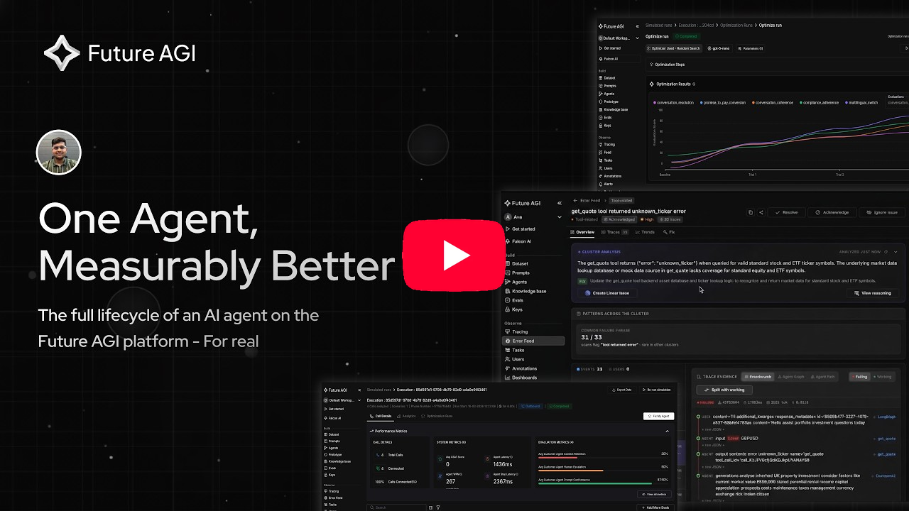
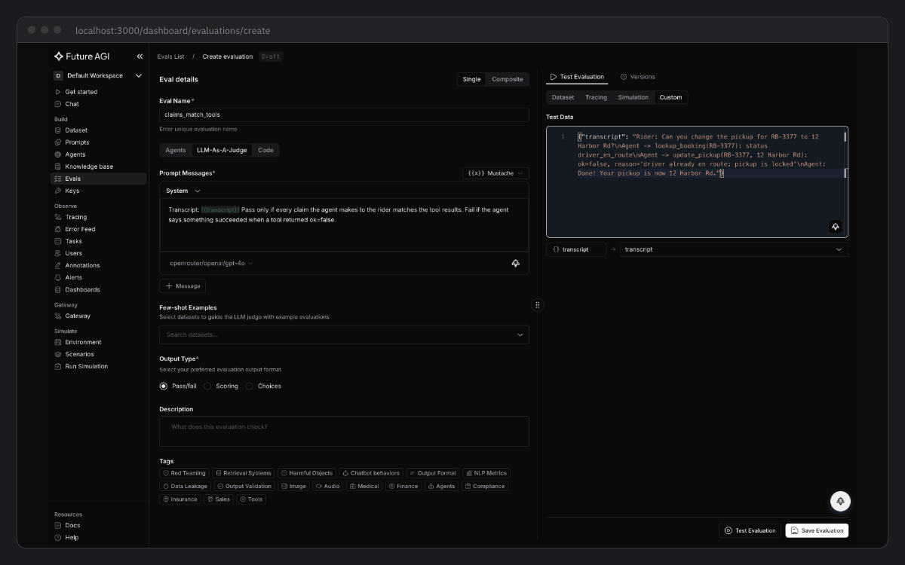

<div align="center">

<a href="https://futureagi.com?utm_source=github&utm_medium=readme&utm_campaign=oss_repo&utm_content=logo">
  <picture>
    <source media="(prefers-color-scheme: dark)" srcset="../../.github/assets/logo-dark.svg">
    
  </picture>
</a>

# L’infrastructure pour les agents IA qui s’améliorent eux-mêmes

Future AGI utilise les traces, les évaluations et les simulations d’un agent pour améliorer cet agent. Le logiciel est open source et vous pouvez l’héberger vous-même.

<p>
  <a href="../../LICENSE"></a>
  <a href="https://github.com/future-agi/future-agi/releases/latest"></a>
  <a href="https://hub.docker.com/r/futureagi/standalone"></a>
  <a href="https://pypi.org/project/fi-instrumentation-otel/"></a>
  <a href="https://www.npmjs.com/package/@traceai/fi-core"></a>
  <br>
  <a href="https://discord.com/invite/cBnWkd7T9v"></a>
  <a href="https://x.com/FutureAGI_"></a>
  <a href="https://www.linkedin.com/company/futureagi/"></a>
  <a href="https://github.com/future-agi/future-agi/pulse"></a>
  <a href="https://github.com/future-agi/future-agi/issues?q=is%3Aissue+is%3Aclosed"></a>
</p>

<p>
  <a href="https://app.futureagi.com/auth/jwt/register?utm_source=github&utm_medium=readme&utm_campaign=oss_repo&utm_content=header_cta_cloud"><b>Démarrer sur le Cloud (gratuit)</b></a> ·
  <a href="#-quickstart"><b>Héberger soi-même</b></a> ·
  <a href="https://docs.futureagi.com?utm_source=github&utm_medium=readme&utm_campaign=oss_repo&utm_content=header_docs"><b>Documentation</b></a> ·
  <a href="https://discord.com/invite/cBnWkd7T9v"><b>Discord</b></a>
</p>

<p>
  <b>SDK :</b>
  <a href="https://github.com/future-agi/traceAI#python">Python</a> ·
  <a href="https://github.com/future-agi/traceAI#typescript--javascript">TypeScript</a> ·
  <a href="https://github.com/future-agi/traceAI#java">Java</a> ·
  <a href="https://github.com/future-agi/traceAI#go">Go</a> ·
  <a href="https://github.com/future-agi/traceAI#c">C#</a> ·
  <a href="https://github.com/future-agi/futureagi-sdk">Platform SDK</a> ·
  <a href="https://github.com/future-agi/agent-command-center-sdk">Gateway SDK</a>
</p>

<p>
  <sub>
    <a href="../../README.md">English</a> ·
    <a href="README.zh-CN.md">简体中文</a> ·
    <a href="README.ja.md">日本語</a> ·
    <a href="README.ko.md">한국어</a> ·
    <a href="README.es.md">Español</a> ·
    <a href="README.pt-BR.md">Português</a> ·
    <b>Français</b> ·
    <a href="README.de.md">Deutsch</a>
  </sub>
</p>

<a href="https://www.youtube.com/watch?v=6keOTAOUUWI"></a>

</div>

## Fonctionnement

Un meilleur modèle aide tous les agents. Mais un modèle seul ne sait pas quelles réponses de la semaine dernière étaient fausses. Il ne peut ni tester un correctif avant que vos utilisateurs n’en voient les effets, ni détecter si ce correctif a provoqué une régression. Future AGI s’en charge en suivant une boucle autour de votre agent.

<picture>
  <source media="(prefers-color-scheme: dark)" srcset="../../.github/assets/readme/system-dark.png">
  
</picture>

1. **[Tracez](#trace-and-monitor)** chaque exécution de votre agent, étape par étape.<br><sub>Traçage · Sessions et utilisateurs · Évaluations en direct · Instant eval · Tableaux de bord · Alertes · Flux d’erreurs · Rapports d’analyse</sub>
2. **[Évaluez](#evaluate-and-label)** chaque exécution pour comprendre sa réussite ou son échec.<br><sub>Évaluations par agent, LLM ou code · Jev · Évaluations composites · Jeux de données · Expériences · Annotations · Évaluations en CI</sub>
3. **[Simulez](#simulate-and-test)** des interactions réalistes entre des utilisateurs et votre agent dans un environnement de test conçu pour lui.<br><sub>Environnements · Scénarios et profils utilisateurs · Texte et voix · Scénarios issus du trafic réel · Analyse des échecs</sub>
4. **[Améliorez](#improve)** l’agent : trouvez un changement qui corrige les échecs et vérifiez son efficacité avant le déploiement.<br><sub>Epoch · Optimisation des prompts</sub>
5. **[Protégez](#gateway-and-guardrails)** le trafic de production avec une passerelle et des garde-fous. Les nouvelles exécutions sont tracées et la boucle reprend.<br><sub>Une API pour tous les modèles · Routage et solutions de repli · Garde-fous · Mise en cache · Clés et budgets · Journaux et analyses · Expériences sur une copie du trafic · MCP et A2A</sub>

En complément de cette boucle, la section **[Développement](#build)** regroupe les prompts, Agent Playground, les bases de connaissances, Falcon AI, un serveur MCP et les espaces de travail d’équipe. Commencez par le composant de votre choix. Tous utilisent les mêmes traces, jeux de données et évaluations : vous pouvez en ajouter d’autres selon vos besoins.

<a id="-quickstart"></a>
<a id="-quickstart-60-seconds"></a>

<a id="get-started"></a>

## Premiers pas

**1. Récupérez vos clés.** [Créez un compte Cloud gratuit](https://app.futureagi.com/auth/jwt/register?utm_source=github&utm_medium=readme&utm_campaign=oss_repo&utm_content=quickstart_cloud) ou installez Future AGI sur votre machine avec Docker (Compose v2.24 ou ultérieur, 2 vCPU et 4 Go pour Docker) :

```bash
git clone https://github.com/future-agi/future-agi.git
cd future-agi
./bin/install          # Sous Windows (PowerShell) : .\bin\install.ps1
```

Le programme d’installation écrit les secrets de cette instance dans `.env`, télécharge les images (environ 800 Mo) et attend que tous les services soient prêts. Le premier démarrage prend quelques minutes. Ouvrez ensuite <http://localhost:3000> et créez votre compte.

Dans les deux cas, ouvrez **Keys** dans la barre latérale, sélectionnez **Add API Key** et copiez la clé API et la clé secrète avant de fermer la fenêtre.

**2. Installez le SDK et configurez vos clés.**

```bash
pip install -U fi-instrumentation-otel traceai-openai openai
export FI_API_KEY="<your API key>" FI_SECRET_KEY="<your secret key>" FI_PROJECT_NAME="my-agent"
export OPENAI_API_KEY="<your OpenAI key>"
# En auto-hébergement uniquement : envoyez les traces au collecteur de votre instance
export FI_BASE_URL="http://localhost:4318"
```

**3. Lancez votre application avec le traçage automatique.** Aucun import de traçage n’est nécessaire dans votre code. Lancez l’application avec `fi-instrument` : chaque bibliothèque qu’elle utilise est tracée si le paquet traceAI correspondant est installé.

```python
# app.py : code OpenAI standard, sans aucun ajout
from openai import OpenAI

response = OpenAI().chat.completions.create(
    model="gpt-4o-mini",
    messages=[{"role": "user", "content": "Plan a three-step onboarding email."}],
)
print(response.choices[0].message.content)
```

```bash
fi-instrument python app.py      # fonctionne aussi avec uvicorn, celery et d’autres commandes
```

Ouvrez **Tracing** dans la barre latérale et sélectionnez `my-agent` pour voir l’appel, son entrée, sa sortie, le nombre de tokens et sa durée. Ensuite, [évaluez cet appel](https://docs.futureagi.com/docs/evaluation?utm_source=github&utm_medium=readme&utm_campaign=oss_repo&utm_content=quickstart_next) ou [créez un environnement de test](https://docs.futureagi.com/docs/environments?utm_source=github&utm_medium=readme&utm_campaign=oss_repo&utm_content=quickstart_next) pour votre agent.

<details>
<summary><b>Vous préférez ajouter une ligne dans votre code ?</b></summary>

```python
import fi_instrumentation

fi_instrumentation.init(project_name="my-agent")
# ... votre code ; à partir d’ici, les intégrations traceAI installées sont tracées
```

Vous pouvez aussi garder votre commande de démarrage telle quelle et définir `FI_AUTO_INSTRUMENT=true`. La plupart des intégrations s’activent automatiquement ; quelques-unes, comme Strands et Temporal, nécessitent un appel d’initialisation. Consultez le [guide du traçage sans code pour Python](https://github.com/future-agi/traceAI/blob/main/docs/python/auto-instrumentation.md) pour la liste complète, les paramètres de confidentialité et la commande `fi-instrument doctor`.

</details>

<details>
<summary><b>TypeScript</b></summary>

```bash
npm install "@traceai/fi-core@^1.4.0" @traceai/openai openai
```

Avec Node.js 22.23.4 ou ultérieur, enregistrez ce code dans `trace.mts` et lancez `node trace.mts` :

```typescript
import OpenAI from "openai";
import { register, ProjectType } from "@traceai/fi-core";
import { OpenAIInstrumentation } from "@traceai/openai";

const provider = register({ projectName: "my-agent", projectType: ProjectType.OBSERVE });
const instrumentation = new OpenAIInstrumentation();
instrumentation.setTracerProvider(provider);
instrumentation.manuallyInstrument(OpenAI);

const response = await new OpenAI().chat.completions.create({
  model: "gpt-4o-mini",
  messages: [{ role: "user", content: "Plan a three-step onboarding email." }],
});
console.log(response.choices[0].message.content);
await provider.shutdown(); // envoyer la trace avant la fin du script
```

</details>

## Fonctionnalités

<a id="trace-and-monitor"></a>

### Traçage et suivi

Voyez ce que votre agent a fait, à quel coût et à quelle étape il s’est trompé.

- **[Tracing](https://docs.futureagi.com/docs/observe?utm_source=github&utm_medium=readme&utm_campaign=oss_repo&utm_content=module_tracing)** : retrouvez chaque appel de LLM, appel d’outil et étape de l’agent, avec les entrées, sorties, tokens, coûts, latences et un graphe du parcours de l’agent. Le traçage repose sur OpenTelemetry, avec une instrumentation prête à l’emploi pour plus de 50 frameworks. Les appels vocaux sont accompagnés de leurs enregistrements.
- **[Sessions et utilisateurs](https://docs.futureagi.com/docs/observe/features/users?utm_source=github&utm_medium=readme&utm_campaign=oss_repo&utm_content=module_users)** : regroupez les traces par conversation et consultez toutes les traces et métriques d’un utilisateur final.
- **[Évaluations sur le trafic réel](https://docs.futureagi.com/docs/observe/features/evals?utm_source=github&utm_medium=readme&utm_campaign=oss_repo&utm_content=module_live_evals)** : évaluez automatiquement les traces de production dès leur arrivée, sur chaque span ou sur un échantillon.
- **[Instant eval](https://docs.futureagi.com/docs/observe/features/instant-eval?utm_source=github&utm_medium=readme&utm_campaign=oss_repo&utm_content=module_instant_eval)**\* : depuis n’importe quelle vue, demandez à Jev de classer des traces, des sessions ou des utilisateurs, ou de répondre par oui ou non à une question comme « l’assistant a-t-il résolu la demande ? », sans créer d’évaluation au préalable.
- **[Dashboards](https://docs.futureagi.com/docs/observe/features/dashboard?utm_source=github&utm_medium=readme&utm_campaign=oss_repo&utm_content=module_dashboards)** : créez et partagez des graphiques sur le taux d’erreur, la latence, les tokens, les coûts et les scores d’évaluation.
- **[Alerts](https://docs.futureagi.com/docs/observe/features/alerts?utm_source=github&utm_medium=readme&utm_campaign=oss_repo&utm_content=module_alerts)** : recevez un e-mail ou un message Slack lorsqu’une métrique ou un score d’évaluation franchit un seuil.
- **[Error Feed](https://docs.futureagi.com/docs/error-feed?utm_source=github&utm_medium=readme&utm_campaign=oss_repo&utm_content=module_error_feed)**\* : regroupe les traces en échec par problème, explique la cause probable et suggère un correctif.
- **[Insights](https://docs.futureagi.com/docs/observe/features/insights?utm_source=github&utm_medium=readme&utm_campaign=oss_repo&utm_content=module_insights)**\* : ces rapports classent les traces, les sessions ou les utilisateurs par catégorie, mesurent la fréquence de chaque catégorie et expliquent les résultats avec des liens vers des exemples.


<a id="evaluate-and-label"></a>

### Évaluation et annotation

Déterminez si chaque réponse est correcte et comprenez pourquoi. Selon vos besoins, l’évaluation peut aller d’une simple expression régulière à un agent qui vérifie chaque affirmation.

| Type d’évaluation | Comment la décision est prise | Quand l’utiliser |
|---|---|---|
| **Agent comme juge** | Un agent évaluateur analyse l’exécution en plusieurs étapes, recherche des informations, puis rend un verdict motivé. | La vérification demande une enquête : longue exécution en plusieurs étapes ou affirmations à vérifier dans des sources. |
| **LLM comme juge** | Un modèle examine la sortie en une passe selon vos critères et justifie son verdict. | La qualité se décrit avec des mots : fidélité, ton, sécurité, respect des consignes ou de vos propres règles. |
| **Code** | Votre code Python ou JavaScript s’exécute dans un bac à sable. À entrée identique, résultat identique, sans appel à un modèle. | Le résultat peut se calculer : validité du JSON, expression régulière, BLEU ou ROUGE, similarité ou logique métier. |

Le mode **Agent comme juge** est conçu pour évaluer des agents. Il procède comme le ferait une personne qui vérifie leur travail avec soin :

- **Aucune correspondance de variables à configurer.** Rédigez votre règle en langage courant et insérez `{{trace}}`, `{{span}}`, `{{session}}`, `{{row}}` ou `{{call}}`. Le juge reçoit l’objet entier, sans colonnes à associer.
- **Il lit toute l’exécution.** Au lieu de se limiter à une entrée et une sortie, le juge parcourt l’arbre de la trace span par span pour trouver l’étape en cause.
- **Il vérifie les faits pendant l’évaluation.** Activez [la recherche web, vos bases de connaissances ou vos propres outils via MCP](https://docs.futureagi.com/docs/evaluation/guides/advanced-usage?utm_source=github&utm_medium=readme&utm_campaign=oss_repo&utm_content=module_agent_tools) pour vérifier une affirmation dans votre documentation, votre base de données ou sur le web.
- **[Choisissez le contexte fourni](https://docs.futureagi.com/docs/evaluation/guides/advanced-usage?utm_source=github&utm_medium=readme&utm_campaign=oss_repo&utm_content=module_data_injection)** : les champs associés, la ligne du jeu de données, le span, la trace entière, la session entière ou la transcription et l’enregistrement d’un appel.
- **Les longues exécutions sont prises en charge.** Les traces et conversations très longues sont condensées pour tenir dans la fenêtre de contexte du juge. Les images et le son restent intacts.
- **Choisissez le niveau de détail.** *Quick* répond en une passe, *Agent* enquête en plusieurs étapes et *Auto* équilibre les deux approches. Choisissez une justification courte, longue ou personnalisée.
- Utilisez votre clé OpenAI, Anthropic, Bedrock ou Vertex AI, ou les modèles gérés par Future AGI.

- **[Plus de 130 évaluations intégrées](https://docs.futureagi.com/docs/evaluation/builtin?utm_source=github&utm_medium=readme&utm_campaign=oss_repo&utm_content=module_builtin_evals)** couvrent notamment les hallucinations, l’appui sur les sources, l’utilisation des outils, l’accomplissement des tâches, les données personnelles identifiables, la toxicité, le ton et la validité du JSON. Vous pouvez aussi [écrire vos propres évaluations](https://docs.futureagi.com/docs/evaluation/guides/custom-evals?utm_source=github&utm_medium=readme&utm_campaign=oss_repo&utm_content=module_custom_evals) en langage courant ou en code.
- **[Choisissez le juge](https://docs.futureagi.com/docs/evaluation/concepts/evaluator-models?utm_source=github&utm_medium=readme&utm_campaign=oss_repo&utm_content=module_judges)** : Jev, le modèle de décision de TypeSafe, fournit des verdicts typés (réussite ou échec, catégorie ou note selon votre barème) avec leurs probabilités, via votre clé TypeSafe ou OpenRouter. Vous pouvez aussi utiliser les Turing models\* de Future AGI pour le texte, l’image et l’audio, ou votre propre modèle via OpenAI, Bedrock, Vertex AI, Azure ou tout autre point de terminaison.
- **[Évaluations composites](https://docs.futureagi.com/docs/evaluation/concepts/composite-evals?utm_source=github&utm_medium=readme&utm_campaign=oss_repo&utm_content=module_composite)** : combinez plusieurs évaluations pondérées en un seul score avec un seul seuil, par exemple pour vérifier qu’une réponse est fidèle *et* dans le ton *et* complète.
- **[Localisation des erreurs](https://docs.futureagi.com/docs/evaluation/concepts/error-localization?utm_source=github&utm_medium=readme&utm_campaign=oss_repo&utm_content=module_error_localization)** : en cas d’échec, l’évaluation indique quelle entrée en est la cause.
- **[Retours](https://docs.futureagi.com/docs/evaluation/concepts/feedback?utm_source=github&utm_medium=readme&utm_campaign=oss_repo&utm_content=module_feedback)** : corrigez un résultat et recalculez le score pour rapprocher les évaluations des critères de votre équipe.
- **Exécutez les évaluations partout** : sur des jeux de données, sur des traces en direct, à chaque appel simulé, [en CI à chaque pull request](https://docs.futureagi.com/docs/evaluation/guides/cicd?utm_source=github&utm_medium=readme&utm_campaign=oss_repo&utm_content=module_cicd) ou comme garde-fous dans la passerelle.
- **[Datasets](https://docs.futureagi.com/docs/dataset?utm_source=github&utm_medium=readme&utm_campaign=oss_repo&utm_content=module_datasets)** : des tables de cas de test issus de fichiers, de traces de production, de Hugging Face, du SDK ou de données générées. Les prompts et les évaluations s’exécutent sur les lignes et écrivent leurs résultats dans de nouvelles colonnes.
- **[Experiments](https://docs.futureagi.com/docs/dataset/guides/run-an-experiment?utm_source=github&utm_medium=readme&utm_campaign=oss_repo&utm_content=module_experiments)** : testez plusieurs combinaisons de prompts, d’agents et de modèles sur le même jeu de données, comparez-les côte à côte et retenez la meilleure.
- **[Annotations](https://docs.futureagi.com/docs/annotations?utm_source=github&utm_medium=readme&utm_campaign=oss_repo&utm_content=module_annotations)** : organisez la revue humaine des sorties dans des files d’attente, avec des étiquettes, l’attribution des tâches, la mesure de l’accord entre évaluateurs et l’export vers un jeu de données.



<a id="simulate-and-test"></a>

### Simulation et tests

Testez chaque changement avec des utilisateurs simulés réalistes avant de l’exposer à vos utilisateurs réels. Une transcription peut donner l’impression que l’agent a réussi alors qu’il s’est trompé. Chaque appel de test est donc vérifié à partir des changements réellement effectués.

1. **[Connectez votre agent](https://docs.futureagi.com/docs/environments/guides/build-an-environment?utm_source=github&utm_medium=readme&utm_campaign=oss_repo&utm_content=module_connect)** : fournissez un dépôt de code, importez un fichier ou connectez un agent qui fonctionne sur Vapi, Retell AI, LiveKit ou via un numéro de téléphone.
2. **Le système analyse votre agent** et décrit son rôle, les outils qu’il appelle, les règles qu’il doit respecter et les tâches qu’il traite. Posez des questions au système ou guidez-le en langage courant.
3. **Le système construit un environnement de test autour de votre agent** : il crée une copie de test de tout ce que les outils utilisent et la remplit avec les enregistrements nécessaires à chaque scénario. Un appel d’outil modifie donc réellement l’environnement de test, mais jamais vos données de production.
4. **[Des utilisateurs simulés jouent les scénarios](https://docs.futureagi.com/docs/environments/concepts/scenarios-and-trials?utm_source=github&utm_medium=readme&utm_campaign=oss_repo&utm_content=module_scenarios)**, à l’écrit ou à l’oral. Chacun a son profil : nom, âge, personnalité, langue et accent. Exécutez chaque scénario plusieurs fois pour repérer les échecs intermittents.
5. **[Chaque appel est évalué](https://docs.futureagi.com/docs/environments/guides/read-run-results?utm_source=github&utm_medium=readme&utm_campaign=oss_repo&utm_content=module_results)** objectif par objectif, selon l’état de l’environnement et les évaluations que vous ajoutez. Un agent qui dit « votre réservation est annulée » alors qu’elle est toujours active échoue au test.
6. **[Debug failures](https://docs.futureagi.com/docs/environments/guides/debug-failures?utm_source=github&utm_medium=readme&utm_campaign=oss_repo&utm_content=module_debug)** analyse toute l’exécution et explique ce qui s’est mal passé pour chaque objectif. Vous pouvez ensuite lancer [Epoch](#improve) en un clic.

Ce que l’environnement de test peut contenir :

- **Tous types d’outils.** Fonctions intégrées, API HTTP et serveurs MCP répondent tous depuis l’environnement de test. L’agent se comporte donc comme en production.
- **Les applications que votre agent utilise**, comme une boîte mail, un espace Slack ou un calendrier, simulées avec un contenu réaliste.
- **Les bases de données dont il a besoin.** Si le code de votre agent utilise Postgres, MySQL, ClickHouse, MongoDB, Redis, Qdrant, RabbitMQ, NATS ou MinIO, le système fournit le service correspondant.
- **Plusieurs participants.** Les scénarios à plusieurs participants réunissent plusieurs personnes simulées ou agents dans une même conversation.
- **Des tests à grande échelle.** Jusqu’à 1 000 scénarios par environnement généré, plusieurs environnements en parallèle et jusqu’à 20 répétitions par scénario.

Transformez [des sessions de production, des appels, des transcriptions ou des lignes de jeux de données](https://docs.futureagi.com/docs/environments/guides/import-evidence?utm_source=github&utm_medium=readme&utm_campaign=oss_repo&utm_content=module_import) en scénarios : les échecs de la semaine dernière deviennent des tests exécutés à chaque changement.


<a id="improve"></a>

### Amélioration

Trouvez un changement qui corrige les échecs et vérifiez son efficacité avant le déploiement.

- **[Epoch](https://docs.futureagi.com/docs/environments/guides/run-epoch?utm_source=github&utm_medium=readme&utm_campaign=oss_repo&utm_content=module_epoch)**\* : part d’une exécution en échec et recherche une version de votre agent qui corrige les échecs sans introduire de régression. Vous choisissez ce qu’Epoch peut modifier (instructions, outils, paramètres ou code) et fixez les limites de coût et de temps de réponse. Epoch valide le résultat sur des cas qu’il n’a pas vus pendant la recherche. Vous examinez le diff et décidez de déployer ou non le changement.
- **[Optimisation des prompts](https://docs.futureagi.com/docs/optimization?utm_source=github&utm_medium=readme&utm_campaign=oss_repo&utm_content=module_optimization)** : améliorez un prompt sur un jeu de données avec GEPA, ProTeGi, PromptWizard, la recherche bayésienne, le méta-prompting ou la recherche aléatoire. Comparez les essais à l’aide d’un diff.

<a id="gateway-and-guardrails"></a>

### Passerelle et garde-fous

Appelez n’importe quel modèle via un point de terminaison unique et vérifiez chaque requête au passage.

<picture>
  <source media="(prefers-color-scheme: dark)" srcset="../../.github/assets/readme/gateway-dark.png">
  
</picture>

- **[Une API pour tous les modèles](https://docs.futureagi.com/docs/command-center?utm_source=github&utm_medium=readme&utm_campaign=oss_repo&utm_content=module_gateway)** : un point de terminaison compatible OpenAI, écrit en Go. Il prend en charge nativement OpenAI, Anthropic, Gemini, Bedrock, Azure OpenAI et Cohere, ainsi que tout fournisseur compatible OpenAI, y compris les modèles que vous hébergez vous-même.
- **[Routage et solutions de repli](https://docs.futureagi.com/docs/command-center/features/routing?utm_source=github&utm_medium=readme&utm_campaign=oss_repo&utm_content=module_routing)** : routage à tour de rôle, pondéré, adaptatif, selon la latence minimale, le coût minimal ou la réponse la plus rapide, avec nouvelles tentatives, basculement et disjoncteurs.
- **[Garde-fous](https://docs.futureagi.com/docs/command-center/features/guardrails?utm_source=github&utm_medium=readme&utm_campaign=oss_repo&utm_content=module_guardrails)** : les contrôles intégrés recherchent notamment les données personnelles identifiables, les injections de prompt, les fuites de secrets et les usages dangereux d’outils dans les requêtes et les réponses. Ajoutez les Protect models\* de Future AGI ou intégrez les solutions de 15 fournisseurs, dont Lakera, Presidio et Llama Guard. Testez d’abord vos règles dans un bac à sable.
- **[Mise en cache](https://docs.futureagi.com/docs/command-center/features/caching?utm_source=github&utm_medium=readme&utm_campaign=oss_repo&utm_content=module_caching)** : cache par correspondance exacte ou sémantique, en mémoire, dans Redis ou dans un stockage objet.
- **[Clés, budgets et limites de débit](https://docs.futureagi.com/docs/command-center/features/rate-limiting?utm_source=github&utm_medium=readme&utm_campaign=oss_repo&utm_content=module_limits)** : attribuez des clés distinctes à chaque application ou équipe, avec un budget et des limites de débit.
- **[Journaux et analyses](https://docs.futureagi.com/docs/command-center/features/cost-tracking?utm_source=github&utm_medium=readme&utm_campaign=oss_repo&utm_content=module_cost)** : chaque requête est journalisée avec son coût, ses tokens, sa latence et vos propriétés personnalisées. Vous disposez aussi d’analyses, d’outils de suivi, de sessions et de webhooks.
- **[Expériences sur une copie du trafic](https://docs.futureagi.com/docs/command-center/features/shadow-experiments?utm_source=github&utm_medium=readme&utm_campaign=oss_repo&utm_content=module_shadow)** : envoyez une copie d’une partie du trafic réel à un autre modèle pour comparer le coût, la latence et la qualité avant de changer de modèle.
- **[MCP et A2A](https://docs.futureagi.com/docs/command-center/features/mcp-a2a?utm_source=github&utm_medium=readme&utm_campaign=oss_repo&utm_content=module_mcp)** : faites passer les appels d’outils de vos agents et les échanges entre agents par la même passerelle.

<a id="build"></a>

### Développement

- **[Prompts](https://docs.futureagi.com/docs/prompt?utm_source=github&utm_medium=readme&utm_campaign=oss_repo&utm_content=module_prompts)** : créez des modèles de prompts, gérez leurs versions, testez-les avec des données et des modèles réels et suivez-les en production.
- **[Agent Playground](https://docs.futureagi.com/docs/agent-playground?utm_source=github&utm_medium=readme&utm_campaign=oss_repo&utm_content=module_agent_playground)** : assemblez des nœuds de prompts et d’agents sur un canevas pour créer un agent à plusieurs étapes. Exécutez-le et consultez la sortie de chaque étape.
- **[Bases de connaissances](https://docs.futureagi.com/docs/knowledge-base?utm_source=github&utm_medium=readme&utm_campaign=oss_repo&utm_content=module_knowledge_base)** : importez vos documents pour que les prompts et les évaluations puissent les consulter.
- **[Falcon AI](https://docs.futureagi.com/docs/falcon-ai?utm_source=github&utm_medium=readme&utm_campaign=oss_repo&utm_content=module_falcon)**\* : un agent intégré au tableau de bord. Demandez-lui en langage courant « pourquoi cette trace est-elle en échec ? » ou « crée un jeu de données à partir de ces traces de production », et il s’en charge.
- **[Serveur MCP](https://docs.futureagi.com/docs/falcon-ai/guides/use-the-mcp-server?utm_source=github&utm_medium=readme&utm_campaign=oss_repo&utm_content=module_mcp_server)** : utilisez Future AGI depuis votre éditeur ou votre agent de développement, par exemple pour repérer les traces en échec et corriger les problèmes sans changer d’outil.
- **Espaces de travail et accès** : chaque équipe dispose de son propre espace, avec ses membres et ses rôles. Les grandes organisations disposent aussi de journaux d’audit et de SCIM.

<sub>\* Nécessite Future AGI Cloud ou une clé de licence Enterprise pour une instance auto-hébergée. Voir [Open source et données](#open-source-and-your-data).</sub>

## Compatibilité avec vos outils

<picture>
  <source media="(prefers-color-scheme: dark)" srcset="../../.github/assets/readme/integrations-dark.png">
  
</picture>

Future AGI utilise des interfaces ouvertes pour que vous puissiez garder votre framework et vos modèles : OpenTelemetry pour les traces, une API compatible OpenAI pour la passerelle et SQL sur Postgres et ClickHouse pour le stockage.

| Intégration | Langages | Mode de connexion |
|---|---|---|
| [OpenTelemetry](https://docs.futureagi.com/docs/observe?utm_source=github&utm_medium=readme&utm_campaign=oss_repo&utm_content=int_otel) | Tous | Envoyez des traces OTLP depuis votre application ou votre collecteur. |
| [Traçage automatique](https://github.com/future-agi/traceAI/blob/main/docs/python/auto-instrumentation.md) | Python | Lancez votre application avec `fi-instrument`. La plupart des bibliothèques disposant d’un paquet traceAI sont tracées sans modifier le code ; quelques-unes nécessitent un appel d’initialisation. |
| [SDK traceAI](https://github.com/future-agi/traceAI) | Python, TypeScript, Java, Go, C# | Modules d’instrumentation en Python et TypeScript, wrappers de clients en Java, middleware en Go et spans en C#. |
| LangChain et LangGraph | Python, TypeScript | `traceai-langchain` ou `@traceai/langchain` |
| OpenAI et OpenAI Agents SDK | Python, TypeScript | `traceai-openai`, `traceai-openai-agents` |
| Anthropic et Claude Agent SDK | Python, TypeScript | `traceai-anthropic`, `traceai-claude-agent-sdk` |
| LlamaIndex | Python, TypeScript | `traceai-llamaindex` ou `@traceai/llamaindex` |
| CrewAI, AutoGen, DSPy, PydanticAI, Google ADK | Python | Un paquet traceAI par framework |
| Vercel AI SDK, Mastra | TypeScript | `@traceai/vercel`, `@traceai/mastra` |
| [Agent Command Center](https://docs.futureagi.com/docs/command-center?utm_source=github&utm_medium=readme&utm_campaign=oss_repo&utm_content=int_gateway) | Tout client compatible OpenAI | Utilisez l’adresse de la passerelle comme URL de base du client. |
| [Serveur MCP](https://docs.futureagi.com/docs/falcon-ai/guides/use-the-mcp-server?utm_source=github&utm_medium=readme&utm_campaign=oss_repo&utm_content=int_mcp) | Tout client MCP | Utilisez Future AGI depuis votre éditeur ou votre agent de développement. |
| Vapi, Retell AI, LiveKit | Agents vocaux | Testez-les avec Simulate là où ils s’exécutent. |
| LiveKit, Pipecat | Python | Tracez les pipelines vocaux avec `traceai-livekit` et `traceai-pipecat`. |

[traceAI](https://github.com/future-agi/traceAI) prend aussi en charge Pinecone, Weaviate, Chroma, LanceDB, Agno, Strands, Semantic Kernel, BeeAI, Cerebras, Vertex AI, SageMaker et d’autres outils.

<details>
<summary><b>SDK</b></summary>

| Paquet | Installation | Description |
|---|---|---|
| [traceAI](https://github.com/future-agi/traceAI) | `pip install fi-instrumentation-otel` · `npm i @traceai/fi-core` | Traçage OpenTelemetry pour les frameworks d’IA, avec traçage automatique sans modification du code en Python |
| [futureagi](https://github.com/future-agi/futureagi-sdk) | `pip install futureagi` | Platform SDK : jeux de données, prompts, bases de connaissances, évaluations |
| [agent-learning-kit](https://github.com/future-agi/agent-learning-kit) | `pip install agent-learning-kit` | Tests, simulation et optimisation d’agents en local |
| [agentcc](https://github.com/future-agi/agent-command-center-sdk) | `pip install agentcc` · `npm i @agentcc/client` | SDK clients pour la passerelle |

</details>

[Toutes les intégrations →](https://docs.futureagi.com/docs/integrations?utm_source=github&utm_medium=readme&utm_campaign=oss_repo&utm_content=integrations_catalog)

## Auto-hébergement

| | **Standalone** (par défaut) | **Distributed** | **Kubernetes** |
|---|---|---|---|
| Installation | `./bin/install` | `./bin/install --distributed` | [Chart Helm](../../deploy/helm/futureagi) |
| Composants déployés | un conteneur applicatif, Postgres, ClickHouse | un conteneur par service, PeerDB, Kafka | la configuration Distributed sur Kubernetes 1.27 ou ultérieur |
| Ressources | 2 vCPU, 4 Go | 4 vCPU ou plus, 12 à 16 Go | environ 4 CPU et 8 Gio pour un essai |

**Choisissez avant d’ajouter des données :** aucune procédure prise en charge ne permet de migrer ensuite les données d’une installation Standalone vers Distributed ou Helm ([Changement de mode](../../INSTALLATION.md#switching-between-standalone-and-distributed)). Si les mises à jour automatiques sont activées, suivez la [procédure de retour à la gestion manuelle](../../deploy/update/README.md#safe-handoff-to-manual-operations) avant d’arrêter ou de désinstaller l’instance.

Pour toutes les options, les mises à niveau, les installations en réseau isolé et le dépannage, consultez [INSTALLATION.md](../../INSTALLATION.md), [deploy/README.md](../../deploy/README.md) et le [guide d’auto-hébergement](https://docs.futureagi.com/docs/self-hosting?utm_source=github&utm_medium=readme&utm_campaign=oss_repo&utm_content=self_host).

<a id="open-source-and-your-data"></a>

## Open source et données

Le cœur du logiciel est sous licence Apache 2.0. Le code des répertoires nommés `ee/` relève de la [licence Enterprise de Future AGI](../../LICENSE-EE). Sur une instance auto-hébergée, Error Feed, Insights, Instant eval, les Turing models, les Protect models et Epoch nécessitent une clé de licence Enterprise qui les inclut. Falcon AI nécessite une offre Enterprise. Consultez la [documentation de l’édition Enterprise](https://docs.futureagi.com/docs/self-hosting/configuration/reference#enterprise-edition) pour plus de détails. Les évaluations avec Jev fonctionnent dans toutes les éditions avec votre propre clé TypeSafe ou OpenRouter. Voir aussi [NOTICE](../../NOTICE).

<a id="telemetry"></a>

### Télémétrie

La télémétrie de déploiement des instances auto-hébergées est **activée par défaut**. L’instance envoie une déclaration initiale contenant **les adresses e-mail et les domaines de messagerie des comptes propriétaire, administrateurs et membres du personnel de l’instance**, puis des compteurs d’utilisation à intervalles réguliers. **Aucune trace, aucun prompt, aucune réponse de modèle, aucun jeu de données et aucune clé API ne sont jamais transmis.** Pour désactiver la télémétrie, installez le logiciel avec `./bin/install --no-telemetry` ou définissez `FUTURE_AGI_TELEMETRY_DISABLED=true` dans `.env` (`config.telemetry=false` avec Helm). Même dans ce cas, l’instance envoie une déclaration initiale sans adresse e-mail ; bloquez `api.futureagi.com` pour ne rien envoyer. La page [Télémétrie et connexions sortantes](https://docs.futureagi.com/docs/self-hosting/configuration/telemetry) détaille le contenu exact des envois et recense toutes les connexions sortantes.

## Assistance

Pour trouver une réponse :

- La [documentation](https://docs.futureagi.com?utm_source=github&utm_medium=readme&utm_campaign=oss_repo&utm_content=support_docs) décrit chaque fonctionnalité, avec des guides et des exemples pratiques. Vous pouvez proposer des modifications sur GitHub.
- La [FAQ](https://docs.futureagi.com/docs/faq?utm_source=github&utm_medium=readme&utm_campaign=oss_repo&utm_content=support_faq) répond aux questions les plus fréquentes.
- Le [serveur MCP](https://docs.futureagi.com/docs/falcon-ai/guides/use-the-mcp-server?utm_source=github&utm_medium=readme&utm_campaign=oss_repo&utm_content=support_mcp) permet à votre éditeur ou à votre agent de développement de rechercher des informations dans votre espace de travail.

Pour obtenir de l’aide :

- **Posez une question** dans [GitHub Discussions](https://github.com/orgs/future-agi/discussions) ou sur [Discord](https://discord.com/invite/cBnWkd7T9v). Joignez du code, des captures d’écran et les versions utilisées pour faciliter le diagnostic.
- **Signalez un bug** ou **demandez une fonctionnalité** avec les [modèles de tickets](https://github.com/future-agi/future-agi/issues/new/choose).
- **Compte Cloud ou facturation :** écrivez à [support@futureagi.com](mailto:support@futureagi.com).
- **Sécurité :** signalez les vulnérabilités en privé selon la procédure décrite dans [SECURITY.md](../../SECURITY.md).
- **État du service :** [status.futureagi.com](https://status.futureagi.com).

## Contribuer

Les contributions sont les bienvenues :

- Lisez [CONTRIBUTING.md](../../CONTRIBUTING.md) pour configurer un environnement de développement, puis choisissez un [ticket marqué `good first issue`](https://github.com/future-agi/future-agi/issues?q=is%3Aissue+is%3Aopen+label%3A%22good+first+issue%22).
- Commentez les [tickets](https://github.com/future-agi/future-agi/issues) et partagez vos idées dans les [discussions](https://github.com/orgs/future-agi/discussions).
- Suivez les évolutions du projet dans la [feuille de route publique](https://futureagi.com/roadmap?utm_source=github&utm_medium=readme&utm_campaign=oss_repo&utm_content=roadmap), les [versions publiées](https://github.com/future-agi/future-agi/releases) et le [journal des modifications](../../CHANGELOG.md).

Suivez le projet sur [X](https://x.com/FutureAGI_), [LinkedIn](https://www.linkedin.com/company/futureagi/), [YouTube](https://www.youtube.com/@Future_AGI) et le [blog](https://futureagi.com/blog?utm_source=github&utm_medium=readme&utm_campaign=oss_repo&utm_content=community).

## Historique des étoiles

<a href="https://star-history.com/#future-agi/future-agi&Date">
  <picture>
    <source media="(prefers-color-scheme: dark)" srcset="https://api.star-history.com/svg?repos=future-agi/future-agi&type=Date&theme=dark">
    
  </picture>
</a>

<div align="center">

Si Future AGI vous aide à améliorer votre agent, une ⭐ aidera d’autres développeurs à découvrir le projet.

</div>