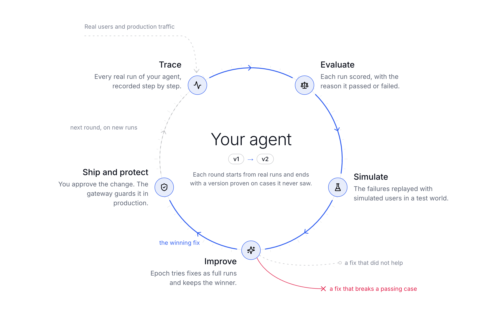
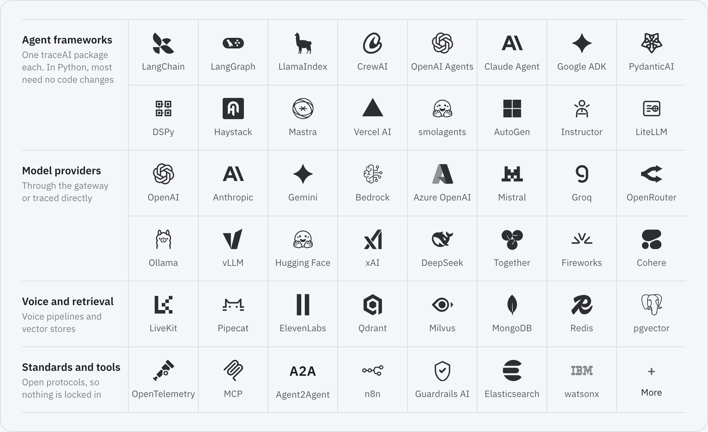

<div align="center">

<a href="https://futureagi.com?utm_source=github&utm_medium=readme&utm_campaign=oss_repo&utm_content=logo">
  <picture>
    <source media="(prefers-color-scheme: dark)" srcset="../../.github/assets/logo-dark.svg">
    
  </picture>
</a>

# 自己改善する AI エージェントのためのインフラストラクチャ

Future AGI は、エージェントのトレース、評価、シミュレーションをエージェント自身の改善につなげます。オープンソースで、セルフホストできます。

<p>
  <a href="../../LICENSE"></a>
  <a href="https://github.com/future-agi/future-agi/releases/latest"></a>
  <a href="https://hub.docker.com/r/futureagi/standalone"></a>
  <a href="https://pypi.org/project/fi-instrumentation-otel/"></a>
  <a href="https://www.npmjs.com/package/@traceai/fi-core"></a>
  <br>
  <a href="https://discord.com/invite/cBnWkd7T9v"></a>
  <a href="https://x.com/FutureAGI_"></a>
  <a href="https://www.linkedin.com/company/futureagi/"></a>
  <a href="https://github.com/future-agi/future-agi/pulse"></a>
  <a href="https://github.com/future-agi/future-agi/issues?q=is%3Aissue+is%3Aclosed"></a>
</p>

<p>
  <a href="https://app.futureagi.com/auth/jwt/register?utm_source=github&utm_medium=readme&utm_campaign=oss_repo&utm_content=header_cta_cloud"><b>クラウドで始める（無料）</b></a> ·
  <a href="#-quickstart"><b>セルフホスト</b></a> ·
  <a href="https://docs.futureagi.com?utm_source=github&utm_medium=readme&utm_campaign=oss_repo&utm_content=header_docs"><b>ドキュメント</b></a> ·
  <a href="https://discord.com/invite/cBnWkd7T9v"><b>Discord</b></a>
</p>

<p>
  <b>SDK:</b>
  <a href="https://github.com/future-agi/traceAI#python">Python</a> ·
  <a href="https://github.com/future-agi/traceAI#typescript--javascript">TypeScript</a> ·
  <a href="https://github.com/future-agi/traceAI#java">Java</a> ·
  <a href="https://github.com/future-agi/traceAI#go">Go</a> ·
  <a href="https://github.com/future-agi/traceAI#c">C#</a> ·
  <a href="https://github.com/future-agi/futureagi-sdk">Platform SDK</a> ·
  <a href="https://github.com/future-agi/agent-command-center-sdk">Gateway SDK</a>
</p>

<p>
  <sub>
    <a href="../../README.md">English</a> ·
    <a href="README.zh-CN.md">简体中文</a> ·
    <b>日本語</b> ·
    <a href="README.ko.md">한국어</a> ·
    <a href="README.es.md">Español</a> ·
    <a href="README.pt-BR.md">Português</a> ·
    <a href="README.fr.md">Français</a> ·
    <a href="README.de.md">Deutsch</a>
  </sub>
</p>

<a href="https://www.youtube.com/watch?v=6keOTAOUUWI"></a>

</div>

## 仕組み

モデルの性能が上がれば、どのエージェントにも役立ちます。ただし、モデルだけでは、先週の回答のどれが間違っていたかはわかりません。修正をユーザーに届ける前にテストすることも、その修正が別の問題を起こしていないかを確かめることもできません。Future AGI は、エージェントの実行と改善を繰り返すループで、これらの作業を行います。

<picture>
  <source media="(prefers-color-scheme: dark)" srcset="../../.github/assets/readme/system-dark.png">
  
</picture>

1. <b>[トレース](#trace-and-monitor)</b>：エージェントのすべての実行をステップごとに記録します。<br><sub>トレース · セッションとユーザー · 本番での評価 · Instant eval · ダッシュボード · アラート · エラーフィード · 分析レポート</sub>
2. <b>[評価](#evaluate-and-label)</b>：各実行を評価し、合格または不合格になった理由を確認します。<br><sub>エージェント、LLM、コードによる評価 · Jev · 複合評価 · データセット · 実験 · アノテーション · CI での評価</sub>
3. <b>[シミュレーション](#simulate-and-test)</b>：エージェントに合わせて構築したテスト環境で、実際のユーザーを想定したやり取りを試します。<br><sub>環境 · シナリオとペルソナ · テキストと音声 · 本番トラフィックからのシナリオ作成 · 失敗原因の調査</sub>
4. <b>[改善](#improve)</b>：失敗を解消する変更を見つけ、リリース前に効果を検証します。<br><sub>Epoch · プロンプトの最適化</sub>
5. <b>[保護](#gateway-and-guardrails)</b>：ゲートウェイとガードレールで本番トラフィックを保護します。新しい実行がトレースされ、再びループが始まります。<br><sub>全モデルに共通の API · ルーティングとフォールバック · ガードレール · キャッシュ · キーと予算 · ログと分析 · シャドー実験 · MCP と A2A</sub>

このループを支える<b>[構築機能](#build)</b>には、プロンプト、Agent Playground、ナレッジベース、Falcon AI、MCP サーバー、チーム用ワークスペースがあります。どの機能からでも始められます。どれも同じトレース、データセット、評価を使うので、必要になった時点で次の機能を追加できます。

<a id="-quickstart"></a>
<a id="-quickstart-60-seconds"></a>

<a id="get-started"></a>

## はじめに

<b>1. キーを取得します。</b> [無料のクラウドアカウントを作成](https://app.futureagi.com/auth/jwt/register?utm_source=github&utm_medium=readme&utm_campaign=oss_repo&utm_content=quickstart_cloud)するか、手元のマシンで Docker を使って起動します（Compose v2.24 以降、Docker 用に 2 vCPU、メモリ 4 GB）：

```bash
git clone https://github.com/future-agi/future-agi.git
cd future-agi
./bin/install          # Windows（PowerShell）の場合: .\bin\install.ps1
```

インストーラーは、この環境のシークレットを `.env` に書き込み、イメージ（約 800 MB）を取得して、すべてのサービスが起動するまで待機します。初回起動には数分かかります。その後、<http://localhost:3000> を開いてアカウントを作成します。

どちらの場合も、サイドバーの <b>Keys</b> を開き、<b>Add API Key</b> を選択します。ダイアログを閉じる前に API キーとシークレットキーをコピーしてください。

<b>2. SDK をインストールし、キーを設定します。</b>

```bash
pip install -U fi-instrumentation-otel traceai-openai openai
export FI_API_KEY="<your API key>" FI_SECRET_KEY="<your secret key>" FI_PROJECT_NAME="my-agent"
export OPENAI_API_KEY="<your OpenAI key>"
# セルフホストの場合のみ：トレースを自分の環境のコレクターに送信
export FI_BASE_URL="http://localhost:4318"
```

<b>3. 自動トレースを有効にしてアプリを実行します。</b> コードにトレース用のインポートは不要です。`fi-instrument` 経由で起動すると、対応する traceAI パッケージがインストールされているライブラリがトレースされます：

```python
# app.py: トレース用の処理を追加していない通常の OpenAI コード
from openai import OpenAI

response = OpenAI().chat.completions.create(
    model="gpt-4o-mini",
    messages=[{"role": "user", "content": "Plan a three-step onboarding email."}],
)
print(response.choices[0].message.content)
```

```bash
fi-instrument python app.py      # uvicorn、celery などのコマンドでも使用可能
```

サイドバーの <b>Tracing</b> を開き、`my-agent` を選ぶと、呼び出しの入力、出力、トークン数、処理時間を確認できます。次は、[評価を使って採点](https://docs.futureagi.com/docs/evaluation?utm_source=github&utm_medium=readme&utm_campaign=oss_repo&utm_content=quickstart_next)するか、エージェントの[テスト環境を構築](https://docs.futureagi.com/docs/environments?utm_source=github&utm_medium=readme&utm_campaign=oss_repo&utm_content=quickstart_next)します。

<details>
<summary><b>コード内で 1 行で初期化するには？</b></summary>

```python
import fi_instrumentation

fi_instrumentation.init(project_name="my-agent")
# ...ここからアプリのコード。インストール済みの traceAI 連携のトレースが始まります
```

起動コマンドを変えずに `FI_AUTO_INSTRUMENT=true` を設定する方法もあります。ほとんどの連携は自動で有効になりますが、Strands や Temporal などは初期設定用の呼び出しが 1 回必要です。対応一覧、プライバシー設定、`fi-instrument doctor` については、[コード変更不要の Python トレース](https://github.com/future-agi/traceAI/blob/main/docs/python/auto-instrumentation.md)を参照してください。

</details>

<details>
<summary><b>TypeScript</b></summary>

```bash
npm install "@traceai/fi-core@^1.4.0" @traceai/openai openai
```

Node.js 22.23.4 以降で、以下を `trace.mts` として保存し、`node trace.mts` を実行します：

```typescript
import OpenAI from "openai";
import { register, ProjectType } from "@traceai/fi-core";
import { OpenAIInstrumentation } from "@traceai/openai";

const provider = register({ projectName: "my-agent", projectType: ProjectType.OBSERVE });
const instrumentation = new OpenAIInstrumentation();
instrumentation.setTracerProvider(provider);
instrumentation.manuallyInstrument(OpenAI);

const response = await new OpenAI().chat.completions.create({
  model: "gpt-4o-mini",
  messages: [{ role: "user", content: "Plan a three-step onboarding email." }],
});
console.log(response.choices[0].message.content);
await provider.shutdown(); // スクリプトの終了前にトレースを送信
```

</details>

## 機能一覧

<a id="trace-and-monitor"></a>

### トレースと監視

エージェントが何をしたか、いくらかかったか、どこで問題が起きたかを確認できます。

- <b>[Tracing](https://docs.futureagi.com/docs/observe?utm_source=github&utm_medium=readme&utm_campaign=oss_repo&utm_content=module_tracing)</b>：すべての LLM 呼び出し、ツール呼び出し、エージェントのステップについて、入力、出力、トークン数、コスト、レイテンシを記録します。実行経路はグラフで確認できます。OpenTelemetry をベースに、50 以上のフレームワーク向けの計装機能を用意しています。音声通話とその録音にも対応します。
- <b>[セッションとユーザー](https://docs.futureagi.com/docs/observe/features/users?utm_source=github&utm_medium=readme&utm_campaign=oss_repo&utm_content=module_users)</b>：会話単位でトレースをまとめ、エンドユーザーごとの全トレースと指標を確認できます。
- <b>[本番トラフィックの評価](https://docs.futureagi.com/docs/observe/features/evals?utm_source=github&utm_medium=readme&utm_campaign=oss_repo&utm_content=module_live_evals)</b>：本番のトレースが届くたびに、すべてのスパン、またはサンプリングしたスパンを自動で採点します。
- <b>[Instant eval](https://docs.futureagi.com/docs/observe/features/instant-eval?utm_source=github&utm_medium=readme&utm_campaign=oss_repo&utm_content=module_instant_eval)</b>\*：事前に評価を作成しなくても、どのビューからでも、表示中のトレース、セッション、ユーザーについて Jev に質問できます。「アシスタントは依頼を解決したか？」のような「はい／いいえ」の質問や、カテゴリを選ぶ質問に対応します。
- <b>[Dashboards](https://docs.futureagi.com/docs/observe/features/dashboard?utm_source=github&utm_medium=readme&utm_campaign=oss_repo&utm_content=module_dashboards)</b>：エラー率、レイテンシ、トークン数、コスト、評価スコアのグラフを作成して共有できます。
- <b>[Alerts](https://docs.futureagi.com/docs/observe/features/alerts?utm_source=github&utm_medium=readme&utm_campaign=oss_repo&utm_content=module_alerts)</b>：指標や評価スコアがしきい値をまたぐと、メールまたは Slack で通知します。
- <b>[Error Feed](https://docs.futureagi.com/docs/error-feed?utm_source=github&utm_medium=readme&utm_campaign=oss_repo&utm_content=module_error_feed)</b>\*：失敗したトレースを問題ごとにまとめ、考えられる原因を説明し、修正案を示します。
- <b>[Insights](https://docs.futureagi.com/docs/observe/features/insights?utm_source=github&utm_medium=readme&utm_campaign=oss_repo&utm_content=module_insights)</b>\*：トレース、セッション、ユーザーを分類し、カテゴリごとの出現頻度を集計します。レポートには分析結果の説明と具体例へのリンクが含まれます。


<a id="evaluate-and-label"></a>

### 評価とラベル付け

各回答が正しいかどうかと、その理由を確認できます。評価方法は、低コストな正規表現のチェックから、一つひとつの主張を調べるエージェントによる検証まで選べます。

| 評価の種類 | 判定方法 | 適した用途 |
|---|---|---|
| <b>エージェントによる判定</b> | 評価用エージェントが複数のステップで実行内容を調査し、必要な情報を調べ、判定と理由を返します。 | 長い多段階の実行や、裏付けが必要な主張など、調査を伴うチェック。 |
| <b>LLM による判定</b> | モデルが出力を指定の基準に照らして 1 回で読み取り、判定と理由を返します。 | 情報源への忠実さ、口調、安全性、指示への準拠、独自ルールなど、言葉で基準を記述できる品質の評価。 |
| <b>コード</b> | 自作の Python または JavaScript をサンドボックスで実行します。モデルは呼び出さず、同じ入力には同じ結果を返します。 | JSON の妥当性、正規表現との一致、BLEU や ROUGE、類似度、独自のビジネスロジックなど、計算で判定できるチェック。 |

<b>エージェントによる判定</b>は、エージェントの評価に合わせた設計です。レビュー担当者が内容を精査するのと同じように判定します：

- <b>変数のマッピングは不要です。</b> 自然言語で書いたルールに `{{trace}}`、`{{span}}`、`{{session}}`、`{{row}}`、`{{call}}` のいずれかを含めると、そのオブジェクト全体が判定側に渡ります。列の対応付けは不要です。
- <b>実行全体を読み取ります。</b> 1 組の入出力だけを見るのではなく、トレースツリーをスパンごとにたどり、どのステップで問題が起きたかを特定します。
- <b>判定中に事実を確認します。</b> [ウェブ検索、ナレッジベース、MCP 経由の独自ツール](https://docs.futureagi.com/docs/evaluation/guides/advanced-usage?utm_source=github&utm_medium=readme&utm_campaign=oss_repo&utm_content=module_agent_tools)を有効にすると、ドキュメント、データベース、ウェブの情報と主張を照合できます。
- <b>[渡すコンテキストを選べます](https://docs.futureagi.com/docs/evaluation/guides/advanced-usage?utm_source=github&utm_medium=readme&utm_campaign=oss_repo&utm_content=module_data_injection)</b>：対応付けたフィールド、データセットの行、スパン、トレース全体、セッション全体、通話の文字起こしと録音から選択できます。
- <b>長い実行にも対応します。</b> 非常に長いトレースや会話は、判定側のコンテキストに収まるように圧縮します。画像と音声はそのまま保持します。
- <b>調査の深さを選べます。</b> *Quick* は 1 回で回答し、*Agent* は複数のステップで調査します。*Auto* は両者のバランスを取ります。理由の説明は短文、長文、カスタムから選べます。
- 自分の OpenAI、Anthropic、Bedrock、Vertex AI のキー、または Future AGI が管理するモデルで実行できます。

- <b>[130 種類以上の組み込み評価](https://docs.futureagi.com/docs/evaluation/builtin?utm_source=github&utm_medium=readme&utm_campaign=oss_repo&utm_content=module_builtin_evals)</b>：ハルシネーション、根拠の有無、ツール利用、タスク完了、個人を特定できる情報（PII）、有害性、口調、JSON の妥当性などをチェックできます。自然言語やコードで[独自の評価を作成](https://docs.futureagi.com/docs/evaluation/guides/custom-evals?utm_source=github&utm_medium=readme&utm_campaign=oss_repo&utm_content=module_custom_evals)することもできます。
- <b>[判定モデルの選択](https://docs.futureagi.com/docs/evaluation/concepts/evaluator-models?utm_source=github&utm_medium=readme&utm_campaign=oss_repo&utm_content=module_judges)</b>：TypeSafe の判定モデル Jev は、形式を指定した判定（合否、単一カテゴリ、独自基準によるスコア）を確率付きで返します。自分の TypeSafe または OpenRouter のキーで利用できます。テキスト、画像、音声に対応する Future AGI の Turing models\* や、OpenAI、Bedrock、Vertex AI、Azure、任意のエンドポイントから呼び出せる自分のモデルも選べます。
- <b>[複合評価](https://docs.futureagi.com/docs/evaluation/concepts/composite-evals?utm_source=github&utm_medium=readme&utm_campaign=oss_repo&utm_content=module_composite)</b>：複数の評価に重みを付け、1 つのスコアとしきい値で判定します。たとえば「情報源に忠実」*かつ*「口調が適切」*かつ*「回答に漏れがない」をまとめて判定できます。
- <b>[エラー箇所の特定](https://docs.futureagi.com/docs/evaluation/concepts/error-localization?utm_source=github&utm_medium=readme&utm_campaign=oss_repo&utm_content=module_error_localization)</b>：評価が不合格の場合、どの入力が原因だったかを示します。
- <b>[フィードバック](https://docs.futureagi.com/docs/evaluation/concepts/feedback?utm_source=github&utm_medium=readme&utm_campaign=oss_repo&utm_content=module_feedback)</b>：結果を訂正して再採点することで、評価をチームの正解基準に近づけます。
- <b>さまざまな場所で実行</b>：データセット、本番トレース、シミュレーション中の各通話、[プルリクエストごとの CI](https://docs.futureagi.com/docs/evaluation/guides/cicd?utm_source=github&utm_medium=readme&utm_campaign=oss_repo&utm_content=module_cicd)で実行できます。ゲートウェイのガードレールとしても使えます。
- <b>[Datasets](https://docs.futureagi.com/docs/dataset?utm_source=github&utm_medium=readme&utm_campaign=oss_repo&utm_content=module_datasets)</b>：ファイル、本番トレース、Hugging Face、SDK、生成データからテストケースを表にまとめます。各行に対してプロンプトや評価を実行し、新しい列に結果を書き戻します。
- <b>[Experiments](https://docs.futureagi.com/docs/dataset/guides/run-an-experiment?utm_source=github&utm_medium=readme&utm_campaign=oss_repo&utm_content=module_experiments)</b>：同じデータセットでプロンプト、エージェント、モデルの組み合わせを複数試し、結果を並べて比較して、最もよい組み合わせを選べます。
- <b>[Annotations](https://docs.futureagi.com/docs/annotations?utm_source=github&utm_medium=readme&utm_campaign=oss_repo&utm_content=module_annotations)</b>：人が出力をレビューするためのキューです。ラベル付け、担当者の割り当て、レビュー担当者間の判定の一致度の確認、データセットへの書き戻しができます。


<a id="simulate-and-test"></a>

### シミュレーションとテスト

変更を実際のユーザーに届ける前に、現実に近い模擬ユーザーで毎回テストできます。やり取りの記録だけを読むと成功に見えても、エージェントの処理は間違っていることがあります。そのため、テスト通話はすべて、実際に何が変わったかと照合して判定します。

1. <b>[エージェントを接続します](https://docs.futureagi.com/docs/environments/guides/build-an-environment?utm_source=github&utm_medium=readme&utm_campaign=oss_repo&utm_content=module_connect)</b>：コードリポジトリ、アップロード、Vapi、Retell AI、LiveKit で稼働中のエージェント、または電話番号から接続できます。
2. <b>エージェントの内容を読み取り</b>、目的、呼び出すツール、守るべきルール、担当するタスクを文書化します。自然言語で質問したり、方針を指示したりできます。
3. <b>エージェントに合わせてテスト環境を構築します</b>：ツールの操作対象をすべてテスト用に複製し、シナリオごとに必要なレコードを用意します。テストでツールを呼ぶと環境の状態が実際に変わりますが、本番データは変更しません。
4. <b>[模擬ユーザーがシナリオを実行します](https://docs.futureagi.com/docs/environments/concepts/scenarios-and-trials?utm_source=github&utm_medium=readme&utm_campaign=oss_repo&utm_content=module_scenarios)</b>。模擬ユーザーにはそれぞれ名前、年齢、性格、言語、アクセントを設定し、テキストまたは音声でやり取りします。各シナリオを複数回実行することで、ときどき発生する回答の失敗も検出できます。
5. <b>[すべての通話を採点します](https://docs.futureagi.com/docs/environments/guides/read-run-results?utm_source=github&utm_medium=readme&utm_campaign=oss_repo&utm_content=module_results)</b>。目標ごとにテスト環境の状態を確認し、追加した評価も実行します。「予約をキャンセルしました」と回答しても、予約が有効なままなら不合格です。
6. <b>[Debug failures](https://docs.futureagi.com/docs/environments/guides/debug-failures?utm_source=github&utm_medium=readme&utm_campaign=oss_repo&utm_content=module_debug)</b> は実行全体を読み取り、何が問題だったかを目標ごとに説明します。そこからワンクリックで [Epoch](#improve) を開始できます。

テスト環境には以下を用意できます：

- <b>各種ツール。</b> 組み込み関数、HTTP API、MCP サーバーはすべてテスト環境のデータで応答するため、エージェントは本番と同じように動作します。
- <b>エージェントが使うアプリ。</b> メールボックス、Slack ワークスペース、カレンダーなどを、実際の利用に近い内容で再現します。
- <b>必要なデータベースなどのサービス。</b> エージェントのコードが Postgres、MySQL、ClickHouse、MongoDB、Redis、Qdrant、RabbitMQ、NATS、MinIO を必要とする場合は、環境の構築時に用意します。
- <b>複数の参加者。</b> 複数参加型のシナリオでは、複数の模擬ユーザーやエージェントが同じ会話に参加します。
- <b>実行規模。</b> 1 回の構築で最大 1,000 シナリオに対応し、複数のテスト環境を並列で実行できます。各シナリオは最大 20 回繰り返せます。

[本番のセッション、通話、文字起こし、データセットの行](https://docs.futureagi.com/docs/environments/guides/import-evidence?utm_source=github&utm_medium=readme&utm_campaign=oss_repo&utm_content=module_import)をシナリオに変換すれば、先週失敗したケースを、変更のたびに実行するテストにできます。


<a id="improve"></a>

### 改善

失敗を解消する変更を見つけ、リリース前に効果を検証します。

- <b>[Epoch](https://docs.futureagi.com/docs/environments/guides/run-epoch?utm_source=github&utm_medium=readme&utm_campaign=oss_repo&utm_content=module_epoch)</b>\*：失敗した実行を出発点に、合格済みのケースを壊さずに失敗を解消できるエージェントの変更案を探します。変更を許可する範囲（指示、ツール、設定、コード）と、コストや応答時間の上限は自分で指定します。探索に使っていないケースで結果を検証します。差分を確認し、リリースするかどうかを判断できます。
- <b>[プロンプトの最適化](https://docs.futureagi.com/docs/optimization?utm_source=github&utm_medium=readme&utm_campaign=oss_repo&utm_content=module_optimization)</b>：データセット上で GEPA、ProTeGi、PromptWizard、ベイズ探索、メタプロンプティング、ランダム探索を使ってプロンプトを改善し、各試行の差分を比較できます。

<a id="gateway-and-guardrails"></a>

### ゲートウェイとガードレール

1 つのエンドポイントからどのモデルでも呼び出せます。すべてのリクエストを中継時にチェックします。

<picture>
  <source media="(prefers-color-scheme: dark)" srcset="../../.github/assets/readme/gateway-dark.png">
  
</picture>

- <b>[全モデルに共通の API](https://docs.futureagi.com/docs/command-center?utm_source=github&utm_medium=readme&utm_campaign=oss_repo&utm_content=module_gateway)</b>：Go で実装した OpenAI 互換のエンドポイントです。OpenAI、Anthropic、Gemini、Bedrock、Azure OpenAI、Cohere を標準サポートします。セルフホストのモデルを含む任意の OpenAI 互換プロバイダーにも対応します。
- <b>[ルーティングとフォールバック](https://docs.futureagi.com/docs/command-center/features/routing?utm_source=github&utm_medium=readme&utm_campaign=oss_repo&utm_content=module_routing)</b>：ラウンドロビン、重み付き、最低レイテンシ、最低コスト、適応型、最速応答の各方式で振り分けられます。リトライ、フェイルオーバー、サーキットブレーカーにも対応します。
- <b>[ガードレール](https://docs.futureagi.com/docs/command-center/features/guardrails?utm_source=github&utm_medium=readme&utm_campaign=oss_repo&utm_content=module_guardrails)</b>：組み込みのスキャナーがリクエストと応答をチェックし、PII、プロンプトインジェクション、シークレットの漏えい、安全でないツール利用などを検出します。Future AGI の Protect models\* を追加したり、Lakera、Presidio、Llama Guard など 15 のベンダーと連携したりできます。ルールは事前にプレイグラウンドで試せます。
- <b>[キャッシュ](https://docs.futureagi.com/docs/command-center/features/caching?utm_source=github&utm_medium=readme&utm_campaign=oss_repo&utm_content=module_caching)</b>：完全一致と意味的な類似性によるキャッシュに対応します。保存先はメモリ、Redis、オブジェクトストレージから選べます。
- <b>[キー、予算、レート制限](https://docs.futureagi.com/docs/command-center/features/rate-limiting?utm_source=github&utm_medium=readme&utm_campaign=oss_repo&utm_content=module_limits)</b>：アプリやチームごとにキーを分け、利用予算とレート制限を設定できます。
- <b>[ログと分析](https://docs.futureagi.com/docs/command-center/features/cost-tracking?utm_source=github&utm_medium=readme&utm_campaign=oss_repo&utm_content=module_cost)</b>：リクエストごとにコスト、トークン数、レイテンシ、独自のプロパティを記録します。分析、監視、セッション、Webhook にも対応します。
- <b>[シャドー実験](https://docs.futureagi.com/docs/command-center/features/shadow-experiments?utm_source=github&utm_medium=readme&utm_campaign=oss_repo&utm_content=module_shadow)</b>：本番トラフィックの一部を別のモデルにも送り、切り替える前にコスト、レイテンシ、品質を比較できます。
- <b>[MCP と A2A](https://docs.futureagi.com/docs/command-center/features/mcp-a2a?utm_source=github&utm_medium=readme&utm_campaign=oss_repo&utm_content=module_mcp)</b>：エージェントのツール呼び出しとエージェント間の通信を同じゲートウェイで中継します。

<a id="build"></a>

### 構築

- <b>[Prompts](https://docs.futureagi.com/docs/prompt?utm_source=github&utm_medium=readme&utm_campaign=oss_repo&utm_content=module_prompts)</b>：プロンプトテンプレートを作成してバージョン管理し、実データとモデルで実行して、本番での動作を監視できます。
- <b>[Agent Playground](https://docs.futureagi.com/docs/agent-playground?utm_source=github&utm_medium=readme&utm_campaign=oss_repo&utm_content=module_agent_playground)</b>：キャンバス上でプロンプトとエージェントのノードを組み合わせて多段階のエージェントを構築し、実行して各ステップの出力を確認できます。
- <b>[ナレッジベース](https://docs.futureagi.com/docs/knowledge-base?utm_source=github&utm_medium=readme&utm_campaign=oss_repo&utm_content=module_knowledge_base)</b>：ドキュメントをアップロードすると、プロンプトや評価からその内容を参照できます。
- <b>[Falcon AI](https://docs.futureagi.com/docs/falcon-ai?utm_source=github&utm_medium=readme&utm_campaign=oss_repo&utm_content=module_falcon)</b>\*：ダッシュボード内で使えるエージェントです。「このトレースが失敗したのはなぜ？」「この本番トレースからデータセットを作成して」のように自然言語で依頼すると、調査や作業を実行します。
- <b>[MCP サーバー](https://docs.futureagi.com/docs/falcon-ai/guides/use-the-mcp-server?utm_source=github&utm_medium=readme&utm_campaign=oss_repo&utm_content=module_mcp_server)</b>：エディターやコーディングエージェントから Future AGI を利用できます。たとえば、作業画面を離れずに、失敗したトレースを見つけて問題を修正できます。
- <b>ワークスペースとアクセス管理</b>：チームごとにワークスペース、メンバー、ロールを分けられます。大規模な組織向けに監査ログと SCIM にも対応します。

<sub>\* Future AGI Cloud、またはセルフホスト環境の Enterprise ライセンスキーが必要です。[オープンソースとデータの取り扱い](#open-source-and-your-data)を参照してください。</sub>

## 既存の技術スタックとの連携

<picture>
  <source media="(prefers-color-scheme: dark)" srcset="../../.github/assets/readme/integrations-dark.png">
  
</picture>

Future AGI はオープンなインターフェースを使うので、既存のフレームワークやモデルをそのまま利用できます。トレースには OpenTelemetry、ゲートウェイには OpenAI 互換 API、ストレージには Postgres と ClickHouse 上の SQL を使います。

| 連携先 | 言語 | 接続方法 |
|---|---|---|
| [OpenTelemetry](https://docs.futureagi.com/docs/observe?utm_source=github&utm_medium=readme&utm_campaign=oss_repo&utm_content=int_otel) | 任意 | アプリまたはコレクターから OTLP トレースを送信します。 |
| [自動トレース](https://github.com/future-agi/traceAI/blob/main/docs/python/auto-instrumentation.md) | Python | `fi-instrument` でアプリを起動します。traceAI パッケージがあるライブラリの大半はコード変更なしでトレースできます。一部は初期設定用の呼び出しが 1 回必要です。 |
| [traceAI SDK](https://github.com/future-agi/traceAI) | Python、TypeScript、Java、Go、C# | Python と TypeScript では計装モジュール、Java ではクライアントラッパー、Go ではミドルウェア、C# ではスパンを使います。 |
| LangChain と LangGraph | Python、TypeScript | `traceai-langchain` または `@traceai/langchain` |
| OpenAI と OpenAI Agents SDK | Python、TypeScript | `traceai-openai`、`traceai-openai-agents` |
| Anthropic と Claude Agent SDK | Python、TypeScript | `traceai-anthropic`、`traceai-claude-agent-sdk` |
| LlamaIndex | Python、TypeScript | `traceai-llamaindex` または `@traceai/llamaindex` |
| CrewAI、AutoGen、DSPy、PydanticAI、Google ADK | Python | それぞれ専用の traceAI パッケージ |
| Vercel AI SDK、Mastra | TypeScript | `@traceai/vercel`、`@traceai/mastra` |
| [Agent Command Center](https://docs.futureagi.com/docs/command-center?utm_source=github&utm_medium=readme&utm_campaign=oss_repo&utm_content=int_gateway) | 任意の OpenAI 互換クライアント | クライアントのベース URL をゲートウェイに設定します。 |
| [MCP サーバー](https://docs.futureagi.com/docs/falcon-ai/guides/use-the-mcp-server?utm_source=github&utm_medium=readme&utm_campaign=oss_repo&utm_content=int_mcp) | 任意の MCP クライアント | エディターやコーディングエージェントから Future AGI を利用できます。 |
| Vapi、Retell AI、LiveKit | 音声エージェント | Simulate を使い、エージェントの稼働先を変えずにテストします。 |
| LiveKit、Pipecat | Python | `traceai-livekit` と `traceai-pipecat` で音声パイプラインをトレースします。 |

[traceAI](https://github.com/future-agi/traceAI) はこのほか、Pinecone、Weaviate、Chroma、LanceDB、Agno、Strands、Semantic Kernel、BeeAI、Cerebras、Vertex AI、SageMaker などにも対応しています。

<details>
<summary><b>SDK</b></summary>

| パッケージ | インストール | 用途 |
|---|---|---|
| [traceAI](https://github.com/future-agi/traceAI) | `pip install fi-instrumentation-otel` · `npm i @traceai/fi-core` | AI フレームワーク向けの OpenTelemetry トレース。Python ではコード変更不要の自動トレースに対応 |
| [futureagi](https://github.com/future-agi/futureagi-sdk) | `pip install futureagi` | Platform SDK：データセット、プロンプト、ナレッジベース、評価 |
| [agent-learning-kit](https://github.com/future-agi/agent-learning-kit) | `pip install agent-learning-kit` | ローカルでのエージェントのテスト、シミュレーション、最適化 |
| [agentcc](https://github.com/future-agi/agent-command-center-sdk) | `pip install agentcc` · `npm i @agentcc/client` | ゲートウェイ用のクライアント SDK |

</details>

[すべての連携先 →](https://docs.futureagi.com/docs/integrations?utm_source=github&utm_medium=readme&utm_campaign=oss_repo&utm_content=integrations_catalog)

## セルフホスト

| | <b>スタンドアロン構成</b>（デフォルト） | <b>分散構成</b> | <b>Kubernetes</b> |
|---|---|---|---|
| インストール | `./bin/install` | `./bin/install --distributed` | [Helm チャート](../../deploy/helm/futureagi) |
| 稼働するサービス | アプリコンテナ 1 個、Postgres、ClickHouse | サービスごとにコンテナ 1 個、PeerDB、Kafka | Kubernetes 1.27 以降で動く分散構成 |
| リソース | 2 vCPU、4 GB | 4 vCPU 以上、12～16 GB | 試用には約 4 CPU、8 GiB |

<b>データを追加する前に構成を選んでください。</b> スタンドアロン構成のデータを後から分散構成や Helm に移行する方法はサポートされていません（[構成の切り替え](../../INSTALLATION.md#switching-between-standalone-and-distributed)）。自動更新に登録した環境を停止またはアンインストールする場合は、先に[手動運用への安全な引き継ぎ](../../deploy/update/README.md#safe-handoff-to-manual-operations)を完了してください。

各オプション、アップグレード、ネットワークから隔離された環境へのインストール、トラブルシューティングについては、[INSTALLATION.md](../../INSTALLATION.md)、[deploy/README.md](../../deploy/README.md)、[セルフホストガイド](https://docs.futureagi.com/docs/self-hosting?utm_source=github&utm_medium=readme&utm_campaign=oss_repo&utm_content=self_host)を参照してください。

<a id="open-source-and-your-data"></a>

## オープンソースとデータの取り扱い

コア部分には Apache 2.0 ライセンスが適用されます。`ee/` という名前のディレクトリにあるコードには [Future AGI Enterprise License](../../LICENSE-EE) が適用されます。セルフホスト環境で Error Feed、Insights、Instant eval、Turing models、Protect models、Epoch を使うには、該当する機能が明記された Enterprise ライセンスキーが必要です。Falcon AI には Enterprise プランが必要です。詳細は [Enterprise Edition リファレンス](https://docs.futureagi.com/docs/self-hosting/configuration/reference#enterprise-edition)を参照してください。Jev による評価は、自分の TypeSafe または OpenRouter のキーを使えば、どのエディションでも利用できます。[NOTICE](../../NOTICE) も参照してください。

<a id="telemetry"></a>

### テレメトリ

セルフホスト環境では、デプロイに関するテレメトリの送信が<b>デフォルトで有効です</b>。初回登録時に、<b>その環境の所有者、管理者、スタッフの各アカウントのメールアドレスとメールドメイン</b>を 1 回送信し、その後は利用回数を定期的に送信します。<b>トレース、プロンプト、モデルの生成結果、データセット、API キーを送信することはありません。</b> 無効にするには、`./bin/install --no-telemetry` でインストールするか、`.env` に `FUTURE_AGI_TELEMETRY_DISABLED=true` を設定してください（Helm では `config.telemetry=false`）。無効にしても、メールアドレスを含まない登録リクエストを 1 回送信します。何も送信しないようにするには、`api.futureagi.com` をブロックしてください。[テレメトリと外部接続](https://docs.futureagi.com/docs/self-hosting/configuration/telemetry)には、送信する正確な内容とすべての外部接続先を記載しています。

## サポート

調べ方：

- [ドキュメント](https://docs.futureagi.com?utm_source=github&utm_medium=readme&utm_campaign=oss_repo&utm_content=support_docs)では、すべての機能をガイドと具体例で説明しています。ドキュメントの修正は GitHub で提案できます。
- [よくある質問](https://docs.futureagi.com/docs/faq?utm_source=github&utm_medium=readme&utm_campaign=oss_repo&utm_content=support_faq)には、特に多い質問への回答があります。
- [MCP サーバー](https://docs.futureagi.com/docs/falcon-ai/guides/use-the-mcp-server?utm_source=github&utm_medium=readme&utm_campaign=oss_repo&utm_content=support_mcp)を使うと、エディターやコーディングエージェントからワークスペース内の情報を調べられます。

問い合わせ先：

- <b>質問</b>は [GitHub Discussions](https://github.com/orgs/future-agi/discussions) または [Discord](https://discord.com/invite/cBnWkd7T9v) へ。コード、スクリーンショット、バージョンを添えると、回答しやすくなります。
- <b>バグ報告</b>や<b>機能リクエスト</b>には [Issue テンプレート](https://github.com/future-agi/future-agi/issues/new/choose)を使ってください。
- <b>クラウドアカウントや請求：</b> [support@futureagi.com](mailto:support@futureagi.com) までメールでお問い合わせください。
- <b>セキュリティ：</b> 脆弱性は [SECURITY.md](../../SECURITY.md) の手順に従って非公開で報告してください。
- <b>サービスの稼働状況：</b> [status.futureagi.com](https://status.futureagi.com)。

## コントリビュート

プロジェクトへの貢献を歓迎します：

- [CONTRIBUTING.md](../../CONTRIBUTING.md) を読んで開発環境をセットアップし、[`good first issue`](https://github.com/future-agi/future-agi/issues?q=is%3Aissue+is%3Aopen+label%3A%22good+first+issue%22) から取り組む Issue を選んでください。
- [Issue](https://github.com/future-agi/future-agi/issues) にコメントしたり、[Discussions](https://github.com/orgs/future-agi/discussions) でアイデアを共有したりできます。
- 今後の予定や変更点は、[公開ロードマップ](https://futureagi.com/roadmap?utm_source=github&utm_medium=readme&utm_campaign=oss_repo&utm_content=roadmap)、[リリース](https://github.com/future-agi/future-agi/releases)、[変更履歴](../../CHANGELOG.md)で確認できます。

最新情報は [X](https://x.com/FutureAGI_)、[LinkedIn](https://www.linkedin.com/company/futureagi/)、[YouTube](https://www.youtube.com/@Future_AGI)、[ブログ](https://futureagi.com/blog?utm_source=github&utm_medium=readme&utm_campaign=oss_repo&utm_content=community)で公開しています。

## スター数の推移

<a href="https://star-history.com/#future-agi/future-agi&Date">
  <picture>
    <source media="(prefers-color-scheme: dark)" srcset="https://api.star-history.com/svg?repos=future-agi/future-agi&type=Date&theme=dark">
    
  </picture>
</a>

<div align="center">

Future AGI がエージェントの改善に役立ったら、⭐ を付けていただけると、ほかの開発者にも見つけてもらいやすくなります。

</div>