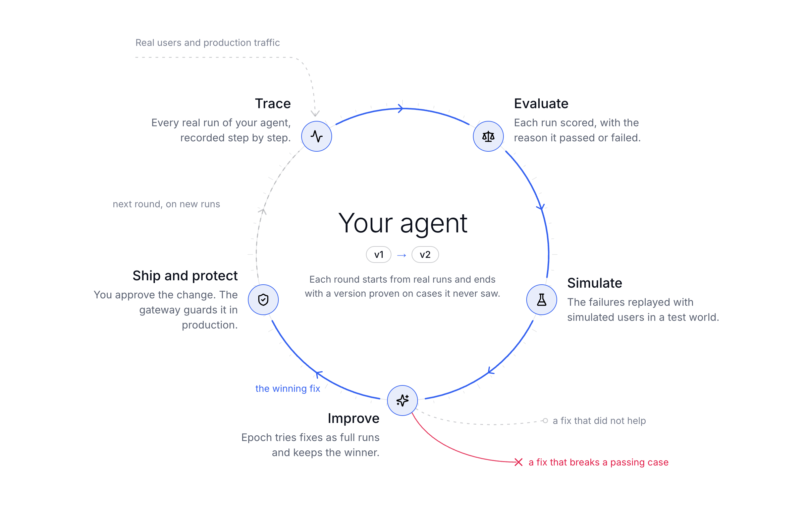
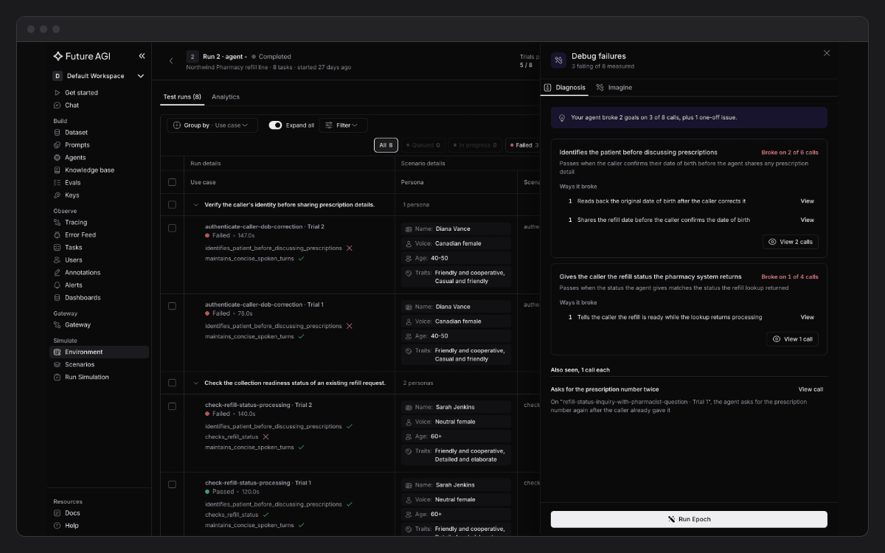

<div align="center">

<a href="https://futureagi.com?utm_source=github&utm_medium=readme&utm_campaign=oss_repo&utm_content=logo">
  <picture>
    <source media="(prefers-color-scheme: dark)" srcset="../../.github/assets/logo-dark.svg">
    
  </picture>
</a>

# 스스로 개선하는 AI 에이전트를 위한 인프라

Future AGI는 에이전트의 트레이스, 평가, 시뮬레이션을 바탕으로 에이전트를 개선합니다. 오픈 소스이며 자체 호스팅할 수 있습니다.

<p>
  <a href="../../LICENSE"></a>
  <a href="https://github.com/future-agi/future-agi/releases/latest"></a>
  <a href="https://hub.docker.com/r/futureagi/standalone"></a>
  <a href="https://pypi.org/project/fi-instrumentation-otel/"></a>
  <a href="https://www.npmjs.com/package/@traceai/fi-core"></a>
  <br>
  <a href="https://discord.com/invite/cBnWkd7T9v"></a>
  <a href="https://x.com/FutureAGI_"></a>
  <a href="https://www.linkedin.com/company/futureagi/"></a>
  <a href="https://github.com/future-agi/future-agi/pulse"></a>
  <a href="https://github.com/future-agi/future-agi/issues?q=is%3Aissue+is%3Aclosed"></a>
</p>

<p>
  <a href="https://app.futureagi.com/auth/jwt/register?utm_source=github&utm_medium=readme&utm_campaign=oss_repo&utm_content=header_cta_cloud"><b>클라우드에서 시작하기(무료)</b></a> ·
  <a href="#-quickstart"><b>자체 호스팅</b></a> ·
  <a href="https://docs.futureagi.com?utm_source=github&utm_medium=readme&utm_campaign=oss_repo&utm_content=header_docs"><b>문서</b></a> ·
  <a href="https://discord.com/invite/cBnWkd7T9v"><b>Discord</b></a>
</p>

<p>
  <b>SDK:</b>
  <a href="https://github.com/future-agi/traceAI#python">Python</a> ·
  <a href="https://github.com/future-agi/traceAI#typescript--javascript">TypeScript</a> ·
  <a href="https://github.com/future-agi/traceAI#java">Java</a> ·
  <a href="https://github.com/future-agi/traceAI#go">Go</a> ·
  <a href="https://github.com/future-agi/traceAI#c">C#</a> ·
  <a href="https://github.com/future-agi/futureagi-sdk">Platform SDK</a> ·
  <a href="https://github.com/future-agi/agent-command-center-sdk">Gateway SDK</a>
</p>

<p>
  <sub>
    <a href="../../README.md">English</a> ·
    <a href="README.zh-CN.md">简体中文</a> ·
    <a href="README.ja.md">日本語</a> ·
    <b>한국어</b> ·
    <a href="README.es.md">Español</a> ·
    <a href="README.pt-BR.md">Português</a> ·
    <a href="README.fr.md">Français</a> ·
    <a href="README.de.md">Deutsch</a>
  </sub>
</p>

<a href="https://www.youtube.com/watch?v=6keOTAOUUWI"></a>

</div>

## 작동 방식

모델이 좋아지면 모든 에이전트에 도움이 됩니다. 하지만 모델만으로는 지난주 답변 중 무엇이 틀렸는지 알 수 없고, 사용자에게 변경 사항을 공개하기 전에 테스트하거나 그 변경으로 다른 문제가 생겼는지 확인할 수도 없습니다. Future AGI는 에이전트를 실행할 때마다 다음 과정을 반복해 이 작업을 대신합니다.

<picture>
  <source media="(prefers-color-scheme: dark)" srcset="../../.github/assets/readme/system-dark.png">
  
</picture>

1. <b>[추적](#trace-and-monitor)</b>: 에이전트의 모든 실행을 단계별로 기록합니다.<br><sub>트레이싱 · 세션과 사용자 · 실시간 평가 · Instant eval · 대시보드 · 알림 · 오류 피드 · 인사이트</sub>
2. <b>[평가](#evaluate-and-label)</b>: 각 실행을 평가하고 통과하거나 실패한 이유를 확인합니다.<br><sub>에이전트, LLM 및 코드 평가 · Jev · 복합 평가 · 데이터셋 · 실험 · 주석 · CI에서 평가 실행</sub>
3. <b>[시뮬레이션](#simulate-and-test)</b>: 에이전트에 맞춰 만든 테스트 환경에서 가상 사용자가 실제처럼 에이전트와 상호작용합니다.<br><sub>환경 · 시나리오와 페르소나 · 텍스트와 음성 · 실제 트래픽 기반 시나리오 · 실패 원인 디버깅</sub>
4. <b>[개선](#improve)</b>: 실패 원인을 해결하는 변경 사항을 찾아 배포 전에 검증합니다.<br><sub>Epoch · 프롬프트 최적화</sub>
5. <b>[보호](#gateway-and-guardrails)</b>: 게이트웨이와 가드레일로 운영 트래픽을 보호합니다. 새로운 실행을 추적하면서 이 과정이 다시 시작됩니다.<br><sub>모든 모델을 위한 단일 API · 라우팅과 폴백 · 가드레일 · 캐싱 · 키와 예산 · 로그와 분석 · 섀도 실험 · MCP와 A2A</sub>

이 과정 전반에서 <b>[빌드](#build)</b> 기능으로 프롬프트, Agent Playground, 지식 베이스, Falcon AI, MCP 서버, 팀 워크스페이스를 사용할 수 있습니다. 어느 기능부터 시작해도 됩니다. 모두 같은 트레이스, 데이터셋, 평가를 사용하므로 필요할 때 다른 기능을 추가할 수 있습니다.

<a id="-quickstart"></a>
<a id="-quickstart-60-seconds"></a>

<a id="get-started"></a>

## 시작하기

<b>1. 키를 발급받습니다.</b> [무료 클라우드 계정을 만들거나](https://app.futureagi.com/auth/jwt/register?utm_source=github&utm_medium=readme&utm_campaign=oss_repo&utm_content=quickstart_cloud) Docker로 로컬에서 실행합니다(Docker에 Compose v2.24 이상, vCPU 2개, 메모리 4 GB 필요).

```bash
git clone https://github.com/future-agi/future-agi.git
cd future-agi
./bin/install          # Windows (PowerShell): .\bin\install.ps1
```

설치 프로그램은 이 인스턴스의 시크릿을 `.env`에 저장하고 이미지(약 800 MB)를 내려받은 뒤 모든 서비스가 시작될 때까지 기다립니다. 처음 시작할 때는 몇 분이 걸립니다. 그런 다음 <http://localhost:3000>을 열고 계정을 만듭니다.

어느 방식이든 사이드바에서 <b>Keys</b>를 열고 <b>Add API Key</b>를 선택한 다음, 대화 상자를 닫기 전에 API 키와 시크릿 키를 복사합니다.

<b>2. SDK를 설치하고 키를 설정합니다.</b>

```bash
pip install -U fi-instrumentation-otel traceai-openai openai
export FI_API_KEY="<your API key>" FI_SECRET_KEY="<your secret key>" FI_PROJECT_NAME="my-agent"
export OPENAI_API_KEY="<your OpenAI key>"
# 자체 호스팅 전용: 설치한 인스턴스의 수집기로 트레이스 전송
export FI_BASE_URL="http://localhost:4318"
```

<b>3. 자동 추적을 켜고 앱을 실행합니다.</b> 코드에서 추적 모듈을 가져올 필요가 없습니다. `fi-instrument`로 앱을 시작하면 해당 traceAI 패키지가 설치된 라이브러리를 자동으로 추적합니다.

```python
# app.py: 별도 코드를 추가하지 않은 일반 OpenAI 코드
from openai import OpenAI

response = OpenAI().chat.completions.create(
    model="gpt-4o-mini",
    messages=[{"role": "user", "content": "Plan a three-step onboarding email."}],
)
print(response.choices[0].message.content)
```

```bash
fi-instrument python app.py      # uvicorn, celery 등 다른 명령에서도 작동
```

사이드바에서 <b>Tracing</b>을 열고 `my-agent`를 선택하면 호출의 입력, 출력, 토큰 수, 소요 시간을 볼 수 있습니다. 다음으로 [평가를 실행해 점수를 매기거나](https://docs.futureagi.com/docs/evaluation?utm_source=github&utm_medium=readme&utm_campaign=oss_repo&utm_content=quickstart_next) 에이전트의 [테스트 환경을 만들어 보세요](https://docs.futureagi.com/docs/environments?utm_source=github&utm_medium=readme&utm_campaign=oss_repo&utm_content=quickstart_next).

<details>
<summary><b>코드 한 줄로 설정하려면?</b></summary>

```python
import fi_instrumentation

fi_instrumentation.init(project_name="my-agent")
# ...여기에 앱 코드 작성. 여기서부터 설치된 traceAI 통합을 추적합니다
```

기존 시작 명령을 그대로 쓰려면 `FI_AUTO_INSTRUMENT=true`를 설정합니다. 대부분의 통합은 자동으로 활성화되지만 Strands, Temporal 등 일부는 설정 함수를 한 번 호출해야 합니다. 전체 목록, 개인정보 보호 설정, `fi-instrument doctor` 사용법은 [코드 수정 없는 Python 추적](https://github.com/future-agi/traceAI/blob/main/docs/python/auto-instrumentation.md)을 참고하세요.

</details>

<details>
<summary><b>TypeScript</b></summary>

```bash
npm install "@traceai/fi-core@^1.4.0" @traceai/openai openai
```

Node.js 22.23.4 이상에서 다음 코드를 `trace.mts`로 저장하고 `node trace.mts`를 실행합니다.

```typescript
import OpenAI from "openai";
import { register, ProjectType } from "@traceai/fi-core";
import { OpenAIInstrumentation } from "@traceai/openai";

const provider = register({ projectName: "my-agent", projectType: ProjectType.OBSERVE });
const instrumentation = new OpenAIInstrumentation();
instrumentation.setTracerProvider(provider);
instrumentation.manuallyInstrument(OpenAI);

const response = await new OpenAI().chat.completions.create({
  model: "gpt-4o-mini",
  messages: [{ role: "user", content: "Plan a three-step onboarding email." }],
});
console.log(response.choices[0].message.content);
await provider.shutdown(); // 스크립트가 종료되기 전에 트레이스 전송
```

</details>

## 주요 기능

<a id="trace-and-monitor"></a>

### 추적과 모니터링

에이전트가 무엇을 했고, 비용이 얼마나 들었으며, 어느 단계에서 문제가 생겼는지 확인합니다.

- <b>[Tracing](https://docs.futureagi.com/docs/observe?utm_source=github&utm_medium=readme&utm_campaign=oss_repo&utm_content=module_tracing)</b>: 모든 LLM 호출, 도구 호출, 에이전트 단계의 입력, 출력, 토큰 수, 비용, 지연 시간을 확인하고 에이전트가 거친 경로를 그래프로 봅니다. OpenTelemetry를 기반으로 하며 50개 이상 프레임워크에 바로 쓸 수 있는 계측 기능을 제공합니다. 음성 통화와 녹음도 확인할 수 있습니다.
- <b>[세션과 사용자](https://docs.futureagi.com/docs/observe/features/users?utm_source=github&utm_medium=readme&utm_campaign=oss_repo&utm_content=module_users)</b>: 트레이스를 대화 단위로 묶고 특정 최종 사용자의 모든 트레이스와 지표를 확인합니다.
- <b>[운영 트래픽 평가](https://docs.futureagi.com/docs/observe/features/evals?utm_source=github&utm_medium=readme&utm_campaign=oss_repo&utm_content=module_live_evals)</b>: 운영 트레이스가 들어올 때마다 모든 스팬 또는 표본을 자동으로 평가합니다.
- <b>[Instant eval](https://docs.futureagi.com/docs/observe/features/instant-eval?utm_source=github&utm_medium=readme&utm_campaign=oss_repo&utm_content=module_instant_eval)</b>\*: 평가를 미리 만들지 않아도 어느 화면에서든 트레이스, 세션, 사용자에 관해 Jev에 질문할 수 있습니다. 예를 들어 “어시스턴트가 요청을 해결했나요?”처럼 예/아니요로 답하거나 범주를 선택하는 질문을 할 수 있습니다.
- <b>[Dashboards](https://docs.futureagi.com/docs/observe/features/dashboard?utm_source=github&utm_medium=readme&utm_campaign=oss_repo&utm_content=module_dashboards)</b>: 오류율, 지연 시간, 토큰 수, 비용, 평가 점수를 차트로 만들어 공유합니다.
- <b>[Alerts](https://docs.futureagi.com/docs/observe/features/alerts?utm_source=github&utm_medium=readme&utm_campaign=oss_repo&utm_content=module_alerts)</b>: 지표나 평가 점수가 임곗값을 벗어나면 이메일이나 Slack 메시지를 받습니다.
- <b>[Error Feed](https://docs.futureagi.com/docs/error-feed?utm_source=github&utm_medium=readme&utm_campaign=oss_repo&utm_content=module_error_feed)</b>\*: 실패한 트레이스를 이슈별로 묶고 가능한 원인을 설명하며 수정안을 제안합니다.
- <b>[Insights](https://docs.futureagi.com/docs/observe/features/insights?utm_source=github&utm_medium=readme&utm_campaign=oss_repo&utm_content=module_insights)</b>\*: 트레이스, 세션, 사용자를 범주별로 분류하고 각 범주의 빈도를 측정한 뒤, 예시 링크와 함께 결과를 설명하는 보고서를 제공합니다.


<a id="evaluate-and-label"></a>

### 평가와 라벨링

각 답변이 맞았는지, 그 이유는 무엇인지 확인합니다. 정규식으로 적은 비용에 평가할 수도 있고 에이전트를 사용해 모든 주장을 꼼꼼히 검증할 수도 있습니다.

| 평가 유형 | 판정 방식 | 적합한 경우 |
|---|---|---|
| <b>에이전트 평가자</b> | 평가 에이전트가 여러 단계에 걸쳐 실행을 검토하고 필요한 정보를 조회한 뒤 판정과 근거를 제시합니다. | 긴 다단계 실행을 검토하거나 주장의 사실 여부를 조회하는 등 조사가 필요할 때 |
| <b>LLM 평가자</b> | 모델이 기준에 따라 출력을 한 번 검토한 뒤 판정과 근거를 반환합니다. | 근거 자료에 대한 충실도, 어조, 안전성, 지시 준수, 자체 규칙처럼 말로 설명할 수 있는 품질을 평가할 때 |
| <b>코드</b> | 샌드박스에서 Python 또는 JavaScript 코드를 실행합니다. 모델 호출 없이 같은 입력에 같은 결과를 냅니다. | JSON 유효성, 정규식 일치, BLEU나 ROUGE 점수, 유사도, 비즈니스 로직처럼 답을 계산할 수 있을 때 |

<b>에이전트 평가자</b>는 에이전트 평가를 위해 설계되었으며, 사람이 꼼꼼히 검토하듯 판정합니다.

- <b>변수 매핑이 필요 없습니다.</b> 자연어로 규칙을 작성하고 `{{trace}}`, `{{span}}`, `{{session}}`, `{{row}}`, `{{call}}` 중 하나를 넣으면 평가자가 해당 객체 전체를 받습니다. 열을 일일이 연결할 필요가 없습니다.
- <b>실행 전체를 읽습니다.</b> 입력 하나와 출력 하나만 보는 대신 트레이스 트리의 스팬을 하나씩 따라가며 문제가 발생한 단계를 찾습니다.
- <b>판정 중에 사실을 확인합니다.</b> [웹 검색, 지식 베이스 또는 MCP를 통한 자체 도구](https://docs.futureagi.com/docs/evaluation/guides/advanced-usage?utm_source=github&utm_medium=readme&utm_campaign=oss_repo&utm_content=module_agent_tools)를 활성화하면 문서, 데이터베이스, 웹의 정보와 주장을 대조합니다.
- <b>[제공할 컨텍스트의 범위를 선택합니다](https://docs.futureagi.com/docs/evaluation/guides/advanced-usage?utm_source=github&utm_medium=readme&utm_campaign=oss_repo&utm_content=module_data_injection)</b>: 매핑된 필드, 데이터셋 행, 스팬, 전체 트레이스, 전체 세션 또는 통화의 대화록과 녹음 중에서 선택합니다.
- <b>긴 실행도 평가합니다.</b> 매우 긴 트레이스와 대화는 평가자의 컨텍스트에 맞게 압축하고 이미지와 오디오는 그대로 유지합니다.
- <b>평가 깊이를 선택합니다.</b> *Quick*은 한 번에 답하고, *Agent*는 여러 단계로 조사하며, *Auto*는 두 방식 사이에서 균형을 맞춥니다. 판정 근거는 짧게, 길게 또는 직접 지정한 형식으로 받을 수 있습니다.
- 자체 OpenAI, Anthropic, Bedrock, Vertex AI 키를 사용하거나 Future AGI의 관리형 모델에서 실행합니다.

- <b>[기본 제공 평가 130개 이상](https://docs.futureagi.com/docs/evaluation/builtin?utm_source=github&utm_medium=readme&utm_campaign=oss_repo&utm_content=module_builtin_evals)</b>: 환각, 근거 유무, 도구 사용, 작업 완료, 개인 식별 정보(PII), 유해성, 어조, JSON 유효성 등을 검사합니다. 자연어나 코드로 [직접 평가를 작성할 수도 있습니다](https://docs.futureagi.com/docs/evaluation/guides/custom-evals?utm_source=github&utm_medium=readme&utm_campaign=oss_repo&utm_content=module_custom_evals).
- <b>[평가자 선택](https://docs.futureagi.com/docs/evaluation/concepts/evaluator-models?utm_source=github&utm_medium=readme&utm_campaign=oss_repo&utm_content=module_judges)</b>: TypeSafe의 판정 모델인 Jev는 자체 TypeSafe 또는 OpenRouter 키로 사용하며, 지정한 유형의 판정(통과/실패, 단일 범주, 자체 평가 기준에 따른 점수)과 확률을 반환합니다. 텍스트, 이미지, 오디오에는 Future AGI의 Turing models\*를 사용할 수 있습니다. OpenAI, Bedrock, Vertex AI, Azure 또는 다른 엔드포인트의 모델을 직접 지정할 수도 있습니다.
- <b>[복합 평가](https://docs.futureagi.com/docs/evaluation/concepts/composite-evals?utm_source=github&utm_medium=readme&utm_campaign=oss_repo&utm_content=module_composite)</b>: 여러 평가에 가중치를 적용해 하나의 점수와 임곗값으로 합칩니다. 예를 들어 답변이 근거에 충실하고 *동시에* 어조가 적절하며 *동시에* 완전한지 평가합니다.
- <b>[오류 위치 파악](https://docs.futureagi.com/docs/evaluation/concepts/error-localization?utm_source=github&utm_medium=readme&utm_campaign=oss_repo&utm_content=module_error_localization)</b>: 평가에 실패하면 어떤 입력이 원인이었는지 알려줍니다.
- <b>[피드백](https://docs.futureagi.com/docs/evaluation/concepts/feedback?utm_source=github&utm_medium=readme&utm_campaign=oss_repo&utm_content=module_feedback)</b>: 결과를 정정하고 다시 채점해 팀이 생각하는 정답 기준에 평가를 맞춰 갑니다.
- <b>어디서나 평가 실행</b>: 데이터셋, 실시간 트레이스, 모든 시뮬레이션 통화, [각 풀 리퀘스트의 CI](https://docs.futureagi.com/docs/evaluation/guides/cicd?utm_source=github&utm_medium=readme&utm_campaign=oss_repo&utm_content=module_cicd)에서 실행하거나 게이트웨이의 가드레일로 사용합니다.
- <b>[Datasets](https://docs.futureagi.com/docs/dataset?utm_source=github&utm_medium=readme&utm_campaign=oss_repo&utm_content=module_datasets)</b>: 파일, 운영 트레이스, Hugging Face, SDK 또는 생성 데이터에서 가져온 테스트 사례를 표로 관리합니다. 각 행에 프롬프트와 평가를 실행하고 결과를 새 열에 기록합니다.
- <b>[Experiments](https://docs.futureagi.com/docs/dataset/guides/run-an-experiment?utm_source=github&utm_medium=readme&utm_campaign=oss_repo&utm_content=module_experiments)</b>: 같은 데이터셋에서 여러 프롬프트, 에이전트, 모델 조합을 실행하고 결과를 나란히 비교해 가장 좋은 조합을 선택합니다.
- <b>[Annotations](https://docs.futureagi.com/docs/annotations?utm_source=github&utm_medium=readme&utm_campaign=oss_repo&utm_content=module_annotations)</b>: 사람이 출력을 검토하는 대기열입니다. 라벨 지정, 담당자 배정, 검토자 간 일치도 확인, 데이터셋으로 결과 내보내기를 지원합니다.


<a id="simulate-and-test"></a>

### 시뮬레이션과 테스트

변경 사항을 실제 사용자에게 공개하기 전에 가상 사용자가 실제처럼 상호작용하도록 테스트합니다. 에이전트가 일을 잘못 처리해도 대화록만 보면 성공한 것처럼 보일 수 있으므로, 테스트 통화마다 실제로 무엇이 바뀌었는지 확인합니다.

1. <b>[에이전트 연결](https://docs.futureagi.com/docs/environments/guides/build-an-environment?utm_source=github&utm_medium=readme&utm_campaign=oss_repo&utm_content=module_connect)</b>: 코드 저장소나 업로드한 파일을 사용하거나 Vapi, Retell AI, LiveKit 또는 전화번호로 서비스 중인 에이전트를 연결합니다.
2. <b>에이전트를 분석해</b> 용도, 호출하는 도구, 지켜야 하는 규칙, 처리하는 작업을 정리합니다. 자연어로 질문하거나 방향을 지정할 수 있습니다.
3. <b>에이전트에 맞는 테스트 환경을 만듭니다.</b> 도구가 접근하는 대상을 모두 복제하고 시나리오별로 필요한 레코드를 채웁니다. 테스트에서 도구를 호출하면 이 환경의 상태가 실제로 바뀝니다. 운영 데이터는 변경하지 않습니다.
4. <b>[가상 사용자가 시나리오를 수행합니다](https://docs.futureagi.com/docs/environments/concepts/scenarios-and-trials?utm_source=github&utm_medium=readme&utm_campaign=oss_repo&utm_content=module_scenarios)</b>. 각 사용자는 이름, 나이, 성격, 언어, 억양이 지정된 페르소나로 텍스트나 음성 대화를 합니다. 시나리오마다 여러 번 실행해 간헐적으로 실패하는 답변도 찾아냅니다.
5. <b>[모든 통화를 채점합니다](https://docs.futureagi.com/docs/environments/guides/read-run-results?utm_source=github&utm_medium=readme&utm_campaign=oss_repo&utm_content=module_results)</b>. 목표마다 테스트 환경의 상태를 확인하고 직접 추가한 평가도 실행합니다. 예약이 여전히 유효한데 “예약이 취소되었습니다”라고 답한 에이전트는 실패 판정을 받습니다.
6. <b>[Debug failures](https://docs.futureagi.com/docs/environments/guides/debug-failures?utm_source=github&utm_medium=readme&utm_campaign=oss_repo&utm_content=module_debug)</b>는 전체 실행을 읽고 목표별로 무엇이 잘못됐는지 설명합니다. 여기서 한 번의 클릭으로 [Epoch](#improve)를 시작할 수 있습니다.

테스트 환경이 지원하는 구성:

- <b>모든 유형의 도구.</b> 내장 함수, HTTP API, MCP 서버가 모두 테스트 환경의 상태를 바탕으로 응답하므로 에이전트는 운영 환경에서와 똑같이 동작합니다.
- <b>에이전트가 사용하는 앱.</b> 메일함, Slack 워크스페이스, 캘린더 등을 실제와 비슷한 콘텐츠로 시뮬레이션합니다.
- <b>필요한 데이터베이스.</b> 에이전트 코드에 Postgres, MySQL, ClickHouse, MongoDB, Redis, Qdrant, RabbitMQ, NATS 또는 MinIO가 필요하면 환경 빌더가 제공합니다.
- <b>여러 참여자.</b> 다자간 시나리오에서는 여러 가상 사용자나 에이전트가 같은 대화에 참여합니다.
- <b>실행 규모.</b> 빌드당 최대 1,000개 시나리오를 지원합니다. 여러 환경을 병렬로 실행하고 시나리오마다 최대 20회 반복할 수 있습니다.

[운영 세션, 통화, 대화록 또는 데이터셋 행](https://docs.futureagi.com/docs/environments/guides/import-evidence?utm_source=github&utm_medium=readme&utm_campaign=oss_repo&utm_content=module_import)을 시나리오로 변환하면 지난주에 실패한 사례를 변경할 때마다 실행하는 테스트로 만들 수 있습니다.



<a id="improve"></a>

### 개선

실패 원인을 해결하는 변경 사항을 찾아 배포 전에 검증합니다.

- <b>[Epoch](https://docs.futureagi.com/docs/environments/guides/run-epoch?utm_source=github&utm_medium=readme&utm_campaign=oss_repo&utm_content=module_epoch)</b>\*: 실패한 실행에서 출발해 기존 통과 사례를 깨뜨리지 않으면서 실패 사례를 해결하는 에이전트 버전을 찾습니다. 변경을 허용할 대상(지침, 도구, 설정, 코드)과 비용 및 응답 시간 한도를 직접 정합니다. 탐색 과정에서 보지 않은 사례로 결과를 검증합니다. 변경 내역을 검토한 뒤 배포 여부를 결정하면 됩니다.
- <b>[프롬프트 최적화](https://docs.futureagi.com/docs/optimization?utm_source=github&utm_medium=readme&utm_campaign=oss_repo&utm_content=module_optimization)</b>: 데이터셋을 대상으로 GEPA, ProTeGi, PromptWizard, 베이지안 탐색, 메타 프롬프팅 또는 무작위 탐색을 사용해 프롬프트를 개선하고 시도별 변경 내역을 비교합니다.

<a id="gateway-and-guardrails"></a>

### 게이트웨이와 가드레일

하나의 엔드포인트로 어떤 모델이든 호출하고 그 과정에서 모든 요청을 검사합니다.

<picture>
  <source media="(prefers-color-scheme: dark)" srcset="../../.github/assets/readme/gateway-dark.png">
  
</picture>

- <b>[모든 모델을 위한 단일 API](https://docs.futureagi.com/docs/command-center?utm_source=github&utm_medium=readme&utm_campaign=oss_repo&utm_content=module_gateway)</b>: Go로 작성한 OpenAI 호환 엔드포인트입니다. OpenAI, Anthropic, Gemini, Bedrock, Azure OpenAI, Cohere를 기본 지원하며 직접 호스팅하는 모델을 비롯해 모든 OpenAI 호환 제공업체를 지원합니다.
- <b>[라우팅과 폴백](https://docs.futureagi.com/docs/command-center/features/routing?utm_source=github&utm_medium=readme&utm_campaign=oss_repo&utm_content=module_routing)</b>: 라운드 로빈, 가중치, 최소 지연 시간, 최소 비용, 적응형 또는 가장 빠른 응답을 기준으로 라우팅합니다. 재시도, 장애 조치, 서킷 브레이커를 지원합니다.
- <b>[가드레일](https://docs.futureagi.com/docs/command-center/features/guardrails?utm_source=github&utm_medium=readme&utm_campaign=oss_repo&utm_content=module_guardrails)</b>: 내장 스캐너가 요청과 응답에서 PII, 프롬프트 인젝션, 시크릿 유출, 안전하지 않은 도구 사용 등을 검사합니다. Future AGI의 Protect models\*를 추가하거나 Lakera, Presidio, Llama Guard 등 15개 공급업체의 도구를 연결할 수 있습니다. 규칙은 플레이그라운드에서 먼저 테스트할 수 있습니다.
- <b>[캐싱](https://docs.futureagi.com/docs/command-center/features/caching?utm_source=github&utm_medium=readme&utm_campaign=oss_repo&utm_content=module_caching)</b>: 메모리, Redis 또는 객체 스토리지에서 정확히 일치하는 입력이나 의미가 유사한 입력에 캐시를 사용합니다.
- <b>[키, 예산, 요청 한도](https://docs.futureagi.com/docs/command-center/features/rate-limiting?utm_source=github&utm_medium=readme&utm_campaign=oss_repo&utm_content=module_limits)</b>: 앱이나 팀별로 키를 분리하고 지출 예산과 요청 한도를 설정합니다.
- <b>[로그와 분석](https://docs.futureagi.com/docs/command-center/features/cost-tracking?utm_source=github&utm_medium=readme&utm_campaign=oss_repo&utm_content=module_cost)</b>: 모든 요청의 비용, 토큰 수, 지연 시간, 사용자 지정 속성을 기록합니다. 분석, 모니터링, 세션, 웹훅도 지원합니다.
- <b>[섀도 실험](https://docs.futureagi.com/docs/command-center/features/shadow-experiments?utm_source=github&utm_medium=readme&utm_campaign=oss_repo&utm_content=module_shadow)</b>: 운영 트래픽 일부를 다른 모델에도 보내 전환 전에 비용, 지연 시간, 품질을 비교합니다.
- <b>[MCP와 A2A](https://docs.futureagi.com/docs/command-center/features/mcp-a2a?utm_source=github&utm_medium=readme&utm_campaign=oss_repo&utm_content=module_mcp)</b>: 에이전트의 도구 호출과 에이전트 간 트래픽을 같은 게이트웨이로 보냅니다.

<a id="build"></a>

### 빌드

- <b>[Prompts](https://docs.futureagi.com/docs/prompt?utm_source=github&utm_medium=readme&utm_campaign=oss_repo&utm_content=module_prompts)</b>: 프롬프트 템플릿을 작성하고 버전을 관리하며, 실제 데이터와 모델로 실행한 뒤 운영 환경에서 모니터링합니다.
- <b>[Agent Playground](https://docs.futureagi.com/docs/agent-playground?utm_source=github&utm_medium=readme&utm_campaign=oss_repo&utm_content=module_agent_playground)</b>: 캔버스에 프롬프트 노드와 에이전트 노드를 배치해 다단계 에이전트를 만들고 실행한 뒤 단계별 출력을 확인합니다.
- <b>[지식 베이스](https://docs.futureagi.com/docs/knowledge-base?utm_source=github&utm_medium=readme&utm_campaign=oss_repo&utm_content=module_knowledge_base)</b>: 문서를 업로드하면 프롬프트와 평가에서 그 내용을 참조할 수 있습니다.
- <b>[Falcon AI](https://docs.futureagi.com/docs/falcon-ai?utm_source=github&utm_medium=readme&utm_campaign=oss_repo&utm_content=module_falcon)</b>\*: 대시보드에 내장된 에이전트입니다. “이 트레이스는 왜 실패했나요?” 또는 “이 운영 트레이스로 데이터셋을 만들어 주세요”처럼 자연어로 요청하면 작업을 수행합니다.
- <b>[MCP 서버](https://docs.futureagi.com/docs/falcon-ai/guides/use-the-mcp-server?utm_source=github&utm_medium=readme&utm_campaign=oss_repo&utm_content=module_mcp_server)</b>: 편집기나 코딩 에이전트에서 Future AGI를 사용합니다. 예를 들어 다른 화면으로 전환하지 않고 실패한 트레이스를 찾아 문제를 해결할 수 있습니다.
- <b>워크스페이스와 접근 권한</b>: 팀마다 워크스페이스, 구성원, 역할을 따로 관리합니다. 대규모 조직에는 감사 로그와 SCIM을 제공합니다.

<sub>\* Future AGI Cloud를 사용하거나 자체 호스팅 인스턴스에 Enterprise 라이선스 키가 있어야 합니다. [오픈 소스와 데이터](#open-source-and-your-data)를 참고하세요.</sub>

## 기존 기술 스택과의 통합

<picture>
  <source media="(prefers-color-scheme: dark)" srcset="../../.github/assets/readme/integrations-dark.png">
  
</picture>

Future AGI는 개방형 인터페이스를 사용하므로 기존 프레임워크와 모델을 그대로 쓸 수 있습니다. 트레이스에는 OpenTelemetry를, 게이트웨이에는 OpenAI 호환 API를, 저장소에는 Postgres와 ClickHouse의 SQL을 사용합니다.

| 통합 | 언어 | 연결 방법 |
|---|---|---|
| [OpenTelemetry](https://docs.futureagi.com/docs/observe?utm_source=github&utm_medium=readme&utm_campaign=oss_repo&utm_content=int_otel) | 모든 언어 | 앱이나 수집기에서 OTLP 트레이스를 보냅니다. |
| [자동 추적](https://github.com/future-agi/traceAI/blob/main/docs/python/auto-instrumentation.md) | Python | `fi-instrument`로 앱을 시작합니다. traceAI 패키지가 있는 대부분의 라이브러리는 코드 수정 없이 추적되며, 일부는 설정 함수를 한 번 호출해야 합니다. |
| [traceAI SDK](https://github.com/future-agi/traceAI) | Python, TypeScript, Java, Go, C# | Python과 TypeScript에서는 계측 모듈, Java에서는 클라이언트 래퍼, Go에서는 미들웨어, C#에서는 스팬을 사용합니다. |
| LangChain과 LangGraph | Python, TypeScript | `traceai-langchain` 또는 `@traceai/langchain` |
| OpenAI와 OpenAI Agents SDK | Python, TypeScript | `traceai-openai`, `traceai-openai-agents` |
| Anthropic과 Claude Agent SDK | Python, TypeScript | `traceai-anthropic`, `traceai-claude-agent-sdk` |
| LlamaIndex | Python, TypeScript | `traceai-llamaindex` 또는 `@traceai/llamaindex` |
| CrewAI, AutoGen, DSPy, PydanticAI, Google ADK | Python | 프레임워크별 traceAI 패키지 한 개 |
| Vercel AI SDK, Mastra | TypeScript | `@traceai/vercel`, `@traceai/mastra` |
| [Agent Command Center](https://docs.futureagi.com/docs/command-center?utm_source=github&utm_medium=readme&utm_campaign=oss_repo&utm_content=int_gateway) | 모든 OpenAI 호환 클라이언트 | 클라이언트의 기본 URL을 게이트웨이로 설정합니다. |
| [MCP 서버](https://docs.futureagi.com/docs/falcon-ai/guides/use-the-mcp-server?utm_source=github&utm_medium=readme&utm_campaign=oss_repo&utm_content=int_mcp) | 모든 MCP 클라이언트 | 편집기나 코딩 에이전트에서 Future AGI를 사용합니다. |
| Vapi, Retell AI, LiveKit | 음성 에이전트 | 에이전트를 옮기지 않고 Simulate에서 테스트합니다. |
| LiveKit, Pipecat | Python | `traceai-livekit`과 `traceai-pipecat`으로 음성 파이프라인을 추적합니다. |

[traceAI](https://github.com/future-agi/traceAI)는 Pinecone, Weaviate, Chroma, LanceDB, Agno, Strands, Semantic Kernel, BeeAI, Cerebras, Vertex AI, SageMaker 등도 지원합니다.

<details>
<summary><b>SDK</b></summary>

| 패키지 | 설치 | 설명 |
|---|---|---|
| [traceAI](https://github.com/future-agi/traceAI) | `pip install fi-instrumentation-otel` · `npm i @traceai/fi-core` | AI 프레임워크용 OpenTelemetry 추적. Python에서는 코드 수정 없이 자동 추적 지원 |
| [futureagi](https://github.com/future-agi/futureagi-sdk) | `pip install futureagi` | Platform SDK: 데이터셋, 프롬프트, 지식 베이스, 평가 |
| [agent-learning-kit](https://github.com/future-agi/agent-learning-kit) | `pip install agent-learning-kit` | 에이전트의 로컬 테스트, 시뮬레이션, 최적화 |
| [agentcc](https://github.com/future-agi/agent-command-center-sdk) | `pip install agentcc` · `npm i @agentcc/client` | 게이트웨이용 클라이언트 SDK |

</details>

[모든 통합 보기 →](https://docs.futureagi.com/docs/integrations?utm_source=github&utm_medium=readme&utm_campaign=oss_repo&utm_content=integrations_catalog)

## 자체 호스팅

| | <b>Standalone</b>(기본값) | <b>Distributed</b> | <b>Kubernetes</b> |
|---|---|---|---|
| 설치 | `./bin/install` | `./bin/install --distributed` | [Helm 차트](../../deploy/helm/futureagi) |
| 실행 구성 | 앱 컨테이너 1개, Postgres, ClickHouse | 서비스당 컨테이너 1개, PeerDB, Kafka | Kubernetes 1.27 이상에서 Distributed 구성 실행 |
| 리소스 | vCPU 2개, 4 GB | vCPU 4개 이상, 12–16 GB | 시험 실행 기준 CPU 약 4개, 8 GiB |

<b>데이터를 추가하기 전에 설치 방식을 선택하세요.</b> 나중에 Standalone 인스턴스의 데이터를 Distributed나 Helm으로 이전하는 방법은 공식 지원하지 않습니다([설치 방식 전환](../../INSTALLATION.md#switching-between-standalone-and-distributed)). 자동 업데이트에 등록한 인스턴스를 중지하거나 제거하려면 먼저 [수동 운영으로 안전하게 전환하는 절차](../../deploy/update/README.md#safe-handoff-to-manual-operations)를 완료하세요.

전체 옵션, 업그레이드, 폐쇄망 설치, 문제 해결은 [INSTALLATION.md](../../INSTALLATION.md), [deploy/README.md](../../deploy/README.md), [자체 호스팅 가이드](https://docs.futureagi.com/docs/self-hosting?utm_source=github&utm_medium=readme&utm_campaign=oss_repo&utm_content=self_host)를 참고하세요.

<a id="open-source-and-your-data"></a>

## 오픈 소스와 데이터

핵심 기능에는 Apache 2.0 라이선스가 적용됩니다. 이름이 `ee/`인 디렉터리의 코드에는 [Future AGI Enterprise 라이선스](../../LICENSE-EE)가 적용됩니다. 자체 호스팅 환경에서 Error Feed, Insights, Instant eval, Turing models, Protect models, Epoch를 사용하려면 해당 기능이 명시된 Enterprise 라이선스 키가 필요합니다. Falcon AI에는 Enterprise 요금제가 필요합니다. 자세한 내용은 [Enterprise Edition 참조 문서](https://docs.futureagi.com/docs/self-hosting/configuration/reference#enterprise-edition)를 확인하세요. Jev 평가는 자체 TypeSafe 또는 OpenRouter 키로 모든 에디션에서 사용할 수 있습니다. [NOTICE](../../NOTICE)도 참고하세요.

<a id="telemetry"></a>

### 텔레메트리

자체 호스팅 인스턴스에서는 배포 텔레메트리 전송이 <b>기본적으로 켜져 있습니다</b>. 처음 한 번은 <b>인스턴스 소유자, 관리자, 스태프 계정의 이메일 주소와 이메일 도메인</b>을 포함한 등록 정보를 보내고, 이후에는 정해진 주기로 사용 횟수를 보냅니다. <b>트레이스, 프롬프트, 모델 응답, 데이터셋, API 키는 절대 보내지 않습니다.</b> 전송을 끄려면 `./bin/install --no-telemetry`로 설치하거나 `.env`에 `FUTURE_AGI_TELEMETRY_DISABLED=true`를 설정하세요(Helm에서는 `config.telemetry=false`). 전송을 꺼도 이메일 주소를 제외한 등록 정보는 한 번 보냅니다. 아무것도 보내지 않으려면 `api.futureagi.com`을 차단하세요. 정확한 전송 내용과 모든 아웃바운드 연결은 [텔레메트리와 아웃바운드 연결](https://docs.futureagi.com/docs/self-hosting/configuration/telemetry)에 나와 있습니다.

## 지원

답을 찾는 방법:

- [문서](https://docs.futureagi.com?utm_source=github&utm_medium=readme&utm_campaign=oss_repo&utm_content=support_docs)에서는 모든 기능을 다루며 가이드와 예제를 제공합니다. GitHub에서 문서 수정을 제안할 수 있습니다.
- [자주 묻는 질문](https://docs.futureagi.com/docs/faq?utm_source=github&utm_medium=readme&utm_campaign=oss_repo&utm_content=support_faq)에서 많이 묻는 질문의 답을 확인할 수 있습니다.
- [MCP 서버](https://docs.futureagi.com/docs/falcon-ai/guides/use-the-mcp-server?utm_source=github&utm_medium=readme&utm_campaign=oss_repo&utm_content=support_mcp)를 사용하면 편집기나 코딩 에이전트에서 워크스페이스의 정보를 조회할 수 있습니다.

지원 채널:

- <b>질문하기:</b> [GitHub Discussions](https://github.com/orgs/future-agi/discussions)나 [Discord](https://discord.com/invite/cBnWkd7T9v)에 질문을 올려 주세요. 코드, 스크린샷, 버전을 첨부하면 더 빨리 도와드릴 수 있습니다.
- <b>버그 신고</b> 또는 <b>기능 요청:</b> [이슈 템플릿](https://github.com/future-agi/future-agi/issues/new/choose)을 사용하세요.
- <b>클라우드 계정 또는 결제:</b> [support@futureagi.com](mailto:support@futureagi.com)으로 이메일을 보내 주세요.
- <b>보안:</b> [SECURITY.md](../../SECURITY.md)의 안내에 따라 취약점을 비공개로 신고해 주세요.
- <b>서비스 상태:</b> [status.futureagi.com](https://status.futureagi.com).

## 기여하기

다음과 같은 방법으로 기여할 수 있습니다.

- [CONTRIBUTING.md](../../CONTRIBUTING.md)를 읽고 개발 환경을 설정한 뒤 [`good first issue` 라벨이 붙은 이슈](https://github.com/future-agi/future-agi/issues?q=is%3Aissue+is%3Aopen+label%3A%22good+first+issue%22)를 선택하세요.
- [이슈](https://github.com/future-agi/future-agi/issues)에 댓글을 남기고 [토론](https://github.com/orgs/future-agi/discussions)에서 아이디어를 공유하세요.
- [공개 로드맵](https://futureagi.com/roadmap?utm_source=github&utm_medium=readme&utm_campaign=oss_repo&utm_content=roadmap), [릴리스](https://github.com/future-agi/future-agi/releases), [변경 기록](../../CHANGELOG.md)에서 향후 계획과 변경 사항을 확인하세요.

[X](https://x.com/FutureAGI_), [LinkedIn](https://www.linkedin.com/company/futureagi/), [YouTube](https://www.youtube.com/@Future_AGI), [블로그](https://futureagi.com/blog?utm_source=github&utm_medium=readme&utm_campaign=oss_repo&utm_content=community)에서 소식을 받아보세요.

## 스타 수 추이

<a href="https://star-history.com/#future-agi/future-agi&Date">
  <picture>
    <source media="(prefers-color-scheme: dark)" srcset="https://api.star-history.com/svg?repos=future-agi/future-agi&type=Date&theme=dark">
    
  </picture>
</a>

<div align="center">

Future AGI가 에이전트 개선에 도움이 되었다면 ⭐를 눌러 주세요. 다른 개발자가 이 프로젝트를 찾는 데 도움이 됩니다.

</div>