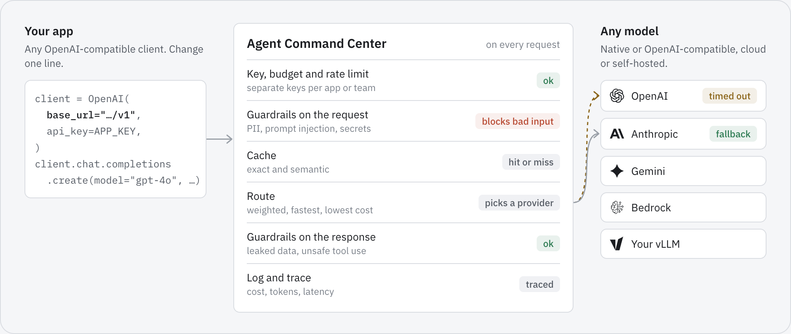

<div align="center">

<a href="https://futureagi.com?utm_source=github&utm_medium=readme&utm_campaign=oss_repo&utm_content=logo">
  <picture>
    <source media="(prefers-color-scheme: dark)" srcset="../../.github/assets/logo-dark.svg">
    
  </picture>
</a>

# A infraestrutura para agentes de IA que se aprimoram

A Future AGI transforma traces, avaliações e simulações de um agente em melhorias no próprio agente. Tem código aberto e pode ser hospedada na sua infraestrutura.

<p>
  <a href="../../LICENSE"></a>
  <a href="https://github.com/future-agi/future-agi/releases/latest"></a>
  <a href="https://hub.docker.com/r/futureagi/standalone"></a>
  <a href="https://pypi.org/project/fi-instrumentation-otel/"></a>
  <a href="https://www.npmjs.com/package/@traceai/fi-core"></a>
  <br>
  <a href="https://discord.com/invite/cBnWkd7T9v"></a>
  <a href="https://x.com/FutureAGI_"></a>
  <a href="https://www.linkedin.com/company/futureagi/"></a>
  <a href="https://github.com/future-agi/future-agi/pulse"></a>
  <a href="https://github.com/future-agi/future-agi/issues?q=is%3Aissue+is%3Aclosed"></a>
</p>

<p>
  <a href="https://app.futureagi.com/auth/jwt/register?utm_source=github&utm_medium=readme&utm_campaign=oss_repo&utm_content=header_cta_cloud"><b>Começar na nuvem (grátis)</b></a> ·
  <a href="#-quickstart"><b>Hospedar na sua infraestrutura</b></a> ·
  <a href="https://docs.futureagi.com?utm_source=github&utm_medium=readme&utm_campaign=oss_repo&utm_content=header_docs"><b>Documentação</b></a> ·
  <a href="https://discord.com/invite/cBnWkd7T9v"><b>Discord</b></a>
</p>

<p>
  <b>SDKs:</b>
  <a href="https://github.com/future-agi/traceAI#python">Python</a> ·
  <a href="https://github.com/future-agi/traceAI#typescript--javascript">TypeScript</a> ·
  <a href="https://github.com/future-agi/traceAI#java">Java</a> ·
  <a href="https://github.com/future-agi/traceAI#go">Go</a> ·
  <a href="https://github.com/future-agi/traceAI#c">C#</a> ·
  <a href="https://github.com/future-agi/futureagi-sdk">Platform SDK</a> ·
  <a href="https://github.com/future-agi/agent-command-center-sdk">Gateway SDK</a>
</p>

<p>
  <sub>
    <a href="../../README.md">English</a> ·
    <a href="README.zh-CN.md">简体中文</a> ·
    <a href="README.ja.md">日本語</a> ·
    <a href="README.ko.md">한국어</a> ·
    <a href="README.es.md">Español</a> ·
    <b>Português</b> ·
    <a href="README.fr.md">Français</a> ·
    <a href="README.de.md">Deutsch</a>
  </sub>
</p>

<a href="https://www.youtube.com/watch?v=6keOTAOUUWI"></a>

</div>

## Como funciona

Um modelo melhor ajuda qualquer agente. Mas, sozinho, o modelo não sabe quais respostas da semana passada estavam erradas, não consegue testar uma correção antes que ela chegue aos usuários nem dizer se a correção quebrou outra coisa. A Future AGI faz esse trabalho por você, em um ciclo que envolve seu agente.

<picture>
  <source media="(prefers-color-scheme: dark)" srcset="../../.github/assets/readme/system-dark.png">
  
</picture>

1. **[Rastreie](#trace-and-monitor)** cada execução do agente, passo a passo.<br><sub>Rastreamento · Sessões e usuários · Avaliações em tempo real · Instant eval · Painéis · Alertas · Feed de erros · Relatórios de análise</sub>
2. **[Avalie](#evaluate-and-label)** cada execução e veja por que ela passou ou falhou.<br><sub>Avaliações com agente, LLM e código · Jev · Avaliações compostas · Conjuntos de dados · Experimentos · Anotações · Avaliações na CI</sub>
3. **[Simule](#simulate-and-test)** usuários realistas interagindo com seu agente em um ambiente de teste criado para ele.<br><sub>Ambientes · Cenários e personas · Texto e voz · Cenários baseados em tráfego real · Depuração de falhas</sub>
4. **[Melhore](#improve)** o agente: encontre uma mudança que corrija as falhas e comprove o resultado antes de colocá-la em produção.<br><sub>Epoch · Otimização de prompts</sub>
5. **[Proteja](#gateway-and-guardrails)** o tráfego de produção com um gateway e mecanismos de proteção. As novas execuções são rastreadas e o ciclo recomeça.<br><sub>Uma API para todos os modelos · Roteamento e alternativas em caso de falha · Mecanismos de proteção · Cache · Chaves e orçamentos · Logs e análises · Experimentos com tráfego espelhado · MCP e A2A</sub>

Para apoiar o ciclo, a seção **[Desenvolvimento](#build)** oferece prompts, Agent Playground, bases de conhecimento, Falcon AI, um servidor MCP e espaços de trabalho para equipes. Comece por qualquer parte. Todas usam os mesmos traces, conjuntos de dados e avaliações. Assim, você pode adicionar a próxima quando precisar.

<a id="-quickstart"></a>
<a id="-quickstart-60-seconds"></a>

<a id="get-started"></a>

## Primeiros passos

**1. Obtenha suas chaves.** [Crie uma conta gratuita na nuvem](https://app.futureagi.com/auth/jwt/register?utm_source=github&utm_medium=readme&utm_campaign=oss_repo&utm_content=quickstart_cloud) ou execute a plataforma na sua máquina com Docker (Compose v2.24+, 2 vCPUs e 4 GB para o Docker):

```bash
git clone https://github.com/future-agi/future-agi.git
cd future-agi
./bin/install          # Windows (PowerShell): .\bin\install.ps1
```

O instalador grava os segredos desta instalação em `.env`, baixa as imagens (cerca de 800 MB) e aguarda até que tudo esteja em execução. A primeira inicialização leva alguns minutos. Depois, abra <http://localhost:3000> e crie sua conta.

Em ambos os casos, abra **Keys** na barra lateral, selecione **Add API Key** e copie a chave de API e a chave secreta antes de fechar a janela.

**2. Instale o SDK e configure suas chaves.**

```bash
pip install -U fi-instrumentation-otel traceai-openai openai
export FI_API_KEY="<your API key>" FI_SECRET_KEY="<your secret key>" FI_PROJECT_NAME="my-agent"
export OPENAI_API_KEY="<your OpenAI key>"
# Somente para hospedagem própria: envie os traces ao coletor da sua instalação
export FI_BASE_URL="http://localhost:4318"
```

**3. Execute sua aplicação com rastreamento automático.** Não é preciso importar módulos de rastreamento no código. Inicie a aplicação com `fi-instrument`. Cada biblioteca que ela usa será rastreada se o pacote traceAI correspondente estiver instalado:

```python
# app.py: código OpenAI comum, sem acréscimos
from openai import OpenAI

response = OpenAI().chat.completions.create(
    model="gpt-4o-mini",
    messages=[{"role": "user", "content": "Plan a three-step onboarding email."}],
)
print(response.choices[0].message.content)
```

```bash
fi-instrument python app.py      # também funciona com uvicorn, celery e outros comandos
```

Abra **Tracing** na barra lateral e selecione `my-agent` para ver a chamada, sua entrada, saída, contagem de tokens e duração. Em seguida, [pontue a chamada com uma avaliação](https://docs.futureagi.com/docs/evaluation?utm_source=github&utm_medium=readme&utm_campaign=oss_repo&utm_content=quickstart_next) ou [crie um ambiente de teste](https://docs.futureagi.com/docs/environments?utm_source=github&utm_medium=readme&utm_campaign=oss_repo&utm_content=quickstart_next) para seu agente.

<details>
<summary><b>Prefere usar uma linha de código?</b></summary>

```python
import fi_instrumentation

fi_instrumentation.init(project_name="my-agent")
# ...código da sua aplicação; a partir daqui, as integrações traceAI instaladas são rastreadas
```

Ou mantenha seu comando de inicialização e defina `FI_AUTO_INSTRUMENT=true`. A maioria das integrações é ativada automaticamente. Algumas, como Strands e Temporal, precisam de uma chamada de configuração. Consulte [rastreamento sem código para Python](https://github.com/future-agi/traceAI/blob/main/docs/python/auto-instrumentation.md) para ver a lista completa, as configurações de privacidade e o comando `fi-instrument doctor`.

</details>

<details>
<summary><b>TypeScript</b></summary>

```bash
npm install "@traceai/fi-core@^1.4.0" @traceai/openai openai
```

Com Node.js 22.23.4 ou posterior, salve o código como `trace.mts` e execute `node trace.mts`:

```typescript
import OpenAI from "openai";
import { register, ProjectType } from "@traceai/fi-core";
import { OpenAIInstrumentation } from "@traceai/openai";

const provider = register({ projectName: "my-agent", projectType: ProjectType.OBSERVE });
const instrumentation = new OpenAIInstrumentation();
instrumentation.setTracerProvider(provider);
instrumentation.manuallyInstrument(OpenAI);

const response = await new OpenAI().chat.completions.create({
  model: "gpt-4o-mini",
  messages: [{ role: "user", content: "Plan a three-step onboarding email." }],
});
console.log(response.choices[0].message.content);
await provider.shutdown(); // envia o trace antes de o script terminar
```

</details>

## O que está incluído

<a id="trace-and-monitor"></a>

### Rastreamento e monitoramento

Veja o que seu agente fez, quanto custou e onde errou.

- **[Tracing](https://docs.futureagi.com/docs/observe?utm_source=github&utm_medium=readme&utm_campaign=oss_repo&utm_content=module_tracing)**: veja cada chamada de LLM, chamada de ferramenta e etapa do agente, com entradas, saídas, tokens, custo e latência, além de um grafo do caminho percorrido pelo agente. O rastreamento usa OpenTelemetry, oferece instrumentação pronta para mais de 50 frameworks e inclui chamadas de voz com suas gravações.
- **[Sessões e usuários](https://docs.futureagi.com/docs/observe/features/users?utm_source=github&utm_medium=readme&utm_campaign=oss_repo&utm_content=module_users)**: agrupe traces por conversa e veja todos os traces e métricas de um usuário final.
- **[Avaliações no tráfego de produção](https://docs.futureagi.com/docs/observe/features/evals?utm_source=github&utm_medium=readme&utm_campaign=oss_repo&utm_content=module_live_evals)**: pontue automaticamente os traces de produção assim que chegarem, em cada span ou em uma amostra.
- **[Instant eval](https://docs.futureagi.com/docs/observe/features/instant-eval?utm_source=github&utm_medium=readme&utm_campaign=oss_repo&utm_content=module_instant_eval)**\*: em qualquer visualização, faça ao Jev uma pergunta de sim ou não ou de classificação sobre traces, sessões ou usuários, como “o assistente resolveu a solicitação?”, sem precisar criar uma avaliação antes.
- **[Dashboards](https://docs.futureagi.com/docs/observe/features/dashboard?utm_source=github&utm_medium=readme&utm_campaign=oss_repo&utm_content=module_dashboards)**: crie e compartilhe gráficos de taxa de erro, latência, tokens, custo e pontuações das avaliações.
- **[Alerts](https://docs.futureagi.com/docs/observe/features/alerts?utm_source=github&utm_medium=readme&utm_campaign=oss_repo&utm_content=module_alerts)**: receba um e-mail ou uma mensagem no Slack quando uma métrica ou pontuação de avaliação cruzar um limite.
- **[Error Feed](https://docs.futureagi.com/docs/error-feed?utm_source=github&utm_medium=readme&utm_campaign=oss_repo&utm_content=module_error_feed)**\*: agrupa traces com falhas por problema, explica a causa provável e sugere uma correção.
- **[Insights](https://docs.futureagi.com/docs/observe/features/insights?utm_source=github&utm_medium=readme&utm_campaign=oss_repo&utm_content=module_insights)**\*: relatórios que classificam traces, sessões ou usuários em categorias, medem a frequência de cada categoria e explicam os resultados com links para exemplos.


<a id="evaluate-and-label"></a>

### Avaliação e rotulagem

Saiba se cada resposta estava correta e por quê. Uma avaliação pode ter o baixo custo de uma expressão regular ou o rigor de um agente que verifica cada afirmação.

| Tipo de avaliação | Como decide | Quando usar |
|---|---|---|
| **Agente como juiz** | Um agente avaliador analisa a execução em várias etapas, consulta informações e dá um veredito com justificativa. | A verificação exige investigação: uma execução longa com várias etapas ou afirmações que precisam de confirmação em outras fontes. |
| **LLM como juiz** | Um modelo compara a saída com seus critérios em uma única passagem e retorna um veredito com justificativa. | O critério de qualidade pode ser descrito em palavras: fidelidade, tom, segurança, cumprimento de instruções ou regras próprias. |
| **Código** | Seu código Python ou JavaScript roda em um ambiente isolado. A mesma entrada produz o mesmo resultado, sem chamada ao modelo. | A resposta pode ser calculada: validade de JSON, correspondência com uma expressão regular, BLEU ou ROUGE, similaridade ou lógica de negócio. |

O **agente como juiz** foi feito para avaliar agentes e trabalha como um revisor cuidadoso:

- **Sem mapeamento de variáveis.** Escreva sua regra em linguagem natural e inclua `{{trace}}`, `{{span}}`, `{{session}}`, `{{row}}` ou `{{call}}`. O juiz recebe o objeto inteiro. Não é preciso associar colunas.
- **Lê a execução inteira.** Em vez de olhar apenas uma entrada e uma saída, o juiz percorre a árvore do trace, span por span, para encontrar a etapa que falhou.
- **Verifica os fatos durante a avaliação.** Ative a [busca na web, suas bases de conhecimento ou suas próprias ferramentas via MCP](https://docs.futureagi.com/docs/evaluation/guides/advanced-usage?utm_source=github&utm_medium=readme&utm_campaign=oss_repo&utm_content=module_agent_tools) para que o juiz confira as afirmações na documentação, no banco de dados ou na web.
- **[Escolha quanto contexto fornecer](https://docs.futureagi.com/docs/evaluation/guides/advanced-usage?utm_source=github&utm_medium=readme&utm_campaign=oss_repo&utm_content=module_data_injection)**: os campos mapeados, a linha do conjunto de dados, o span, o trace inteiro, a sessão inteira ou a transcrição e a gravação de uma chamada.
- **Aceita execuções longas.** Traces e conversas muito longos são compactados para caber no contexto do juiz. Imagens e áudios são mantidos intactos.
- **Escolha a profundidade.** O modo *Quick* responde em uma passagem, o *Agent* investiga em várias etapas e o *Auto* equilibra as duas abordagens. Escolha uma justificativa curta, longa ou personalizada.
- Funciona com sua chave da OpenAI, Anthropic, Bedrock ou Vertex AI, ou com os modelos gerenciados da Future AGI.

- **[Mais de 130 avaliações prontas](https://docs.futureagi.com/docs/evaluation/builtin?utm_source=github&utm_medium=readme&utm_campaign=oss_repo&utm_content=module_builtin_evals)**, incluindo alucinação, fundamentação nas fontes, uso de ferramentas, conclusão de tarefas, informações de identificação pessoal (PII), toxicidade, tom e validade de JSON. Você também pode [criar suas próprias avaliações](https://docs.futureagi.com/docs/evaluation/guides/custom-evals?utm_source=github&utm_medium=readme&utm_campaign=oss_repo&utm_content=module_custom_evals) em linguagem natural ou código.
- **[Escolha o juiz](https://docs.futureagi.com/docs/evaluation/concepts/evaluator-models?utm_source=github&utm_medium=readme&utm_campaign=oss_repo&utm_content=module_judges)**: use o Jev, modelo de decisão da TypeSafe, com sua chave da TypeSafe ou OpenRouter para obter vereditos tipados (aprovação/reprovação, uma categoria ou uma nota na sua escala) com probabilidades; use os Turing models\* da Future AGI para texto, imagem e áudio; ou use seu próprio modelo da OpenAI, Bedrock, Vertex AI, Azure ou de qualquer endpoint.
- **[Avaliações compostas](https://docs.futureagi.com/docs/evaluation/concepts/composite-evals?utm_source=github&utm_medium=readme&utm_campaign=oss_repo&utm_content=module_composite)**: combine várias avaliações com pesos em uma única pontuação com um único limite. Por exemplo, a resposta deve ser fiel *e* ter o tom adequado *e* estar completa.
- **[Localização de erros](https://docs.futureagi.com/docs/evaluation/concepts/error-localization?utm_source=github&utm_medium=readme&utm_campaign=oss_repo&utm_content=module_error_localization)**: quando uma avaliação falha, ela indica qual entrada causou a falha.
- **[Feedback](https://docs.futureagi.com/docs/evaluation/concepts/feedback?utm_source=github&utm_medium=readme&utm_campaign=oss_repo&utm_content=module_feedback)**: corrija um resultado e recalcule a pontuação para alinhar as avaliações ao que sua equipe considera correto.
- **Execute as avaliações onde precisar**: em conjuntos de dados, em traces de produção, em cada chamada simulada, [na CI a cada pull request](https://docs.futureagi.com/docs/evaluation/guides/cicd?utm_source=github&utm_medium=readme&utm_campaign=oss_repo&utm_content=module_cicd) ou como mecanismos de proteção no gateway.
- **[Datasets](https://docs.futureagi.com/docs/dataset?utm_source=github&utm_medium=readme&utm_campaign=oss_repo&utm_content=module_datasets)**: tabelas de casos de teste criadas a partir de arquivos, traces de produção, Hugging Face, do SDK ou de dados gerados. Os prompts e as avaliações são executados nas linhas e gravam os resultados em novas colunas.
- **[Experiments](https://docs.futureagi.com/docs/dataset/guides/run-an-experiment?utm_source=github&utm_medium=readme&utm_campaign=oss_repo&utm_content=module_experiments)**: execute diferentes combinações de prompts, agentes e modelos no mesmo conjunto de dados, compare os resultados lado a lado e escolha a melhor.
- **[Annotations](https://docs.futureagi.com/docs/annotations?utm_source=github&utm_medium=readme&utm_campaign=oss_repo&utm_content=module_annotations)**: filas para revisão humana das saídas, com rótulos, atribuição de tarefas, medição da concordância entre revisores e exportação de volta para um conjunto de dados.


<a id="simulate-and-test"></a>

### Simulação e testes

Teste cada mudança com usuários simulados realistas antes que ela chegue aos usuários reais. Uma transcrição pode dar a impressão de sucesso mesmo quando o agente erra. Por isso, cada chamada de teste é avaliada com base no que realmente mudou.

1. **[Conecte seu agente](https://docs.futureagi.com/docs/environments/guides/build-an-environment?utm_source=github&utm_medium=readme&utm_campaign=oss_repo&utm_content=module_connect)**: use um repositório de código, envie um arquivo ou conecte um agente que já esteja em execução no Vapi, Retell AI, LiveKit ou em um número de telefone.
2. **A plataforma analisa seu agente** e registra sua finalidade, as ferramentas que ele chama, as regras que deve seguir e as tarefas que executa. Faça perguntas ou dê orientações em linguagem natural.
3. **A plataforma cria um ambiente de teste para o agente**: uma cópia de teste de tudo o que as ferramentas acessam, já com os registros necessários para cada cenário. Assim, uma chamada de ferramenta no teste realmente altera algo, mas nunca seus dados de produção.
4. **[Usuários simulados executam os cenários](https://docs.futureagi.com/docs/environments/concepts/scenarios-and-trials?utm_source=github&utm_medium=readme&utm_campaign=oss_repo&utm_content=module_scenarios)** por texto ou voz, cada um com uma persona: nome, idade, personalidade, idioma e sotaque. Execute cada cenário várias vezes para detectar respostas que só falham de vez em quando.
5. **[Cada chamada é avaliada](https://docs.futureagi.com/docs/environments/guides/read-run-results?utm_source=github&utm_medium=readme&utm_campaign=oss_repo&utm_content=module_results)** objetivo por objetivo, com base no estado do ambiente e nas avaliações que você adicionar. Um agente que diz “sua reserva foi cancelada” quando a reserva ainda está ativa é reprovado.
6. **[Debug failures](https://docs.futureagi.com/docs/environments/guides/debug-failures?utm_source=github&utm_medium=readme&utm_campaign=oss_repo&utm_content=module_debug)** lê a execução inteira e explica o que deu errado em cada objetivo. A partir daí, um clique inicia o [Epoch](#improve).

O que o ambiente de teste comporta:

- **Ferramentas de todos os tipos.** Funções integradas, APIs HTTP e servidores MCP respondem a partir do ambiente de teste, para que o agente se comporte exatamente como em produção.
- **As aplicações que seu agente usa**, como uma caixa de e-mail, um espaço de trabalho no Slack ou um calendário, simuladas com conteúdo realista.
- **Os bancos de dados de que ele precisa.** Se o código do agente espera encontrar Postgres, MySQL, ClickHouse, MongoDB, Redis, Qdrant, RabbitMQ, NATS ou MinIO, o gerador de ambientes fornece o serviço.
- **Mais de um participante.** Cenários com vários participantes colocam diversas pessoas simuladas ou agentes na mesma conversa.
- **Escala.** Até 1.000 cenários por geração de ambiente, vários ambientes em paralelo e até 20 repetições por cenário.

Transforme [sessões de produção, chamadas, transcrições ou linhas de conjuntos de dados](https://docs.futureagi.com/docs/environments/guides/import-evidence?utm_source=github&utm_medium=readme&utm_campaign=oss_repo&utm_content=module_import) em cenários. Assim, os casos que falharam na semana passada viram testes executados a cada mudança.


<a id="improve"></a>

### Melhoria

Encontre uma mudança que corrija as falhas e comprove o resultado antes de colocá-la em produção.

- **[Epoch](https://docs.futureagi.com/docs/environments/guides/run-epoch?utm_source=github&utm_medium=readme&utm_campaign=oss_repo&utm_content=module_epoch)**\*: parte de uma execução com falha e busca uma versão do agente que corrija os casos com falha sem quebrar os que já passavam. Você decide o que ele pode mudar (instruções, ferramentas, configurações ou código) e define limites de custo e tempo de resposta. O Epoch verifica o resultado em casos que não viu durante a busca. Você revisa o diff e decide se coloca a mudança em produção.
- **[Otimização de prompts](https://docs.futureagi.com/docs/optimization?utm_source=github&utm_medium=readme&utm_campaign=oss_repo&utm_content=module_optimization)**: melhore um prompt em um conjunto de dados com GEPA, ProTeGi, PromptWizard, busca bayesiana, metaprompting ou busca aleatória e compare cada tentativa com um diff.

<a id="gateway-and-guardrails"></a>

### Gateway e mecanismos de proteção

Chame qualquer modelo por um único endpoint e verifique cada requisição no caminho.

<picture>
  <source media="(prefers-color-scheme: dark)" srcset="../../.github/assets/readme/gateway-dark.png">
  
</picture>

- **[Uma API para todos os modelos](https://docs.futureagi.com/docs/command-center?utm_source=github&utm_medium=readme&utm_campaign=oss_repo&utm_content=module_gateway)**: um endpoint compatível com OpenAI, escrito em Go. Suporte nativo a OpenAI, Anthropic, Gemini, Bedrock, Azure OpenAI e Cohere, além de qualquer provedor compatível com OpenAI, incluindo modelos que você mesmo hospeda.
- **[Roteamento e alternativas em caso de falha](https://docs.futureagi.com/docs/command-center/features/routing?utm_source=github&utm_medium=readme&utm_campaign=oss_repo&utm_content=module_routing)**: roteamento round-robin, ponderado, por menor latência, por menor custo, adaptativo ou por resposta mais rápida, com novas tentativas, failover e circuit breakers.
- **[Mecanismos de proteção](https://docs.futureagi.com/docs/command-center/features/guardrails?utm_source=github&utm_medium=readme&utm_campaign=oss_repo&utm_content=module_guardrails)**: verificadores integrados analisam requisições e respostas em busca de PII, injeção de prompt, vazamento de segredos, uso inseguro de ferramentas e outros problemas. Adicione os Protect models\* da Future AGI ou integre soluções de 15 fornecedores, como Lakera, Presidio e Llama Guard. Teste as regras primeiro em um playground.
- **[Cache](https://docs.futureagi.com/docs/command-center/features/caching?utm_source=github&utm_medium=readme&utm_campaign=oss_repo&utm_content=module_caching)**: cache por correspondência exata ou semântica, em memória, no Redis ou em armazenamento de objetos.
- **[Chaves, orçamentos e limites de requisições](https://docs.futureagi.com/docs/command-center/features/rate-limiting?utm_source=github&utm_medium=readme&utm_campaign=oss_repo&utm_content=module_limits)**: chaves separadas por aplicação ou equipe, com orçamento de gastos e limites de requisições.
- **[Logs e análises](https://docs.futureagi.com/docs/command-center/features/cost-tracking?utm_source=github&utm_medium=readme&utm_campaign=oss_repo&utm_content=module_cost)**: registro de cada requisição com custo, tokens, latência e propriedades definidas por você, além de análises, monitoramento, sessões e webhooks.
- **[Experimentos com tráfego espelhado](https://docs.futureagi.com/docs/command-center/features/shadow-experiments?utm_source=github&utm_medium=readme&utm_campaign=oss_repo&utm_content=module_shadow)**: envie uma cópia de parte do tráfego de produção a outro modelo e compare custo, latência e qualidade antes de trocar.
- **[MCP e A2A](https://docs.futureagi.com/docs/command-center/features/mcp-a2a?utm_source=github&utm_medium=readme&utm_campaign=oss_repo&utm_content=module_mcp)**: envie as chamadas de ferramentas dos seus agentes e o tráfego entre agentes pelo mesmo gateway.

<a id="build"></a>

### Desenvolvimento

- **[Prompts](https://docs.futureagi.com/docs/prompt?utm_source=github&utm_medium=readme&utm_campaign=oss_repo&utm_content=module_prompts)**: escreva templates de prompts, gerencie suas versões, execute-os com dados e modelos reais e monitore seu uso em produção.
- **[Agent Playground](https://docs.futureagi.com/docs/agent-playground?utm_source=github&utm_medium=readme&utm_campaign=oss_repo&utm_content=module_agent_playground)**: monte um agente de várias etapas em um editor visual usando nós de prompt e de agente, execute-o e veja o que cada etapa produziu.
- **[Bases de conhecimento](https://docs.futureagi.com/docs/knowledge-base?utm_source=github&utm_medium=readme&utm_campaign=oss_repo&utm_content=module_knowledge_base)**: envie seus documentos para que prompts e avaliações possam consultá-los.
- **[Falcon AI](https://docs.futureagi.com/docs/falcon-ai?utm_source=github&utm_medium=readme&utm_campaign=oss_repo&utm_content=module_falcon)**\*: um agente dentro do painel. Peça em linguagem natural, por exemplo, “por que este trace falhou?” ou “crie um conjunto de dados a partir destes traces de produção”, e ele executa a tarefa.
- **[Servidor MCP](https://docs.futureagi.com/docs/falcon-ai/guides/use-the-mcp-server?utm_source=github&utm_medium=readme&utm_campaign=oss_repo&utm_content=module_mcp_server)**: use a Future AGI diretamente no editor ou no agente de programação, por exemplo, para encontrar traces com falhas e corrigi-las sem sair de onde está trabalhando.
- **Espaços de trabalho e acesso**: cada equipe tem espaços de trabalho, membros e funções separados, com logs de auditoria e SCIM para organizações maiores.

<sub>\* Requer Future AGI Cloud ou uma chave de licença Enterprise em uma instalação própria. Consulte [Código aberto e seus dados](#open-source-and-your-data).</sub>

## Compatibilidade com sua stack

<picture>
  <source media="(prefers-color-scheme: dark)" srcset="../../.github/assets/readme/integrations-dark.png">
  
</picture>

A Future AGI usa interfaces abertas, então você pode manter o framework e os modelos que já usa: OpenTelemetry para traces, uma API compatível com OpenAI para o gateway e SQL no Postgres e no ClickHouse para armazenamento.

| Integração | Linguagens | Como conectar |
|---|---|---|
| [OpenTelemetry](https://docs.futureagi.com/docs/observe?utm_source=github&utm_medium=readme&utm_campaign=oss_repo&utm_content=int_otel) | Qualquer uma | Envie traces via OTLP pela aplicação ou pelo coletor. |
| [Rastreamento automático](https://github.com/future-agi/traceAI/blob/main/docs/python/auto-instrumentation.md) | Python | Inicie a aplicação com `fi-instrument`. A maioria das bibliotecas com um pacote traceAI é rastreada sem mudanças no código. Algumas exigem uma chamada de configuração. |
| [SDKs traceAI](https://github.com/future-agi/traceAI) | Python, TypeScript, Java, Go, C# | Instrumentação em Python e TypeScript, wrappers de cliente em Java, middleware em Go e spans em C#. |
| LangChain e LangGraph | Python, TypeScript | `traceai-langchain` ou `@traceai/langchain` |
| OpenAI e OpenAI Agents SDK | Python, TypeScript | `traceai-openai`, `traceai-openai-agents` |
| Anthropic e Claude Agent SDK | Python, TypeScript | `traceai-anthropic`, `traceai-claude-agent-sdk` |
| LlamaIndex | Python, TypeScript | `traceai-llamaindex` ou `@traceai/llamaindex` |
| CrewAI, AutoGen, DSPy, PydanticAI, Google ADK | Python | Um pacote traceAI para cada um |
| Vercel AI SDK, Mastra | TypeScript | `@traceai/vercel`, `@traceai/mastra` |
| [Agent Command Center](https://docs.futureagi.com/docs/command-center?utm_source=github&utm_medium=readme&utm_campaign=oss_repo&utm_content=int_gateway) | Qualquer cliente compatível com OpenAI | Configure a URL base do cliente para apontar para o gateway. |
| [Servidor MCP](https://docs.futureagi.com/docs/falcon-ai/guides/use-the-mcp-server?utm_source=github&utm_medium=readme&utm_campaign=oss_repo&utm_content=int_mcp) | Qualquer cliente MCP | Use a Future AGI no editor ou no agente de programação. |
| Vapi, Retell AI, LiveKit | Agentes de voz | Use o Simulate para testá-los onde já estão em execução. |
| LiveKit, Pipecat | Python | Rastreie pipelines de voz com `traceai-livekit` e `traceai-pipecat`. |

Também há suporte a Pinecone, Weaviate, Chroma, LanceDB, Agno, Strands, Semantic Kernel, BeeAI, Cerebras, Vertex AI, SageMaker e outros no [traceAI](https://github.com/future-agi/traceAI).

<details>
<summary><b>SDKs</b></summary>

| Pacote | Instalação | O que oferece |
|---|---|---|
| [traceAI](https://github.com/future-agi/traceAI) | `pip install fi-instrumentation-otel` · `npm i @traceai/fi-core` | Rastreamento com OpenTelemetry para frameworks de IA, com rastreamento automático sem código para Python |
| [futureagi](https://github.com/future-agi/futureagi-sdk) | `pip install futureagi` | Platform SDK: conjuntos de dados, prompts, bases de conhecimento e avaliações |
| [agent-learning-kit](https://github.com/future-agi/agent-learning-kit) | `pip install agent-learning-kit` | Testes, simulação e otimização de agentes em ambiente local |
| [agentcc](https://github.com/future-agi/agent-command-center-sdk) | `pip install agentcc` · `npm i @agentcc/client` | SDKs de cliente para o gateway |

</details>

[Todas as integrações →](https://docs.futureagi.com/docs/integrations?utm_source=github&utm_medium=readme&utm_campaign=oss_repo&utm_content=integrations_catalog)

## Hospedagem própria

| | **Standalone** (padrão) | **Distributed** | **Kubernetes** |
|---|---|---|---|
| Instalação | `./bin/install` | `./bin/install --distributed` | [Chart do Helm](../../deploy/helm/futureagi) |
| O que é executado | um contêiner da aplicação, Postgres e ClickHouse | um contêiner por serviço, PeerDB e Kafka | a configuração Distributed no Kubernetes 1.27+ |
| Recursos | 2 vCPUs, 4 GB | 4 ou mais vCPUs, 12–16 GB | cerca de 4 CPUs e 8 GiB para testar |

**Escolha antes de adicionar dados:** não há um método com suporte para migrar depois os dados de uma instalação Standalone para Distributed ou Helm ([Mudança de modo](../../INSTALLATION.md#switching-between-standalone-and-distributed)). Se as atualizações automáticas estiverem ativadas na instalação, conclua a [transição segura para operações manuais](../../deploy/update/README.md#safe-handoff-to-manual-operations) antes de interrompê-la ou desinstalá-la.

Para todas as opções, atualizações, instalações em redes isoladas e solução de problemas, consulte [INSTALLATION.md](../../INSTALLATION.md), [deploy/README.md](../../deploy/README.md) e o [guia de hospedagem própria](https://docs.futureagi.com/docs/self-hosting?utm_source=github&utm_medium=readme&utm_campaign=oss_repo&utm_content=self_host).

<a id="open-source-and-your-data"></a>

## Código aberto e seus dados

O núcleo usa a licença Apache 2.0. O código nos diretórios chamados `ee/` é regido pela [licença Enterprise da Future AGI](../../LICENSE-EE). Em uma instalação própria, os recursos Error Feed, Insights, Instant eval, Turing models, Protect models e Epoch exigem uma chave de licença Enterprise que os inclua. O Falcon AI exige um plano Enterprise. Consulte os detalhes na [referência da edição Enterprise](https://docs.futureagi.com/docs/self-hosting/configuration/reference#enterprise-edition). As avaliações com Jev funcionam em todas as edições com sua própria chave da TypeSafe ou OpenRouter. Consulte também [NOTICE](../../NOTICE).

<a id="telemetry"></a>

### Telemetria

Instalações próprias enviam telemetria de implantação, **ativada por padrão**: primeiro, um registro que inclui os **endereços e domínios de e-mail das contas do proprietário, de administradores e de membros da equipe da instalação**; depois, contagens periódicas de uso. **Nunca são enviados traces, prompts, respostas de modelos, conjuntos de dados ou chaves de API.** Para desativar a telemetria, instale com `./bin/install --no-telemetry` ou defina `FUTURE_AGI_TELEMETRY_DISABLED=true` em `.env` (`config.telemetry=false` no Helm). Mesmo com a telemetria desativada, a instalação envia um registro sem endereços de e-mail. Para não enviar nada, bloqueie `api.futureagi.com`. A página [Telemetria e conexões de saída](https://docs.futureagi.com/docs/self-hosting/configuration/telemetry) lista o conteúdo exato dos dados enviados e todas as conexões de saída.

## Suporte

Onde encontrar respostas:

- A [documentação](https://docs.futureagi.com?utm_source=github&utm_medium=readme&utm_campaign=oss_repo&utm_content=support_docs) cobre todos os recursos, com guias e exemplos práticos. Sugira alterações na documentação pelo GitHub.
- As [perguntas frequentes](https://docs.futureagi.com/docs/faq?utm_source=github&utm_medium=readme&utm_campaign=oss_repo&utm_content=support_faq) trazem respostas para as dúvidas mais comuns.
- Com o [servidor MCP](https://docs.futureagi.com/docs/falcon-ai/guides/use-the-mcp-server?utm_source=github&utm_medium=readme&utm_campaign=oss_repo&utm_content=support_mcp), seu editor ou agente de programação pode consultar informações no seu espaço de trabalho.

Canais de suporte:

- **Faça uma pergunta** no [GitHub Discussions](https://github.com/orgs/future-agi/discussions) ou no [Discord](https://discord.com/invite/cBnWkd7T9v). Inclua código, capturas de tela e versões para agilizar o atendimento.
- **Relate um bug** ou **solicite um recurso** usando os [modelos de issue](https://github.com/future-agi/future-agi/issues/new/choose).
- **Conta na nuvem ou cobrança:** envie um e-mail para [support@futureagi.com](mailto:support@futureagi.com).
- **Segurança:** comunique vulnerabilidades de forma privada, conforme descrito em [SECURITY.md](../../SECURITY.md).
- **Status do serviço:** [status.futureagi.com](https://status.futureagi.com).

## Como contribuir

Contribuições são bem-vindas:

- Leia [CONTRIBUTING.md](../../CONTRIBUTING.md) para configurar um ambiente de desenvolvimento. Depois, escolha uma issue com o rótulo [`good first issue`](https://github.com/future-agi/future-agi/issues?q=is%3Aissue+is%3Aopen+label%3A%22good+first+issue%22).
- Comente nas [issues](https://github.com/future-agi/future-agi/issues) e compartilhe ideias nas [discussões](https://github.com/orgs/future-agi/discussions).
- Acompanhe as novidades no [roteiro público de desenvolvimento](https://futureagi.com/roadmap?utm_source=github&utm_medium=readme&utm_campaign=oss_repo&utm_content=roadmap), nas [versões](https://github.com/future-agi/future-agi/releases) e no [histórico de alterações](../../CHANGELOG.md).

Acompanhe a Future AGI no [X](https://x.com/FutureAGI_), no [LinkedIn](https://www.linkedin.com/company/futureagi/), no [YouTube](https://www.youtube.com/@Future_AGI) e no [blog](https://futureagi.com/blog?utm_source=github&utm_medium=readme&utm_campaign=oss_repo&utm_content=community).

## Histórico de estrelas

<a href="https://star-history.com/#future-agi/future-agi&Date">
  <picture>
    <source media="(prefers-color-scheme: dark)" srcset="https://api.star-history.com/svg?repos=future-agi/future-agi&type=Date&theme=dark">
    
  </picture>
</a>

<div align="center">

Se a Future AGI ajuda seu agente a melhorar, uma ⭐ ajuda outros desenvolvedores a encontrar o projeto.

</div>