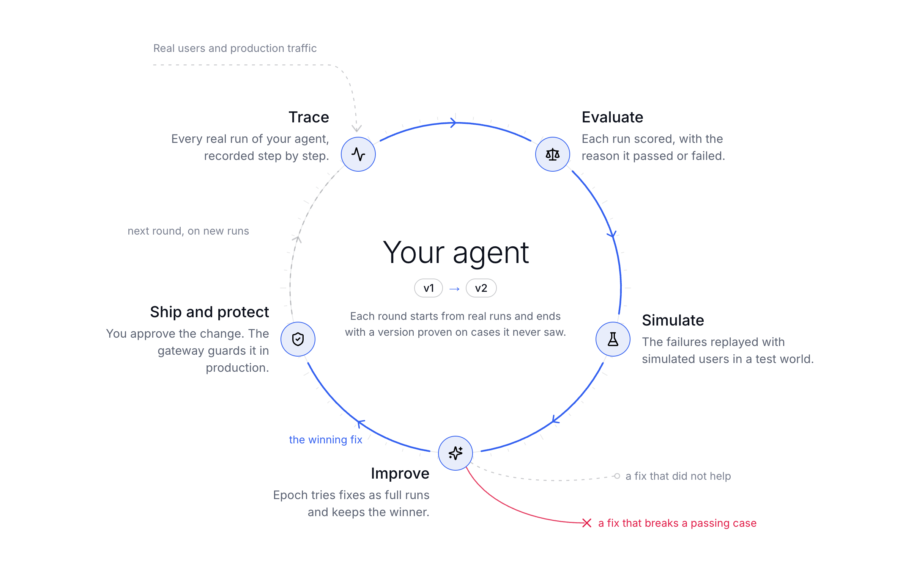
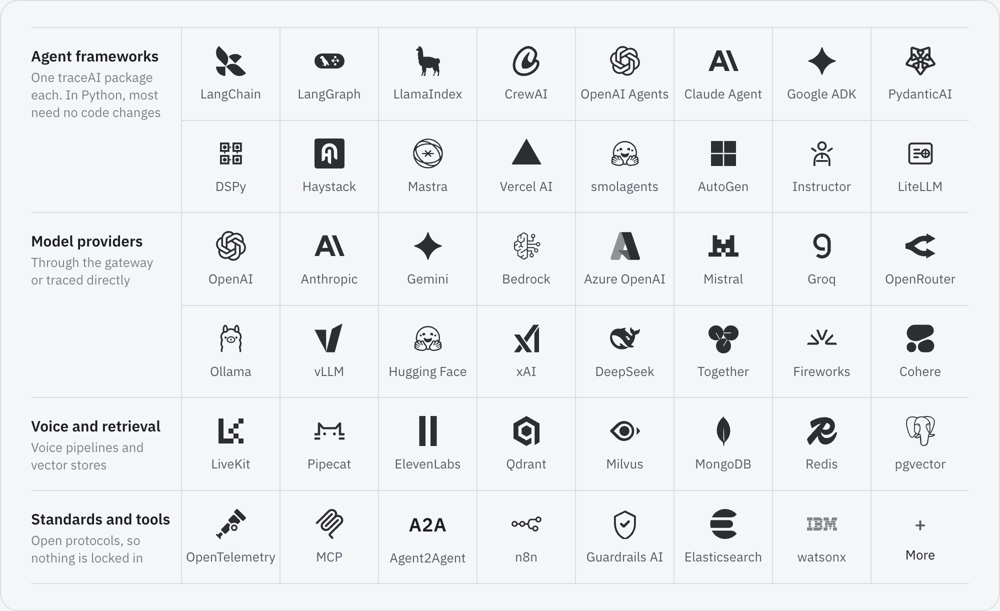

<div align="center">

<a href="https://futureagi.com?utm_source=github&utm_medium=readme&utm_campaign=oss_repo&utm_content=logo">
  <picture>
    <source media="(prefers-color-scheme: dark)" srcset="../../.github/assets/logo-dark.svg">
    
  </picture>
</a>

# 用于自我改进型 AI 智能体的基础设施

Future AGI 利用智能体的追踪记录、评测结果和模拟测试来改进智能体本身。项目开源，支持自托管。

<p>
  <a href="../../LICENSE"></a>
  <a href="https://github.com/future-agi/future-agi/releases/latest"></a>
  <a href="https://hub.docker.com/r/futureagi/standalone"></a>
  <a href="https://pypi.org/project/fi-instrumentation-otel/"></a>
  <a href="https://www.npmjs.com/package/@traceai/fi-core"></a>
  <br>
  <a href="https://discord.com/invite/cBnWkd7T9v"></a>
  <a href="https://x.com/FutureAGI_"></a>
  <a href="https://www.linkedin.com/company/futureagi/"></a>
  <a href="https://github.com/future-agi/future-agi/pulse"></a>
  <a href="https://github.com/future-agi/future-agi/issues?q=is%3Aissue+is%3Aclosed"></a>
</p>

<p>
  <a href="https://app.futureagi.com/auth/jwt/register?utm_source=github&utm_medium=readme&utm_campaign=oss_repo&utm_content=header_cta_cloud"><b>免费使用云服务</b></a> ·
  <a href="#-quickstart"><b>自托管</b></a> ·
  <a href="https://docs.futureagi.com?utm_source=github&utm_medium=readme&utm_campaign=oss_repo&utm_content=header_docs"><b>文档</b></a> ·
  <a href="https://discord.com/invite/cBnWkd7T9v"><b>Discord</b></a>
</p>

<p>
  <b>SDK：</b>
  <a href="https://github.com/future-agi/traceAI#python">Python</a> ·
  <a href="https://github.com/future-agi/traceAI#typescript--javascript">TypeScript</a> ·
  <a href="https://github.com/future-agi/traceAI#java">Java</a> ·
  <a href="https://github.com/future-agi/traceAI#go">Go</a> ·
  <a href="https://github.com/future-agi/traceAI#c">C#</a> ·
  <a href="https://github.com/future-agi/futureagi-sdk">Platform SDK</a> ·
  <a href="https://github.com/future-agi/agent-command-center-sdk">Gateway SDK</a>
</p>

<p>
  <sub>
    <a href="../../README.md">English</a> ·
    <b>简体中文</b> ·
    <a href="README.ja.md">日本語</a> ·
    <a href="README.ko.md">한국어</a> ·
    <a href="README.es.md">Español</a> ·
    <a href="README.pt-BR.md">Português</a> ·
    <a href="README.fr.md">Français</a> ·
    <a href="README.de.md">Deutsch</a>
  </sub>
</p>

<a href="https://www.youtube.com/watch?v=6keOTAOUUWI"></a>

</div>

## 工作原理

更好的模型对每个智能体都有帮助。但单靠模型，你并不知道上周哪些回答有误，也无法在用户看到改动前测试修复方案，或确认修复是否引入了其他问题。Future AGI 围绕你的智能体循环执行以下步骤，完成这些工作。

<picture>
  <source media="(prefers-color-scheme: dark)" srcset="../../.github/assets/readme/system-dark.png">
  
</picture>

1. <b>[追踪](#trace-and-monitor)</b> 智能体每次运行的每个步骤。<br><sub>链路追踪 · 会话与用户 · 在线评测 · Instant eval · 仪表板 · 告警 · 错误列表 · 分析报告</sub>
2. <b>[评测](#evaluate-and-label)</b> 每次运行，了解通过或失败的原因。<br><sub>智能体、LLM 和代码评测 · Jev · 组合评测 · 数据集 · 实验 · 标注 · CI 中的评测</sub>
3. <b>[模拟](#simulate-and-test)</b> 真实用户，在为智能体搭建的测试环境中与它交互。<br><sub>环境 · 场景与用户角色 · 文本与语音 · 来自真实流量的场景 · 失败排查</sub>
4. <b>[改进](#improve)</b> 智能体：找到能修复失败用例的改动，并在发布前验证。<br><sub>Epoch · 提示词优化</sub>
5. <b>[防护](#gateway-and-guardrails)</b>：通过网关和防护规则保护线上流量。系统会追踪新的运行，开始下一轮循环。<br><sub>用一个 API 调用所有模型 · 路由与回退 · 防护规则 · 缓存 · 密钥与预算 · 日志与分析 · 影子实验 · MCP 和 A2A</sub>

除了上述循环，<b>[构建](#build)</b> 功能还提供提示词、Agent Playground、知识库、Falcon AI、MCP 服务器和团队工作区。你可以从任一部分开始。这些功能共用追踪记录、数据集和评测，需要时再接入其他部分即可。

<a id="-quickstart"></a>
<a id="-quickstart-60-seconds"></a>

<a id="get-started"></a>

## 快速开始

<b>1. 获取密钥。</b> [创建免费的云账号](https://app.futureagi.com/auth/jwt/register?utm_source=github&utm_medium=readme&utm_campaign=oss_repo&utm_content=quickstart_cloud)，或使用 Docker 在本机运行（需要 Compose v2.24 或更高版本，并为 Docker 分配 2 个 vCPU 和 4 GB 内存）：

```bash
git clone https://github.com/future-agi/future-agi.git
cd future-agi
./bin/install          # Windows（PowerShell）：.\bin\install.ps1
```

安装程序会将本次部署的密钥写入 `.env`，拉取镜像（约 800 MB），然后等待所有服务就绪。首次启动需要几分钟。之后，打开 <http://localhost:3000> 并创建账号。

无论采用哪种方式，都请在侧边栏打开 <b>Keys</b>，选择 <b>Add API Key</b>，并在关闭对话框前复制 API key 和 secret key。

<b>2. 安装 SDK 并设置密钥。</b>

```bash
pip install -U fi-instrumentation-otel traceai-openai openai
export FI_API_KEY="<your API key>" FI_SECRET_KEY="<your secret key>" FI_PROJECT_NAME="my-agent"
export OPENAI_API_KEY="<your OpenAI key>"
# 仅限自托管：将追踪数据发送到本次部署的采集器
export FI_BASE_URL="http://localhost:4318"
```

<b>3. 启用自动追踪并运行应用。</b> 无需在代码中导入追踪模块。通过 `fi-instrument` 启动应用，只要安装了所用库对应的 traceAI 包，就会自动追踪该库的调用：

```python
# app.py：普通的 OpenAI 代码，无需添加追踪逻辑
from openai import OpenAI

response = OpenAI().chat.completions.create(
    model="gpt-4o-mini",
    messages=[{"role": "user", "content": "Plan a three-step onboarding email."}],
)
print(response.choices[0].message.content)
```

```bash
fi-instrument python app.py      # 也适用于 uvicorn、celery 等命令
```

在侧边栏打开 <b>Tracing</b>，选择 `my-agent`，即可查看这次调用的输入、输出、token 数和耗时。接下来可以[通过评测为这次调用打分](https://docs.futureagi.com/docs/evaluation?utm_source=github&utm_medium=readme&utm_campaign=oss_repo&utm_content=quickstart_next)，或[为智能体搭建测试环境](https://docs.futureagi.com/docs/environments?utm_source=github&utm_medium=readme&utm_campaign=oss_repo&utm_content=quickstart_next)。

<details>
<summary><b>想在代码中用一行调用启用追踪？</b></summary>

```python
import fi_instrumentation

fi_instrumentation.init(project_name="my-agent")
# ……在这里编写应用代码；从这里开始追踪已安装的 traceAI 集成
```

也可以保留原来的启动命令，设置 `FI_AUTO_INSTRUMENT=true`。大多数集成会自动启用；Strands 和 Temporal 等少数集成需要调用一次初始化函数。完整列表、隐私设置和 `fi-instrument doctor` 的用法见 [Python 零代码追踪](https://github.com/future-agi/traceAI/blob/main/docs/python/auto-instrumentation.md)。

</details>

<details>
<summary><b>TypeScript</b></summary>

```bash
npm install "@traceai/fi-core@^1.4.0" @traceai/openai openai
```

使用 Node.js 22.23.4 或更高版本时，将以下代码保存为 `trace.mts`，然后运行 `node trace.mts`：

```typescript
import OpenAI from "openai";
import { register, ProjectType } from "@traceai/fi-core";
import { OpenAIInstrumentation } from "@traceai/openai";

const provider = register({ projectName: "my-agent", projectType: ProjectType.OBSERVE });
const instrumentation = new OpenAIInstrumentation();
instrumentation.setTracerProvider(provider);
instrumentation.manuallyInstrument(OpenAI);

const response = await new OpenAI().chat.completions.create({
  model: "gpt-4o-mini",
  messages: [{ role: "user", content: "Plan a three-step onboarding email." }],
});
console.log(response.choices[0].message.content);
await provider.shutdown(); // 在脚本退出前发送追踪数据
```

</details>

## 功能概览

<a id="trace-and-monitor"></a>

### 追踪与监控

查看智能体做了什么、花费多少，以及哪一步出了问题。

- <b>[Tracing](https://docs.futureagi.com/docs/observe?utm_source=github&utm_medium=readme&utm_campaign=oss_repo&utm_content=module_tracing)</b>：记录每次 LLM 调用、工具调用和智能体步骤，包括输入、输出、token 数、成本和延迟，并以图展示执行路径。基于 OpenTelemetry，为 50 多种框架提供现成的插桩工具，也支持追踪语音通话并查看录音。
- <b>[会话与用户](https://docs.futureagi.com/docs/observe/features/users?utm_source=github&utm_medium=readme&utm_campaign=oss_repo&utm_content=module_users)</b>：按对话归集追踪记录，查看单个终端用户的所有追踪记录和指标。
- <b>[线上流量评测](https://docs.futureagi.com/docs/observe/features/evals?utm_source=github&utm_medium=readme&utm_campaign=oss_repo&utm_content=module_live_evals)</b>：生产环境的追踪数据到达时自动评分，可评测每个 span，也可抽样评测。
- <b>[Instant eval](https://docs.futureagi.com/docs/observe/features/instant-eval?utm_source=github&utm_medium=readme&utm_campaign=oss_repo&utm_content=module_instant_eval)</b>\*：针对任意视图中的追踪记录、会话或用户，向 Jev 提出是非题或分类问题，例如“助手解决了用户的请求吗？”，无需先创建评测。
- <b>[Dashboards](https://docs.futureagi.com/docs/observe/features/dashboard?utm_source=github&utm_medium=readme&utm_campaign=oss_repo&utm_content=module_dashboards)</b>：创建和分享图表，展示错误率、延迟、token 数、成本和评测分数。
- <b>[Alerts](https://docs.futureagi.com/docs/observe/features/alerts?utm_source=github&utm_medium=readme&utm_campaign=oss_repo&utm_content=module_alerts)</b>：当指标或评测分数越过阈值时，通过邮件或 Slack 消息接收通知。
- <b>[Error Feed](https://docs.futureagi.com/docs/error-feed?utm_source=github&utm_medium=readme&utm_campaign=oss_repo&utm_content=module_error_feed)</b>\*：将失败的追踪记录按问题归类，解释可能的原因并建议修复方法。
- <b>[Insights](https://docs.futureagi.com/docs/observe/features/insights?utm_source=github&utm_medium=readme&utm_campaign=oss_repo&utm_content=module_insights)</b>\*：生成报告，对追踪记录、会话或用户进行分类，统计各类出现的频率，并提供可点击的示例来解释结果。


<a id="evaluate-and-label"></a>

### 评测与标注

了解每个回答是否正确以及原因。评测可以只用一个低成本的正则表达式，也可以让智能体逐条核实回答中的说法。

| 评测类型 | 判断方式 | 适用场景 |
|---|---|---|
| <b>智能体评审</b> | 评审智能体分步检查运行过程，查证信息，再给出结论和理由。 | 需要调查，例如检查较长的多步运行，或核实需要查证的说法。 |
| <b>LLM 评审</b> | 模型对照你的标准，一次读完输出并给出结论和理由。 | 可以用语言描述的质量要求，例如内容忠实度、语气、安全性、是否遵循指令或自定义规则。 |
| <b>代码评测</b> | 在沙箱中运行你的 Python 或 JavaScript 代码。相同输入得到相同结果，无需调用模型。 | 可以通过计算判断，例如 JSON 合法性、正则匹配、BLEU 或 ROUGE 分数、相似度或业务逻辑。 |

<b>智能体评审</b>专为评测智能体设计，检查方式类似于人工仔细审查：

- <b>无需映射变量。</b> 用自然语言编写规则，并在其中写入 `{{trace}}`、`{{span}}`、`{{session}}`、`{{row}}` 或 `{{call}}`，评审智能体就会收到整个对象，无需逐列绑定。
- <b>检查完整运行过程。</b> 评审智能体不只查看一次输入和输出，还会逐个 span 遍历追踪树，找出出错的步骤。
- <b>在评审时核实事实。</b> 启用[网络搜索、知识库或通过 MCP 接入的自有工具](https://docs.futureagi.com/docs/evaluation/guides/advanced-usage?utm_source=github&utm_medium=readme&utm_campaign=oss_repo&utm_content=module_agent_tools)，即可对照文档、数据库或网上的信息核实回答。
- <b>[选择评审所需的上下文](https://docs.futureagi.com/docs/evaluation/guides/advanced-usage?utm_source=github&utm_medium=readme&utm_campaign=oss_repo&utm_content=module_data_injection)</b>：可以提供映射的字段、数据集中的一行、一个 span、整条追踪记录、整个会话，或一次通话的转录文本和录音。
- <b>支持长任务。</b> 系统会压缩很长的追踪记录和对话，使其适配评审模型的上下文窗口，同时保留完整的图像和音频。
- <b>选择评审深度。</b> *Quick* 一次给出结论，*Agent* 分步调查，*Auto* 在两者之间权衡。理由说明可选简短、详细或自定义格式。
- 可使用你自己的 OpenAI、Anthropic、Bedrock 或 Vertex AI 密钥，也可使用 Future AGI 托管的模型。

- <b>[130 多项内置评测](https://docs.futureagi.com/docs/evaluation/builtin?utm_source=github&utm_medium=readme&utm_campaign=oss_repo&utm_content=module_builtin_evals)</b>，涵盖幻觉、回答是否有据可依、工具使用、任务完成情况、个人身份信息（PII）、有害内容、语气和 JSON 合法性等，也可以用自然语言或代码[编写自己的评测](https://docs.futureagi.com/docs/evaluation/guides/custom-evals?utm_source=github&utm_medium=readme&utm_campaign=oss_repo&utm_content=module_custom_evals)。
- <b>[选择评审模型](https://docs.futureagi.com/docs/evaluation/concepts/evaluator-models?utm_source=github&utm_medium=readme&utm_campaign=oss_repo&utm_content=module_judges)</b>：通过 TypeSafe 或 OpenRouter 密钥使用 TypeSafe 的决策模型 Jev，获得带概率的指定类型结果（通过或失败、单个类别，或按评分标准给出的分数）；使用 Future AGI 的 Turing models\* 评测文本、图像和音频；也可以使用来自 OpenAI、Bedrock、Vertex AI、Azure 或任意端点的自选模型。
- <b>[组合评测](https://docs.futureagi.com/docs/evaluation/concepts/composite-evals?utm_source=github&utm_medium=readme&utm_campaign=oss_repo&utm_content=module_composite)</b>：将多项评测加权合并为一个分数，并设定统一阈值，例如要求回答同时满足内容忠实、语气恰当和信息完整三项标准。
- <b>[错误定位](https://docs.futureagi.com/docs/evaluation/concepts/error-localization?utm_source=github&utm_medium=readme&utm_campaign=oss_repo&utm_content=module_error_localization)</b>：评测失败时，指出是哪项输入导致了失败。
- <b>[反馈](https://docs.futureagi.com/docs/evaluation/concepts/feedback?utm_source=github&utm_medium=readme&utm_campaign=oss_repo&utm_content=module_feedback)</b>：纠正结果并重新评分，让评测逐步符合团队对“正确”的定义。
- <b>在不同环节运行评测</b>：评测数据集、线上追踪记录或每次模拟通话，[在 CI 中评测每个拉取请求](https://docs.futureagi.com/docs/evaluation/guides/cicd?utm_source=github&utm_medium=readme&utm_campaign=oss_repo&utm_content=module_cicd)，也可将评测用作网关的防护规则。
- <b>[Datasets](https://docs.futureagi.com/docs/dataset?utm_source=github&utm_medium=readme&utm_campaign=oss_repo&utm_content=module_datasets)</b>：用文件、生产追踪记录、Hugging Face、SDK 或生成的数据构建测试用例表。逐行运行提示词和评测，并将结果写回新列。
- <b>[Experiments](https://docs.futureagi.com/docs/dataset/guides/run-an-experiment?utm_source=github&utm_medium=readme&utm_campaign=oss_repo&utm_content=module_experiments)</b>：在同一数据集上运行多种提示词、智能体和模型组合，并排比较结果，选出最佳组合。
- <b>[Annotations](https://docs.futureagi.com/docs/annotations?utm_source=github&utm_medium=readme&utm_campaign=oss_repo&utm_content=module_annotations)</b>：通过队列分配人工审核任务、为输出添加标签、查看审核者之间的一致性，并将结果导出到数据集。


<a id="simulate-and-test"></a>

### 模拟与测试

在真实用户接触改动之前，先用拟真的模拟用户测试每项改动。仅看对话文本，智能体即使做错了也可能像是通过了测试，因此每次测试交互都会核对环境中实际发生的变化。

1. <b>[接入智能体](https://docs.futureagi.com/docs/environments/guides/build-an-environment?utm_source=github&utm_medium=readme&utm_campaign=oss_repo&utm_content=module_connect)</b>：可以连接代码仓库、上传文件，也可以接入运行在 Vapi、Retell AI、LiveKit 上或可通过电话号码拨打的智能体。
2. <b>系统分析智能体</b>，记录它的用途、调用的工具、必须遵守的规则和处理的任务。你可以用自然语言向系统提问或给出指导。
3. <b>系统为智能体搭建测试环境</b>：为工具访问的所有资源创建测试副本，并填入每个场景所需的记录。这样，测试中的工具调用确实会改变环境状态，但绝不会改动线上数据。
4. <b>[模拟用户执行各个场景](https://docs.futureagi.com/docs/environments/concepts/scenarios-and-trials?utm_source=github&utm_medium=readme&utm_campaign=oss_repo&utm_content=module_scenarios)</b>，通过文本或语音交互。每个用户都有自己的姓名、年龄、性格、语言和口音。多次运行同一场景，可以发现偶尔才会出错的回答。
5. <b>[为每次交互评分](https://docs.futureagi.com/docs/environments/guides/read-run-results?utm_source=github&utm_medium=readme&utm_campaign=oss_repo&utm_content=module_results)</b>：对照测试环境的状态逐项检查目标，并运行你添加的评测。如果智能体说“你的预订已取消”，但预订实际上仍然有效，测试就不通过。
6. <b>[Debug failures](https://docs.futureagi.com/docs/environments/guides/debug-failures?utm_source=github&utm_medium=readme&utm_campaign=oss_repo&utm_content=module_debug)</b> 会读取完整的运行记录，逐项解释哪些目标出了问题。随后只需点击一次即可启动 [Epoch](#improve)。

测试环境支持：

- <b>各类工具。</b> 内置函数、HTTP API 和 MCP 服务器均根据测试环境的状态返回结果，因此智能体的行为与生产环境一致。
- <b>智能体使用的应用</b>，例如邮箱、Slack 工作区或日历，其中填有贴近实际的模拟内容。
- <b>智能体依赖的数据库等服务。</b> 如果智能体代码需要 Postgres、MySQL、ClickHouse、MongoDB、Redis、Qdrant、RabbitMQ、NATS 或 MinIO，环境构建器会提供相应服务。
- <b>多方参与。</b> 多人场景允许多个模拟用户或智能体加入同一对话。
- <b>批量测试。</b> 每次构建最多支持 1,000 个场景，可并行运行多个测试环境，每个场景最多重复 20 次。

将[生产环境中的会话、通话、转录文本或数据集行](https://docs.futureagi.com/docs/environments/guides/import-evidence?utm_source=github&utm_medium=readme&utm_campaign=oss_repo&utm_content=module_import)转换为场景，就能针对上周出过问题的案例，在每次改动后运行回归测试。


<a id="improve"></a>

### 改进

找到能修复失败用例的改动，并在发布前验证。

- <b>[Epoch](https://docs.futureagi.com/docs/environments/guides/run-epoch?utm_source=github&utm_medium=readme&utm_campaign=oss_repo&utm_content=module_epoch)</b>\*：从一次失败的运行开始，寻找既能修复失败用例，又不会导致原有用例不再通过的智能体版本。你决定允许改动哪些内容（指令、工具、设置或代码），并设定成本和响应时间上限。Epoch 使用搜索过程中从未见过的用例验证结果。你可以查看差异，再决定是否发布。
- <b>[提示词优化](https://docs.futureagi.com/docs/optimization?utm_source=github&utm_medium=readme&utm_campaign=oss_repo&utm_content=module_optimization)</b>：在数据集上使用 GEPA、ProTeGi、PromptWizard、贝叶斯搜索、元提示或随机搜索来改进提示词，并通过差异对比查看每次试验的改动。

<a id="gateway-and-guardrails"></a>

### 网关与防护规则

通过一个端点调用任意模型，并在转发过程中检查每个请求。

<picture>
  <source media="(prefers-color-scheme: dark)" srcset="../../.github/assets/readme/gateway-dark.png">
  
</picture>

- <b>[用一个 API 调用所有模型](https://docs.futureagi.com/docs/command-center?utm_source=github&utm_medium=readme&utm_campaign=oss_repo&utm_content=module_gateway)</b>：用 Go 编写的 OpenAI 兼容端点。原生支持 OpenAI、Anthropic、Gemini、Bedrock、Azure OpenAI 和 Cohere，也支持任何兼容 OpenAI 的提供商，包括你自己托管的模型。
- <b>[路由与回退](https://docs.futureagi.com/docs/command-center/features/routing?utm_source=github&utm_medium=readme&utm_campaign=oss_repo&utm_content=module_routing)</b>：支持轮询、加权、最低延迟、最低成本、自适应或最快响应路由，并提供重试、故障转移和熔断机制。
- <b>[防护规则](https://docs.futureagi.com/docs/command-center/features/guardrails?utm_source=github&utm_medium=readme&utm_campaign=oss_repo&utm_content=module_guardrails)</b>：内置扫描器检查请求和响应中是否存在个人身份信息、提示词注入、密钥泄露、不安全的工具调用等问题。可以添加 Future AGI 的 Protect models\*，也可以接入 Lakera、Presidio、Llama Guard 等 15 家提供商的方案。规则可先在交互式测试环境中试运行。
- <b>[缓存](https://docs.futureagi.com/docs/command-center/features/caching?utm_source=github&utm_medium=readme&utm_campaign=oss_repo&utm_content=module_caching)</b>：支持精确匹配缓存和语义缓存，可使用内存、Redis 或对象存储。
- <b>[密钥、预算与速率限制](https://docs.futureagi.com/docs/command-center/features/rate-limiting?utm_source=github&utm_medium=readme&utm_campaign=oss_repo&utm_content=module_limits)</b>：为每个应用或团队分配独立密钥，并设置支出预算和速率限制。
- <b>[日志与分析](https://docs.futureagi.com/docs/command-center/features/cost-tracking?utm_source=github&utm_medium=readme&utm_campaign=oss_repo&utm_content=module_cost)</b>：记录每个请求的成本、token 数、延迟和自定义属性，并支持分析、监控、会话和 webhook。
- <b>[影子实验](https://docs.futureagi.com/docs/command-center/features/shadow-experiments?utm_source=github&utm_medium=readme&utm_campaign=oss_repo&utm_content=module_shadow)</b>：将一部分线上流量复制到另一个模型，在切换前比较成本、延迟和质量。
- <b>[MCP 和 A2A](https://docs.futureagi.com/docs/command-center/features/mcp-a2a?utm_source=github&utm_medium=readme&utm_campaign=oss_repo&utm_content=module_mcp)</b>：让智能体的工具调用和智能体之间的通信使用同一个网关。

<a id="build"></a>

### 构建

- <b>[Prompts](https://docs.futureagi.com/docs/prompt?utm_source=github&utm_medium=readme&utm_campaign=oss_repo&utm_content=module_prompts)</b>：编写提示词模板、管理版本，使用真实数据和模型运行模板，并监控其线上表现。
- <b>[Agent Playground](https://docs.futureagi.com/docs/agent-playground?utm_source=github&utm_medium=readme&utm_campaign=oss_repo&utm_content=module_agent_playground)</b>：在画布上用提示词节点和智能体节点构建多步智能体，运行后查看每一步的输出。
- <b>[知识库](https://docs.futureagi.com/docs/knowledge-base?utm_source=github&utm_medium=readme&utm_campaign=oss_repo&utm_content=module_knowledge_base)</b>：上传文档，供提示词和评测读取。
- <b>[Falcon AI](https://docs.futureagi.com/docs/falcon-ai?utm_source=github&utm_medium=readme&utm_campaign=oss_repo&utm_content=module_falcon)</b>\*：仪表板内的智能体。用自然语言提问或分配任务，例如“这条追踪记录为什么失败？”或“用这些生产追踪记录构建数据集”，它会执行相应操作。
- <b>[MCP 服务器](https://docs.futureagi.com/docs/falcon-ai/guides/use-the-mcp-server?utm_source=github&utm_medium=readme&utm_campaign=oss_repo&utm_content=module_mcp_server)</b>：在编辑器或编程智能体中使用 Future AGI，例如直接查找失败的追踪记录并修复问题，无需切换工具。
- <b>工作区与访问控制</b>：为每个团队分别管理工作区、成员和角色，并为较大的组织提供审计日志和 SCIM 支持。

<sub>\* 需要使用 Future AGI Cloud，或在自托管实例上配置企业版许可证密钥。详见[开源许可与你的数据](#open-source-and-your-data)。</sub>

## 与现有技术栈集成

<picture>
  <source media="(prefers-color-scheme: dark)" srcset="../../.github/assets/readme/integrations-dark.png">
  
</picture>

Future AGI 使用开放接口，因此你可以继续使用现有的框架和模型：追踪使用 OpenTelemetry，网关提供兼容 OpenAI 的 API，存储层通过 SQL 访问 Postgres 和 ClickHouse。

| 集成 | 语言 | 接入方式 |
|---|---|---|
| [OpenTelemetry](https://docs.futureagi.com/docs/observe?utm_source=github&utm_medium=readme&utm_campaign=oss_repo&utm_content=int_otel) | 任意语言 | 从应用或采集器发送 OTLP 追踪数据。 |
| [自动追踪](https://github.com/future-agi/traceAI/blob/main/docs/python/auto-instrumentation.md) | Python | 使用 `fi-instrument` 启动应用。大多数有对应 traceAI 包的库无需修改代码即可追踪，少数需要调用一次初始化函数。 |
| [traceAI SDK](https://github.com/future-agi/traceAI) | Python、TypeScript、Java、Go、C# | Python 和 TypeScript 提供插桩工具，Java 提供客户端封装，Go 提供中间件，C# 提供 span。 |
| LangChain 和 LangGraph | Python、TypeScript | `traceai-langchain` 或 `@traceai/langchain` |
| OpenAI 和 OpenAI Agents SDK | Python、TypeScript | `traceai-openai`、`traceai-openai-agents` |
| Anthropic 和 Claude Agent SDK | Python、TypeScript | `traceai-anthropic`、`traceai-claude-agent-sdk` |
| LlamaIndex | Python、TypeScript | `traceai-llamaindex` 或 `@traceai/llamaindex` |
| CrewAI、AutoGen、DSPy、PydanticAI、Google ADK | Python | 每个框架都有对应的 traceAI 包 |
| Vercel AI SDK、Mastra | TypeScript | `@traceai/vercel`、`@traceai/mastra` |
| [Agent Command Center](https://docs.futureagi.com/docs/command-center?utm_source=github&utm_medium=readme&utm_campaign=oss_repo&utm_content=int_gateway) | 任意兼容 OpenAI 的客户端 | 将客户端的基础 URL 指向网关。 |
| [MCP 服务器](https://docs.futureagi.com/docs/falcon-ai/guides/use-the-mcp-server?utm_source=github&utm_medium=readme&utm_campaign=oss_repo&utm_content=int_mcp) | 任意 MCP 客户端 | 在编辑器或编程智能体中使用 Future AGI。 |
| Vapi、Retell AI、LiveKit | 语音智能体 | 使用模拟功能直接测试部署在原平台上的智能体。 |
| LiveKit、Pipecat | Python | 使用 `traceai-livekit` 和 `traceai-pipecat` 追踪语音处理流程。 |

还支持 Pinecone、Weaviate、Chroma、LanceDB、Agno、Strands、Semantic Kernel、BeeAI、Cerebras、Vertex AI、SageMaker 等，详见 [traceAI](https://github.com/future-agi/traceAI)。

<details>
<summary><b>SDK</b></summary>

| 包 | 安装命令 | 用途 |
|---|---|---|
| [traceAI](https://github.com/future-agi/traceAI) | `pip install fi-instrumentation-otel` · `npm i @traceai/fi-core` | 为 AI 框架提供 OpenTelemetry 追踪，支持 Python 零代码自动追踪 |
| [futureagi](https://github.com/future-agi/futureagi-sdk) | `pip install futureagi` | Platform SDK：数据集、提示词、知识库和评测 |
| [agent-learning-kit](https://github.com/future-agi/agent-learning-kit) | `pip install agent-learning-kit` | 在本地测试、模拟和优化智能体 |
| [agentcc](https://github.com/future-agi/agent-command-center-sdk) | `pip install agentcc` · `npm i @agentcc/client` | 网关的客户端 SDK |

</details>

[所有集成 →](https://docs.futureagi.com/docs/integrations?utm_source=github&utm_medium=readme&utm_campaign=oss_repo&utm_content=integrations_catalog)

## 自托管

| | <b>独立部署</b>（默认） | <b>分布式部署</b> | <b>Kubernetes</b> |
|---|---|---|---|
| 安装 | `./bin/install` | `./bin/install --distributed` | [Helm chart](../../deploy/helm/futureagi) |
| 运行组件 | 一个应用容器、Postgres、ClickHouse | 每个服务一个容器，另有 PeerDB、Kafka | 在 Kubernetes 1.27 或更高版本上运行分布式部署 |
| 资源 | 2 个 vCPU，4 GB 内存 | 至少 4 个 vCPU，12–16 GB 内存 | 试用约需 4 个 CPU 和 8 GiB 内存 |

<b>请在添加数据之前选择部署方式：</b>目前不支持将独立部署的数据迁移到分布式部署或 Helm 部署（见[切换部署方式](../../INSTALLATION.md#switching-between-standalone-and-distributed)）。如果实例已启用自动更新，请先[安全切换到手动运维](../../deploy/update/README.md#safe-handoff-to-manual-operations)，再停止或卸载实例。

有关所有部署选项、升级、隔离网络安装和故障排查，请参阅 [INSTALLATION.md](../../INSTALLATION.md)、[deploy/README.md](../../deploy/README.md) 和[自托管指南](https://docs.futureagi.com/docs/self-hosting?utm_source=github&utm_medium=readme&utm_campaign=oss_repo&utm_content=self_host)。

<a id="open-source-and-your-data"></a>

## 开源许可与你的数据

核心代码采用 Apache 2.0 许可证。名为 `ee/` 的目录中的代码采用 [Future AGI 企业版许可证](../../LICENSE-EE)。在自托管实例上，Error Feed、Insights、Instant eval、Turing models、Protect models 和 Epoch 需要企业版许可证密钥，且密钥必须列明所用功能；Falcon AI 则需要企业版套餐。详见[企业版参考文档](https://docs.futureagi.com/docs/self-hosting/configuration/reference#enterprise-edition)。所有版本均可使用你自己的 TypeSafe 或 OpenRouter 密钥运行 Jev 评测。另见 [NOTICE](../../NOTICE)。

<a id="telemetry"></a>

### 遥测

自托管实例<b>默认开启</b>部署遥测：先发送一次注册信息，其中包含<b>实例所有者、管理员和工作人员账号的电子邮件地址及邮箱域名</b>，之后定期发送使用次数统计。<b>绝不会发送追踪记录、提示词、模型生成结果、数据集或 API 密钥。</b> 要关闭遥测，请使用 `./bin/install --no-telemetry` 安装，或在 `.env` 中设置 `FUTURE_AGI_TELEMETRY_DISABLED=true`（使用 Helm 时设置 `config.telemetry=false`）。关闭遥测后，实例仍会发送一次不含电子邮件地址的注册信息；如需完全禁止发送，请屏蔽 `api.futureagi.com`。[遥测与出站连接](https://docs.futureagi.com/docs/self-hosting/configuration/telemetry)列出了实际发送的数据内容和所有出站连接。

## 支持

查找答案：

- [文档](https://docs.futureagi.com?utm_source=github&utm_medium=readme&utm_campaign=oss_repo&utm_content=support_docs)涵盖所有功能，并提供指南和实用示例。可以在 GitHub 上提出文档修改建议。
- [常见问题](https://docs.futureagi.com/docs/faq?utm_source=github&utm_medium=readme&utm_campaign=oss_repo&utm_content=support_faq)提供最常见问题的解答。
- [MCP 服务器](https://docs.futureagi.com/docs/falcon-ai/guides/use-the-mcp-server?utm_source=github&utm_medium=readme&utm_campaign=oss_repo&utm_content=support_mcp)可让编辑器或编程智能体在你的工作区中查询信息。

支持渠道：

- <b>提问：</b>前往 [GitHub Discussions](https://github.com/orgs/future-agi/discussions) 或 [Discord](https://discord.com/invite/cBnWkd7T9v)。请附上代码、截图和版本信息，以便我们更快地提供帮助。
- <b>报告问题</b>或<b>提出功能请求</b>：使用[议题模板](https://github.com/future-agi/future-agi/issues/new/choose)。
- <b>云账号或账单：</b>发送邮件至 [support@futureagi.com](mailto:support@futureagi.com)。
- <b>安全问题：</b>请按 [SECURITY.md](../../SECURITY.md) 中的说明私下报告漏洞。
- <b>服务状态：</b>[status.futureagi.com](https://status.futureagi.com)。

## 参与贡献

欢迎参与贡献：

- 阅读 [CONTRIBUTING.md](../../CONTRIBUTING.md) 以设置开发环境，然后挑选一个带有 [`good first issue`](https://github.com/future-agi/future-agi/issues?q=is%3Aissue+is%3Aopen+label%3A%22good+first+issue%22) 标签的议题。
- 在[议题](https://github.com/future-agi/future-agi/issues)中发表评论，在[讨论区](https://github.com/orgs/future-agi/discussions)分享想法。
- 查看[公开路线图](https://futureagi.com/roadmap?utm_source=github&utm_medium=readme&utm_campaign=oss_repo&utm_content=roadmap)、[发布记录](https://github.com/future-agi/future-agi/releases)和[更新日志](../../CHANGELOG.md)，了解后续计划和版本变化。

在 [X](https://x.com/FutureAGI_)、[LinkedIn](https://www.linkedin.com/company/futureagi/)、[YouTube](https://www.youtube.com/@Future_AGI) 和[博客](https://futureagi.com/blog?utm_source=github&utm_medium=readme&utm_campaign=oss_repo&utm_content=community)上关注项目动态。

## Star 数量变化

<a href="https://star-history.com/#future-agi/future-agi&Date">
  <picture>
    <source media="(prefers-color-scheme: dark)" srcset="https://api.star-history.com/svg?repos=future-agi/future-agi&type=Date&theme=dark">
    
  </picture>
</a>

<div align="center">

如果 Future AGI 帮你改进了智能体，可以给项目点个 ⭐，让更多开发者发现它。

</div>